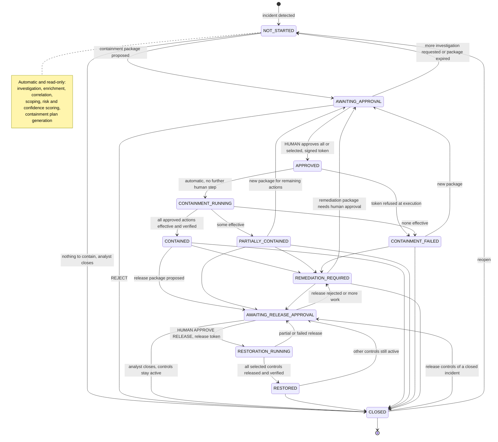
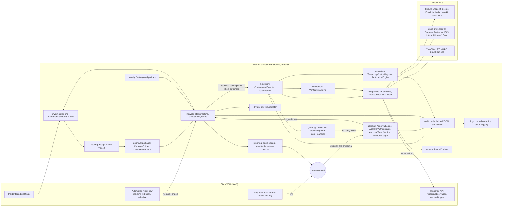
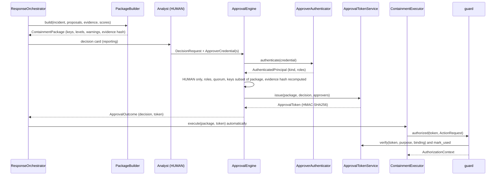

# Architecture: Cisco XDR human-in-the-loop incident response framework

Status: owner deliverable 1 (brief section 49). This is the specification that the Phase 0 components are coded against. Date: 2026-10-06.

Sections 1 to 12 answer the twelve questions in the brief. Section 13, **Phase 0 contract**, is binding for implementers: module paths, class names, enum values and signatures there must be used exactly as written. Where this document and an implementation disagree, the implementation is wrong until this document is changed in the same commit.

**The non-negotiable lifecycle.** Every component in this document serves it.

| Stage | Who acts | Enforcement |
|---|---|---|
| Investigation, enrichment, correlation, scoping, scoring | Automatic | Read-only adapter operations (`OperationKind.READ` / `VERIFY`) |
| Recommendation (containment package) | Automatic | `PackageBuilder`; recommendations never execute anything |
| Approval of any state-changing action (containment, remediation, release, restoration, removing blocks) | **Human only** | `ApprovalEngine` + HMAC token + `guard.py` (deterministic code, never prompts) |
| Execution of approved containment | Automatic, immediately after approval | `ContainmentExecutor` inside `guard.authorized(...)` |
| Verification | Automatic | `VerificationEngine` (read-only) |
| Restoration | Separate **human release approval**, then automatic | Release token (`purpose="release"`), `RestorationEngine` |
| AI / automation | May summarize, correlate, prioritize, explain, recommend, write narratives | May **never** approve, fabricate evidence, override analysts, bypass approval or alter audit history. `PrincipalKind.AI`, `SERVICE` and `AUTOMATION` are always rejected as approvers |

---

## 1. Current repository assessment

### 1.1 What exists today

**The repository is a design catalog plus a planning engine. It has no response runtime.** The README calls everything a "specification". Nothing in it calls a vendor API, carries an approval, executes an action, verifies a result, restores a control or writes an audit record.

| Area | Contents | Quality |
|---|---|---|
| `workflows/` (19) | Each has a README, a `workflow.yaml` and `scenarios/*.yaml` (105 in total). Each `workflow.yaml` holds metadata, MITRE IDs, triggers, inputs, `defaults.dry_run: true`, phased `steps` (intake, enrich, investigate, decide, contain, record, notify), `plan` rules (`for_each` / `when` / `target` / `args`) and note templates. | High. The format is consistent and machine-checked. Scenarios cover the happy path, benign look-alikes, protected assets, blast-radius overflow and allow-listed indicators. |
| `atomic/` (15) | Contracts for enrich-hash/domain/ip, investigate-host/user, 8 containment actions (isolate-endpoint, block-domain/url/ip/hash, disable-user, revoke-session, quarantine-email), create-ticket and notify-soc. Each declares inputs and outputs, `side_effects`, `requires_approval`, `reversible`, `rollback`, `idempotent` and `supports_dry_run`. | Good contracts, no code behind them. |
| `integrations/` (9) | cisco-xdr, secure-endpoint, secure-email, umbrella, microsoft-entra, meraki, splunk, cloudflare, servicenow: auth, permissions, API surface. | Every README says "Verify every endpoint". Verification now lives in `docs/integrations.md` (71 VERIFIED, 31 UNVERIFIED endpoints). |
| `engine/xdr_plan/` (~780 LOC) | `expr.py` (safe AST rule evaluator, no `eval`), `planner.py` (`build_plan` turns rules + results + guardrails into a `Plan` of `Action`s), `guardrails.py` (protected hosts/users/groups, CIDR and domain allow-lists, internal-IP and hash checks), `validate.py`, `repo.py`, CLI. | Clean, deterministic, well tested. |
| `docs/` | `integrations.md` (vendor API verification, source of truth for endpoints), `mitre-mapping/`, `deployment/` (README, `guardrails.example.yaml`), `testing/`. | Concise. |
| Tests and CI | 69 tests in `tests/test_engine.py`, `test_repo.py`, `test_workflows.py`. CI (Python 3.12) runs pytest and `python -m xdr_plan check`. | Solid regression net for the spec layer. |
| `.claude/agents/wf-*.md` | 19 agents, one per workflow, each limited to its own directory. | Useful for Phases 2 to 5. |

### 1.2 What is reused

- **Plan rules become the recommendation source.** `build_plan` already is the "generate containment plan" step. In Phase 1 a bridge (`xdr_response.lifecycle.plan_bridge`) wraps each planned `Action` as a `ProposedAction`, and `PackageBuilder` adds numbered evidence, risk and confidence scores, the idempotency key, `params` and `approval_level`. The expression engine and the `for_each` / `when` rules carry over unchanged.
- **105 scenarios become simulation fixtures** for `tests/simulation/` and `tools/simulator/` (dry-run output, decision cards, lifecycle tests against mocked adapters).
- **Guardrails become config:** `protected.*` becomes `config/critical-assets.yaml` (the brief's 10 classes); `allowlist.*` (including `approved_rmm`) becomes `config/allowlists.yaml` and `config/exclusions.yaml`; `blast_radius` becomes `config/thresholds.yaml`; `expiry_hours` becomes the release-review reminder TTL for temporary controls (never an automatic release).
- **MITRE mapping** (`docs/mitre-mapping/mitre-mapping.yaml` and per-workflow entries) is reused, with a tactic field added and a "no forced mappings" check.
- **Atomic contract metadata:** `reversible` and `rollback` seed the action catalog's `rollback_action_type`; `idempotent` and `supports_dry_run` seed adapter capability flags.

### 1.3 Conflicts with the non-negotiable lifecycle

| # | Conflict | Resolution |
|---|---|---|
| C1 | `atomic/revoke-session/atomic.yaml` sets `requires_approval: false`; ransomware, account-takeover, bec, cloud-compromise, credential-dumping, lateral-movement and others repeat it, and their scenarios assert it. | The runtime ignores spec-layer approval flags: approval is required whenever `ActionSpec.state_changing` is true, and `revoke_sessions` is state-changing. Phase 1 changes the YAML and the scenario assertions in the same commit. |
| C2 | `guardrails.example.yaml` has `auto_approve` (`account-takeover: revoke-session: true`) and `planner.py` honours it. | `xdr_response.config` refuses any config containing `auto_approve`, `skip_approval`, `bypass_approval` or `approval_required: false` (`ConfigError`). Phase 1 removes the section and the planner branch. |
| C3 | Protected assets are silently skipped (`skipped_protected`, no escalation). A protected domain controller with ransomware drops out of the plan. | Critical-asset matches make the action `ELEVATED` and attach a `CriticalAssetWarning` (asset, role, action, potential impact). Never silently blocked. |
| C4 | Isolation unlock codes are written into incident notes and rollback templates (`{plan.unlock_codes}` in c2, dns-tunneling, exfiltration, malware and others). | `unlock_code` is a sensitive key in the central redactor; it is never written to notes, logs or audit. Phase 1 removes the template references. |
| C5 | Over-limit actions are dropped (`skipped_limit`, `escalate`). | Over the blast-radius cap, actions become `ELEVATED` with a warning. Nothing disappears from the package. |

### 1.4 Gaps against the brief

- **Runtime code:** models, config, secrets, logging, audit, adapters, health checks, approval tokens, execution guard, execution, verification, restoration, dry-run, scoring. Lifecycle states, `risk_score` / `confidence_score` and numbered evidence do not exist yet.
- **Integrations missing from `integrations/`:** Defender for Endpoint, Defender for O365, Intune, Microsoft Cloud, VirusTotal, AlienVault OTX, HIBP, Secure Malware Analytics, Secure Cloud Analytics. (`docs/integrations.md` already covers all 16.)
- **Extra integrations, not in the brief:** cloudflare, servicenow. Kept as optional add-ons; no adapter in Phase 0.
- **Workflows missing:** mfa-fatigue (today only scenario `account-takeover/05-mfa-fatigue-approved`), suspicious-authentication, threat-intel-sweep.
- **Workflows named differently:** `powershell` (brief: `malicious-powershell`), `rmm` (brief: `unauthorized-rmm`). Mapped by a name table, not renamed (renaming breaks the 69 tests).
- **Extra workflows:** `vulnerability-exploitation`, `web-attacks`. Kept as add-ons.
- **Atomics missing:** enrich_url/email_address/user/endpoint; most investigate_* and search_*_enterprise; isolate_defender_endpoint, delete_malicious_email, intune_device_action, terminate_process, quarantine_file, remove_persistence, remove_privileged_role; all verification, restoration and approval atomics. In the runtime they are action types in the catalog (section 13.6).
- **Tests missing:** safety tests (`test_isolation_without_approval_fails` and the others in section 10), mocked-API integration tests, lifecycle tests.

### 1.5 Structural differences from the brief's tree

| Brief | Repo today | Decision |
|---|---|---|
| Snake_case integration dirs (`cisco_xdr`, `entra`) | Kebab-case spec dirs (`cisco-xdr`, `microsoft-entra`) | Runtime adapters live in `src/xdr_response/integrations/<snake_case>/`. Spec dirs stay. Mapping table in 3.3. |
| `atomic/` grouped by stage | One flat directory per action | Spec dirs stay flat. The grouping is the `ActionCategory` of each action type. |
| `models/`, `config/`, `tools/` | Missing | `src/xdr_response/models/`, top-level `config/`, `tools/`. |
| `tests/unit`, `integration`, `simulation`, `fixtures` | Flat `tests/test_*.py` | New dirs added; existing `tests/test_*.py` stay where they are. |
| docs: architecture, approval-model, containment-model, rollback, integrations, threat-scoring, workflows/ | Only integrations.md | This file now; the others in Phases 0 and 1 (section 3). |
| LICENSE, CHANGELOG, CONTRIBUTING, SECURITY | Missing | Added in Phase 0. |
| Example config under `config/` | `.env.example` and `docs/deployment/guardrails.example.yaml` | `config/*.yaml` added; the old files stay until Phase 1 removes `auto_approve`. |
| (not in brief) | `pyproject.toml` packages only `engine/`; CI uses Python 3.12 | Add `src` to package discovery and `pythonpath`; code must run on Python 3.12 and 3.13. |

### 1.6 Known open issues inherited from the spec layer

- **Undocumented nested fields** used by rules (`item.detections[].disposition`, `item.signins[].ip/result`, `item.profile.groups`, `is_protected`, `isolation_capable`, `prevalence`, `hosts`). Phase 1 defines them in pydantic investigation models.
- **`incident.context` workarounds:** 13 workflows read 115 facts no atomic produces (`previously_revoked_users`, `fraud_senders`, `mailbox_rules`, `lookalike_domains`, `malicious_urls`, `targeted_endpoints`, ...). They become investigation outputs or evidence in Phases 1 to 5.
- **Allow-lists are not per action.** `url_check` applies the domain allow-list, so a malicious path on an owned domain is always skipped. `allowlists.yaml` separates `never_block` from `url_block_allowed_domains`.
- **Rollback endpoints in templates were unverified.** Any endpoint not VERIFIED in `docs/integrations.md` raises `UnverifiedEndpointError` (a `NotImplementedError`). (`DELETE /v1/computers/{guid}/isolation` is now VERIFIED.)

---

## 2. Proposed architecture

### 2.1 Principles

1. **One framework, many workflows.** Workflows (Phases 2 to 5) are data: plan rules, scoring weights, MITRE mapping, scenarios. They call shared atomic operations; they never contain vendor HTTP code or approval logic.
2. **Enforcement in code, at the lowest layer.** Every state-changing adapter method is wrapped by `@state_changing`, and the HTTP client refuses any `STATE_CHANGING` request outside an authorized context. A bug or a prompt in a higher layer cannot cause a state change.
3. **Fail closed.** No verifier registered, dry run active, expired token, any mismatch, audit unavailable: the state change is refused.
4. **Native first.** Where Cisco XDR has a native response action (section 4), it is the preferred execution path, through the VERIFIED Response API trigger, wrapped by the guard.
5. **Vendor logic behind adapters.** No endpoint is implemented unless `docs/integrations.md` lists it as VERIFIED with a source.
6. **Evidence is data from sources, never from AI.** AI narratives are stored separately and flagged.
7. **Dry run by default.** `dry_run` defaults to `true` in config and in the guard itself.

### 2.2 Lifecycle state diagram

The brief's stages DETECT through GENERATE CONTAINMENT PLAN run inside `NOT_STARTED` (automatic, read-only). The 12 states and the transitions below are exactly `ALLOWED_TRANSITIONS` in section 13.9.



Closing an incident never removes controls. `CLOSED` keeps every `ACTIVE` registry entry, and `CLOSED -> AWAITING_RELEASE_APPROVAL` exists so they can still be released later, with a human release approval.

### 2.3 Component diagram



### 2.4 Layering and import rules

| Layer | Packages | May import |
|---|---|---|
| 0 Foundation | `errors`, `clock`, `models` | stdlib, pydantic |
| 1 Contracts | `interfaces`, `guard` | layer 0 |
| 2 Services | `config`, `secrets`, `logs`, `audit` | layers 0 and 1 |
| 3 Adapters | `integrations` | layers 0 to 2, httpx |
| 4 Engines | `approval`, `execution`, `verification`, `restoration`, `dryrun`, `reporting`, `scoring` | layers 0 to 3 |
| 5 Composition | `lifecycle` (state machine, orchestrator, runtime builder) | everything |

Inside the package, imports are absolute (`from xdr_response.models import RecommendedAction`). No module is named `logging` or `secrets` at top level; the subpackages `xdr_response.logs` and `xdr_response.secrets` are safe because every import is absolute. `guard.py` never imports `approval`: the verifier is injected with `guard.register_verifier(...)` by `lifecycle.runtime.build_runtime`.

---

## 3. Files and directories to create

### 3.1 Phase 0 tree (new files only; existing content is kept)

```
LICENSE  CHANGELOG.md  CONTRIBUTING.md  SECURITY.md
pyproject.toml                      (edit: package src/, add pydantic and httpx, pythonpath engine + src)
.github/workflows/ci.yml            (edit: run the whole tests/ tree, tools/validation checks)
.gitignore                          (edit: var/, config/*.yaml copies without .example)
config/
  integrations.example.yaml         runtime section + 16 integrations (splunk enabled: false)
  thresholds.yaml                   scoring bands, blast radius, approval, verification, execution, temporary controls
  exclusions.yaml                   third-party lookup exclusions (never sent to VirusTotal/OTX/HIBP)
  critical-assets.yaml              the 10 critical asset classes and their match rules
  allowlists.yaml                   never_block, url_block_allowed_domains, approved_rmm
docs/
  architecture.md                   this file
  approval-model.md  containment-model.md  rollback.md  threat-scoring.md   (Phase 0, condensed from sections 5-9)
  integrations.md                   exists: endpoint verification, source of truth
src/xdr_response/
  __init__.py  errors.py  guard.py  interfaces.py  clock.py
  models/        __init__.py enums.py canonical.py catalog.py observable.py evidence.py incident.py
                 recommendation.py approval.py action.py verification.py restoration.py audit.py
                 health.py investigation.py
  config/        __init__.py schema.py loader.py policy.py
  secrets/       __init__.py provider.py
  logs/          __init__.py redaction.py setup.py
  audit/         __init__.py trail.py verify.py summary.py
  integrations/  __init__.py base.py http.py auth.py registry.py health.py simulated.py _graph.py _adapter_support.py
                 cisco_xdr/ secure_endpoint/ secure_email/ secure_malware_analytics/ secure_cloud_analytics/
                 umbrella/ meraki/ entra/ defender_endpoint/ defender_o365/ intune/ microsoft_cloud/
                 virustotal/ alienvault_otx/ hibp/ splunk/        (each: __init__.py manifest.py adapter.py)
  approval/      __init__.py authenticator.py tokens.py ledger.py critical_assets.py package.py engine.py
  execution/     __init__.py runner.py executor.py outcome.py
  verification/  __init__.py engine.py
  restoration/   __init__.py registry.py planner.py engine.py
  dryrun/        __init__.py simulator.py
  reporting/     __init__.py decision_card.py containment_report.py release_checklist.py
  lifecycle/     __init__.py states.py machine.py store.py investigation.py recommendation.py orchestrator.py runtime.py
  scoring/       __init__.py README.md                             (design-only in Phase 0)
tests/
  test_engine.py test_repo.py test_workflows.py                    (exist, unchanged)
  conftest.py                                                      (autouse fixture: guard._reset_for_test_harness())
  fixtures/      __init__.py factories.py http_mocks.py principals.py
                 guard_helpers.py incidents/*.yaml                  (fake data only; incidents = simulator scenarios)
  unit/          models/ config/ secrets/ logs/ audit/ guard/ integrations/ approval/
                 execution/ verification/ restoration/ dryrun/ reporting/ lifecycle/
  integration/   test_lifecycle_http_adapters.py _fake_vendors.py (real adapters + engines, httpx.MockTransport)
  simulation/    test_dry_run_scenarios.py test_lifecycle_end_to_end.py
  safety/        test_approval_required.py test_token_binding.py test_principals.py test_dry_run_guard.py
                 test_http_guard.py test_restoration_safety.py test_audit_tamper.py test_secret_redaction.py
                 test_adapter_guard_coverage.py test_config_safety.py test_double_execution.py
tools/
  simulator/     README.md simulate.py scenario.py (run a fixture incident end to end, dry run or simulated live)
  validation/    README.md validate_config.py verify_audit_chain.py check_endpoints.py
  deployment/    README.md                       (XDR automation rule and webhook setup, secret provisioning)
var/                                             (git-ignored runtime data: audit, registry, ledger)
```

### 3.2 Phase 1 additions (for completeness)

`src/xdr_response/lifecycle/plan_bridge.py` (xdr_plan `Plan` to `ProposedAction`), `src/xdr_response/scoring/engine.py`, investigation models for the nested fields in 1.6, XDR workflow JSON exports under `workflows/<name>/xdr/`, `docs/workflows/`, spec alignment for conflicts C1 to C5 (atomic YAML, scenarios, planner) with the matching test updates.

### 3.3 Spec names to runtime names (no directory renames)

| Spec dir (`integrations/`) | Adapter (`src/xdr_response/integrations/`) |
|---|---|
| cisco-xdr | cisco_xdr |
| secure-endpoint | secure_endpoint |
| secure-email | secure_email |
| umbrella | umbrella |
| microsoft-entra | entra |
| meraki | meraki |
| splunk | splunk (optional, disabled by default) |
| cloudflare, servicenow | none in Phase 0 (optional add-ons) |
| (none yet) | secure_malware_analytics, secure_cloud_analytics, defender_endpoint, defender_o365, intune, microsoft_cloud, virustotal, alienvault_otx, hibp |

| Spec atomic (`atomic/`) | `ActionType` |
|---|---|
| isolate-endpoint | `isolate_endpoint` |
| block-domain / block-url / block-ip / block-hash | `block_domain` / `block_url` / `block_ip` / `block_hash` |
| disable-user | `disable_user` |
| revoke-session | `revoke_sessions` |
| quarantine-email | `quarantine_email` |
| enrich-hash / enrich-domain / enrich-ip | `enrich_hash` / `enrich_domain` / `enrich_ip` |
| investigate-host / investigate-user | `investigate_endpoint` / `investigate_user` |
| create-ticket / notify-soc | `create_ticket` / `notify_soc` |

| Spec workflow (`workflows/`) | Brief name |
|---|---|
| powershell | malicious-powershell |
| rmm | unauthorized-rmm |
| password-spray | password spraying |
| vulnerability-exploitation, web-attacks | add-ons, not in the brief |

---

## 4. Cisco XDR integration strategy

Based on `docs/integrations.md` (research date 2026-10-06). Every statement about an endpoint below refers to its status there.

### 4.1 What runs in XDR Automation and what runs in the external orchestrator

| Concern | Cisco XDR Automation | External orchestrator (`xdr_response`) |
|---|---|---|
| Detection, incident creation | Yes (XDR incidents and sightings; Secure Cloud Analytics alerts arrive as XDR incidents) | Reads them (incident summary and full incident view: VERIFIED) |
| Trigger | An automation rule on **new incident**, or a **webhook** rule, starts a small XDR workflow that sends the incident ID to the orchestrator; alternatively the orchestrator polls. Webhook limits (1 MB, 25 runs/min) come from search summaries and must be re-read before production. | Accepts only the incident ID from the trigger and re-reads the incident through the API. |
| Investigation, enrichment, correlation, scoping, scoring | Not used for decisions (no documented workflow schema or result guarantees) | Yes, through read-only adapters |
| Containment plan and evidence | No | Yes (`PackageBuilder`) |
| Analyst decision UI | Optional. A **Request Approval** task may notify the analyst and link to the orchestrator decision page. An XDR task approval **never authorizes anything by itself**: no binding to evidence, parameters, targets or human identity is documented, and no REST API to act on tasks is VERIFIED. | The decision goes to `ApprovalEngine` with an authenticated human credential. The HMAC token is the only authorization. |
| Execution of native actions | The native response action runs inside XDR when triggered | The orchestrator triggers it with `POST /iroh/iroh-response/respond/trigger/{module-instance-id}/{action-id}` (VERIFIED) inside `guard.authorized(...)` |
| Execution of non-native actions | No | Direct adapter calls: Entra revoke sessions, confirm compromised, role removal; Meraki; Intune; Secure Email Threat Defense release |
| Verification | The native trigger only returns `success` / `failure` | Product read calls (section 7) |
| Restoration | Native restore actions exist | Triggered only with a release token, built from registry entries |
| Incident notes and status | Worklog note path UNVERIFIED; status update VERIFIED on the Global Intelligence host only | Bookkeeping operations; unverified paths raise `UnverifiedEndpointError` |
| Audit | Run history, worklog, 72-hour trigger history (not tamper-evident) | Hash-chained JSONL audit trail (authoritative) |
| Secrets | Account keys and Secure Strings for XDR-side workflows | `SecretProvider` (environment or vault); never in code or config |
| Version control | Workflow JSON exports (Git commit from the editor), without secure-string values | Python code, YAML example config, workflow specs |

### 4.2 Native-first execution path

For action types with a native workflow in section 1.4 of `docs/integrations.md` (isolate, disable user, block domain/URL/IP, block hash, quarantine email, delete email for Defender for O365, and the matching restore actions), the preferred adapter is `cisco_xdr`:

1. **Plan time (read-only).** `CiscoXdrAdapter.list_response_actions(observable)` calls `POST /iroh/iroh-response/respond/observables` (VERIFIED, `OperationKind.READ`) and selects the action whose module matches the configured product. Its `module_instance_id` and `action_id` go into the recommendation `params`, with `observable_type`, `observable_value` and `verify_integration` (the product adapter that can read back state). `params` are hashed into the approval token, so the analyst approves exactly this module and action.
2. **Execution.** `CiscoXdrAdapter.execute(request)` dispatches to the `@state_changing` method for the action type, which calls `respond/trigger` with `kind=OperationKind.STATE_CHANGING`. The decorator re-verifies the token before the call, and the HTTP client checks the guard again.
3. **Verification.** `respond/trigger` returns only `success` / `failure`, so `VerificationEngine` calls `verify` on the `verify_integration` adapter (for example `defender_endpoint` for isolation through MDE). If that product has no VERIFIED read call, the result is `UNABLE_TO_VERIFY`.
4. **Registry.** The control is registered with `integration="cisco_xdr"`, the module-instance ID and the action ID. At release time the restore action is looked up the same way and bound into the release token.

The direct product adapter is chosen instead when (a) no native action exists, (b) the native module is not configured for the tenant, or (c) the package states a reason (for example direct MDE isolation returns a machine-action ID that can be verified). The choice is recorded in `params["integration"]` and is therefore part of what the analyst approves.

### 4.3 Coverage by action type

| Action type | Native XDR | Direct adapter (VERIFIED endpoint) | Verify |
|---|---|---|---|
| isolate_endpoint / release_endpoint | Yes (Secure Endpoint, MDE) | secure_endpoint PUT/DELETE isolation; defender_endpoint isolate/unisolate | MDE machine action: VERIFIED. Secure Endpoint isolation GET: UNVERIFIED, so `UNABLE_TO_VERIFY` |
| block_domain / unblock_domain, block_url / unblock_url | Yes (Umbrella, Secure Access) | umbrella destination lists (store the destination ID); defender_endpoint indicators | Umbrella list GET: VERIFIED. MDE indicator GET: UNVERIFIED |
| block_ip / unblock_ip | Yes (IPv4 only) | meraki MX L3 (read-modify-write, serialized per network); defender_endpoint indicators. Direct Umbrella IP blocking: UNVERIFIED/CONFLICT, not implemented | Meraki L3 GET: VERIFIED |
| block_hash / unblock_hash | Yes (Secure Endpoint, MDE) | defender_endpoint indicators. Secure Endpoint file lists: UNVERIFIED | `UNABLE_TO_VERIFY` until the MDE indicator GET is verified |
| disable_user / enable_user | Yes (Entra, Duo) | entra PATCH `accountEnabled` | entra GET user: VERIFIED |
| revoke_sessions | **No** | entra `revokeSignInSessions` | `signInSessionsValidFromDateTime` at or after the action time: VERIFIED |
| confirm_user_compromised | **No** | entra `riskyUsers/confirmCompromised` (P2 licence) | riskyUser GET UNVERIFIED, so `UNABLE_TO_VERIFY` |
| remove_privileged_role / restore_privileged_role | **No** | entra roleAssignments DELETE / POST (always ELEVATED) | roleAssignments list: VERIFIED |
| quarantine_email / release_email | Quarantine yes (ETD, Defender O365); native release only for Defender O365 | secure_email `messages/move` (`inbox` for release); defender_o365 `analyzedEmails/remediate` | ETD `messages/status`: VERIFIED. Defender O365: `UNABLE_TO_VERIFY` |
| delete_email | Yes (Defender O365 only) | defender_o365 `softDelete` / `moveToDeletedItems` (never `hardDelete`); secure_email move to `trash` | as above |
| block_network_client / restore_network_client | **No** | meraki client policy PUT (capture the previous policy first) | client policy GET: VERIFIED |
| lock_device | **No** | intune `remoteLock` | `UNABLE_TO_VERIFY` (actionName unknown) |
| terminate_process, quarantine_file, restore_file, remove_persistence, reset_password, reset_mfa, revoke_app_credentials, remove_application | **No** | none VERIFIED: the method raises `UnverifiedEndpointError` | n/a |

### 4.4 Rules for every adapter

- Implement only endpoints marked VERIFIED in `docs/integrations.md`, and copy the source URL into the operation's `OperationSpec.source`. `tools/validation/check_endpoints.py` cross-checks every manifest against the document.
- An UNVERIFIED operation raises `UnverifiedEndpointError`, whose message is exactly `unverified endpoint: <integration>.<operation> - see docs/integrations.md`. It subclasses `NotImplementedError`.
- Every call supports timeout, retry with exponential backoff, `429` with `Retry-After`, client-side rate limiting (VERIFIED limits: Umbrella policies 2000/min, Meraki 10 req/s per org, MDE 100/min and 1,500/h, VirusTotal public 4/min and 500/day; unknown limits rely on backoff), auth failure (one token refresh on 401; 403 is not retried), integration unavailable and invalid target.
- URLs are logged with query strings redacted (Secure Malware Analytics sends `api_key` in the query string).
- VirusTotal, OTX and HIBP receive only observables allowed by `DisclosurePolicy` (`config/exclusions.yaml`): never internal hostnames, internal URLs, internal domains or private IPs; HIBP receives only the investigated account. VirusTotal's public API is non-commercial only; the example config marks it as such.
- Meraki L3 writes replace the whole rule set: read, change exactly one rule tagged with the idempotency key, write, verify. Writes are serialized per network with a lock.
- Vendor-side expiry (`expirationTime` on MDE indicators and similar) is **not** set by default: an automatic expiry is a release without a human release approval. It can be enabled only through an explicit per-integration option, documented as such.
- Secure Cloud Analytics has no VERIFIED endpoint: its alerts are read as Cisco XDR incidents; all its adapter methods raise `UnverifiedEndpointError` and its health is `UNKNOWN`.

---

## 5. Approval architecture

### 5.1 Flow



### 5.2 Containment package

`ContainmentPackage` (section 13.5) carries: incident, endpoints, users, severity, `risk_score`, `confidence_score`, a summary, numbered evidence, the evidence snapshot hash, blast radius, excluded targets (allow-listed, with reason) and the `RecommendedAction` checklist. Each action has numbered sourced evidence, its own `risk_score` and `confidence_score`, the idempotency key `<incident_id>:<action_type>:<target>`, `params` (including `params["integration"]`) and `approval_level`.

`PackageBuilder` rules (deterministic, in this order):

1. Reject any proposal whose action type is not `state_changing` (read-only work never needs a package).
2. Normalize the target (`normalize_target`), compute the idempotency key, drop exact duplicates by key (keeping the higher risk score and merging evidence).
3. `AllowlistPolicy.excluded_reason(...)`: allow-listed targets move to `excluded_targets` with the reason. They are shown on the decision card, never dropped silently.
4. `CriticalAssetPolicy.evaluate(...)`: any match sets `approval_level=ELEVATED` and attaches a `CriticalAssetWarning` with asset, asset class, role, action and potential impact. Never blocked.
5. `ActionSpec.always_elevated` (privileged role removal and restore) sets `ELEVATED`.
6. Blast radius over the `thresholds.yaml` caps sets `ELEVATED` on every action of the capped kind, with a warning. Nothing is removed.
7. Number the evidence (1..n, stable order: source, observed_at, summary), compute `evidence_snapshot_hash`, set `expires_at = now + package_ttl`.

### 5.3 Analyst decisions

| Decision | Approved keys | Rejected keys | Token | Comment | Next state |
|---|---|---|---|---|---|
| `APPROVE_ALL` | all package keys | none | issued | optional | `APPROVED`, then automatic execution |
| `APPROVE_SELECTED` | non-empty strict or full subset given by analyst | the rest (computed; if given it must equal the rest) | issued for approved keys only | optional | `APPROVED`, then automatic execution |
| `REJECT` | none | all | none | **required** | containment: `CLOSED`; release: `REMEDIATION_REQUIRED` (controls stay `ACTIVE`; the analyst may close the incident afterwards) |
| `REQUEST_MORE_INVESTIGATION` | none | none | none | **required** | containment: `NOT_STARTED` (a new package will be built); release: `REMEDIATION_REQUIRED` |

Every decision is recorded as `AnalystDecision`: incident ID, analyst identity (all approver principals), timestamp, approved and rejected keys, comment, workflow ID and version, evidence snapshot hash, package ID, purpose and token ID. It is written to the audit trail **before** the token is returned. If the audit write fails, no token is issued (`AuditError`).

### 5.4 Who may approve

- Approvers are authenticated by a pluggable `ApproverAuthenticator` (`authenticate(credential) -> AuthenticatedPrincipal`). Phase 0 ships the protocol and `InMemoryApproverAuthenticator` (tests, lab and simulator: principals and salted secret hashes configured in code or fixtures, never in repo config). Production authenticators (OIDC/SSO) are added behind the same protocol.
- Only `PrincipalKind.HUMAN` may approve. `SERVICE`, `AUTOMATION` and `AI` are rejected with `ApproverNotAllowedError`, regardless of roles, and the denial is audited (`APPROVAL_DENIED`). The check is repeated in the token verifier.
- `STANDARD` actions need `standard_min_approvers` (default 1) distinct humans holding `standard_role` (default `xdr-approver`).
- `ELEVATED` actions need `elevated_min_approvers` (default 1) distinct humans holding `elevated_role` (default `xdr-elevated-approver`). If the elevated quorum is not met, `APPROVE_ALL` fails and `APPROVE_SELECTED` must exclude the elevated actions.
- Self-approval: when `package.requested_by` is a human principal, that principal does not count toward the quorum unless `allow_self_approval: true` (default false). Packages built by automation have `requested_by="automation:<component>"`.
- The decision must reference only keys present in the package, the package must not be expired, and its evidence hash is recomputed and must match `evidence_snapshot_hash` (a modified package is refused).

### 5.5 Approval token

`ApprovalToken` = `ApprovalTokenClaims` + `key_id` + `alg="HMAC-SHA256"` + `signature`.

- Claims (exactly): `version=1`, `token_id`, `purpose` (`"containment"` or `"release"`), `package_id`, `incident_id`, `evidence_snapshot_hash`, `workflow_id`, `workflow_version`, `decision_id`, `actions` (per action: `idempotency_key`, `action_type`, `target`, `params_hash`, `approval_level`), `approvers` (per approver: `principal_id`, `kind`, sorted `roles`), `issued_at`, `expires_at`.
- `signature = HMAC-SHA256(key, b"xdr-response/approval-token/v1\n" + canonical_json(claims))`, hex. Comparison uses `hmac.compare_digest`.
- `canonical_json`: UTF-8, `sort_keys=True`, `separators=(",", ":")`, `ensure_ascii=False`, datetimes as UTC ISO 8601 with `Z`, enums as their values, tuples as lists, no floats in signed data.
- Key: `SecretProvider.get("APPROVAL_SIGNING_KEY")`, at least 32 bytes after UTF-8 encoding, otherwise `ConfigError`. Optional `APPROVAL_SIGNING_KEY_PREVIOUS` is accepted for verification only (rotation). `key_id` comes from config (`approval.signing_key_id`, default `"primary"`). The key is never in code, config files, logs or audit.
- TTL: `containment_token_ttl_minutes` (default 30) and `release_token_ttl_minutes` (default 30). Execution starts immediately after approval, so a short TTL is enough. Maximum accepted lifetime is enforced at verification (`expires_at - issued_at <= ttl`).
- Serialization (`encode()` / `decode()`): `base64url(canonical_json(claims)) + "." + key_id + "." + signature`. The token is a bearer secret: `signature`, `approval_token` and `token` keys are redacted everywhere. The audit trail stores `token_id` and the claims hash, never the signature.

### 5.6 Token verification (deterministic, fail closed)

`ApprovalTokenService.verify(token, *, purpose, binding)` raises a subclass of `ApprovalRequiredError` on the first failed check:

1. `alg == "HMAC-SHA256"` and `key_id` known, else `TokenInvalidError`.
2. Signature valid over the claims, else `TokenInvalidError`.
3. `issued_at <= now + clock_skew`, `now < expires_at`, lifetime within TTL, else `TokenExpiredError`.
4. `claims.purpose == purpose`, where `purpose` comes from the action catalog (`ActionSpec.purpose`) and never from the caller's input, else `TokenMismatchError`.
5. `claims.incident_id == binding.incident_id`, else `TokenMismatchError`.
6. A grant exists with `idempotency_key == binding.idempotency_key`, and its `action_type`, `target` and `params_hash` all equal the binding, else `TokenMismatchError`.
7. Approvers non-empty, distinct, all `HUMAN`; quorum and elevated role rules of 5.4 hold for the grant's `approval_level`, else `TokenInvalidError` (a correctly signed token with such claims can only come from a bug or a stolen key, so it is treated as invalid).
8. `mark_used(token, idempotency_key)` (only from `guard.authorized`) consumes the pair in the `TokenUseLedger`; a second use raises `TokenReplayError`.

`verify_package(token, package)` additionally checks `package_id`, `evidence_snapshot_hash` (recomputed from the package evidence), `workflow_version` and that every grant matches the package action with the same key. The executor calls it once before any action.

### 5.7 Execution guard (`guard.py`)

- A `ContextVar[AuthorizationContext | None]` holds the current authorization; a second `ContextVar[bool]` holds a per-run dry-run flag; a module-level flag holds the global dry-run setting, **default `True`** until `guard.configure(dry_run=False)` is called by `build_runtime` from settings.
- `guard.authorized(token, action)` is a context manager. It refuses (raises) if no verifier is registered (`ApprovalRequiredError`), dry run is active (`DryRunViolationError`), an authorization is already active (nesting is not allowed), or verification fails (section 5.6). On success it consumes the token use and sets the context var; it resets it on exit, even on exceptions.
- `@state_changing` wraps every state-changing adapter method. The wrapped method takes an `ActionRequest` as first argument after `self`. Before calling it, the decorator requires an active context whose binding equals the request's binding, whose `params["integration"]` equals the adapter name, and re-verifies the token (without consuming). Otherwise `ApprovalRequiredError` (or a subclass). This holds even if the method is called directly.
- `GuardedHttpClient` calls `guard.require_active_authorization(integration)` before every attempt of a `STATE_CHANGING` request, so a vendor write cannot be sent from an unguarded method either.
- Dry run: `guard.dry_run()` context manager enables it per run; it can only switch dry run **on**, never off. With dry run active, every state-changing path raises `DryRunViolationError`, even with a valid token.

### 5.8 Release approval

Release uses the same engine with `purpose="release"`. A `ReleasePackage` is built only from `ACTIVE` registry entries (section 8). A containment token can never authorize a release action and vice versa, because the purpose is derived from the action catalog. The release checklist (restore endpoint connectivity, re-enable Entra account, remove temporary Umbrella domain block, remove temporary IP block, remove temporary hash block) is rendered from the release package, with `[APPROVE RELEASE]`.

---

## 6. Containment execution architecture

### 6.1 Automatic start

`ResponseOrchestrator.submit_decision(...)` transitions `AWAITING_APPROVAL -> APPROVED`, then immediately `APPROVED -> CONTAINMENT_RUNNING` and calls `ContainmentExecutor.execute(package, token)`. There is no other human step and no queue that a human must release. The only thing that can stop approved actions from executing is a failed safety check (token, guard, audit), which yields `CONTAINMENT_FAILED` with the reason.

### 6.2 Per-action pipeline (`ActionRunner.run`)

For each approved action, in package order (sequential in Phase 0; per-integration concurrency is a later option):

1. Build `ActionRequest.from_recommendation(action)`; select the adapter by `params["integration"]`. If the integration is disabled or missing: `SKIPPED` (`NO_CAPABLE_ADAPTER` or `INTEGRATION_DISABLED`), requires attention.
2. Audit `ACTION_STARTED`. If the audit write fails, the action is not executed: `FAILED` with `ErrorCode.AUDIT_UNAVAILABLE`.
3. `with guard.authorized(token, request):`
   1. `adapter.current_state(request)` (read-only). `IN_DESIRED_STATE` returns `ALREADY_CONTAINED`; no vendor write, **no registry entry** (the control was not created by this automation).
   2. Otherwise `adapter.execute(request)` returns an `ActionOutcome` (`SUCCESS` with `external_ref` and `rollback_params`, or raises).
   3. Integration exceptions map to `FAILED` with `ErrorInfo` (`TIMEOUT`, `RATE_LIMITED`, `AUTH_FAILED`, `UNAVAILABLE`, `INVALID_TARGET`, `API_ERROR`, `UNVERIFIED_ENDPOINT`, `NOT_SUPPORTED`) and the manifest's `escalation_hint` (for example "Microsoft 365 administrator" on a 403 from Graph).
4. Outside the guard context: `VerificationEngine.verify(request, outcome)` (section 7) for `SUCCESS` and `ALREADY_CONTAINED`.
5. If `SUCCESS` and the catalog says `creates_control`: `TemporaryControlRegistry.register(...)` with the rollback action type and `rollback_params`, then audit `CONTROL_REGISTERED`.
6. Audit `ACTION_RESULT` and `VERIFICATION_RESULT` with redacted API summaries.

Every exception inside one action is caught and recorded; it never stops the next action. Package actions that were not approved are reported as `SKIPPED` with `REJECTED_BY_ANALYST` and are excluded from the overall calculation.

### 6.3 Idempotency and double-execution protection

| Layer | Mechanism |
|---|---|
| Key | `<incident_id>:<action_type>:<target>`, target normalized (section 13.3), for example `XDR-83921:isolate_endpoint:TH-LT-1047` |
| Token | `TokenUseLedger` consumes `(token_id, idempotency_key)` once; replay raises `TokenReplayError` |
| Adapter | `current_state` pre-check returns `ALREADY_CONTAINED`; MDE "Action is already in progress" maps to `ALREADY_CONTAINED`; Umbrella checks list membership; Meraki finds its tagged rule |
| HTTP | State-changing requests are retried only when the request was provably not sent (connect error) or the server said so (`429`, `503` with `Retry-After`). A read timeout on a write is **not** blindly retried: the runner re-checks `current_state` |
| Registry | `register` is idempotent by key; an `ACTIVE` entry for the same key is returned unchanged |
| Lifecycle | `APPROVED -> CONTAINMENT_RUNNING` happens once per package; the package store marks the package `EXECUTED` |

A failed action is never retried later with the same token. Retrying needs a new package and a new human approval.

### 6.4 Overall result

`compute_containment_overall(results, unable_to_verify_counts_as_contained)` considers only approved actions that were not `SKIPPED` for `REJECTED_BY_ANALYST`:

- An action **failed** when its status is `FAILED`, or `SKIPPED` for any reason other than `REJECTED_BY_ANALYST`, or its verification is `NOT_VERIFIED`.
- An action is **confirmed** when its status is `SUCCESS` or `ALREADY_CONTAINED` **and** its verification is `VERIFIED` (or `UNABLE_TO_VERIFY` when the threshold flag `verification.unable_to_verify_counts_as_contained` is true; default **false**). `is_effective(...)` in 13.16 returns "confirmed".
- Every action failed: `CONTAINMENT_FAILED`. Every action confirmed: `CONTAINED`. Anything else (including executed but unverifiable actions with the flag false): `PARTIALLY_CONTAINED`.
- One unrelated integration failing never turns the whole run into `CONTAINMENT_FAILED` while other actions succeeded.
- `UNABLE_TO_VERIFY` actions always appear as "requires attention: verify manually" on the result table.
- Dry-run executions have no overall containment state; the incident stays where it was.

### 6.5 Result table (reporting)

```
CONTAINMENT RESULT  XDR-83921  PARTIALLY_CONTAINED
Action                                   Status             Verification       Note
isolate_endpoint TH-LT-1047              SUCCESS            VERIFIED
block_domain evil.example.com            SUCCESS            VERIFIED
revoke_sessions jsmith@example.com       FAILED             -                  HTTP 403 (AUTH_FAILED)
Requires attention: revoke_sessions jsmith@example.com
Recommended escalation: Microsoft 365 administrator
```

### 6.6 Error handling contract (every external call)

| Condition | HTTP client behaviour | Exception | Health |
|---|---|---|---|
| Timeout | retry (reads); state-changing: no blind retry | `IntegrationTimeoutError` | `DEGRADED` |
| `429` | honour `Retry-After`, else exponential backoff with jitter, up to `max_retries` | `RateLimitedError(retry_after)` | `RATE_LIMITED` |
| `401` | invalidate token, refresh once, retry once | `AuthFailedError` | `AUTH_FAILED` |
| `403` | no retry | `AuthFailedError(http_status=403)` | `AUTH_FAILED` |
| `404`, `400` on target lookup | no retry | `InvalidTargetError` | unchanged |
| other `4xx` | no retry | `ApiError` | unchanged |
| `5xx`, connect error | retry with backoff | `IntegrationUnavailableError` | `UNAVAILABLE` / `DEGRADED` |
| Unverified endpoint | never sent | `UnverifiedEndpointError` | unchanged |
| Already contained | adapter pre-check | (no exception) `ALREADY_CONTAINED` | unchanged |

---

## 7. Verification architecture

- `VerificationEngine.verify(request, outcome) -> VerificationResult` runs after every `SUCCESS` and `ALREADY_CONTAINED` action and after every restoration action. It uses only `READ` / `VERIFY` operations and never needs the guard.
- The verifying adapter is `params["verify_integration"]` when present (native XDR actions), else `params["integration"]`. `IntegrationAdapter.verify` must not assume it executed the action.
- Polling: up to `verification.timeout_seconds` (default 300) every `verification.poll_interval_seconds` (default 10), injected clock and sleep for tests. Asynchronous vendor actions (MDE machine actions, Entra session revocation delay) poll until a terminal state.
- Statuses:
  - `VERIFIED`: an independent read shows the desired state (for revoke sessions: `signInSessionsValidFromDateTime >= action time`).
  - `NOT_VERIFIED`: the read shows the state was not reached (terminal failure status, value still present after removal, account still enabled).
  - `UNABLE_TO_VERIFY`: no VERIFIED read call, unknown status values, the read failed, or polling timed out.
- Any exception during verification yields `UNABLE_TO_VERIFY` with the error recorded; it never raises out of the engine.
- Verification feeds the overall state (6.4). `NOT_VERIFIED` counts as not effective.
- The per-integration verify calls and their status are the table in section 3 of `docs/integrations.md`. Verify capability is declared per action type in the manifest (`verifiable_actions`); the engine returns `UNABLE_TO_VERIFY` immediately for undeclared ones.

---

## 8. Rollback architecture

### 8.1 Temporary control registry

`TemporaryControlRegistry` (Phase 0: `JsonlControlRegistry`, an append-only event log with an in-memory view; `SqliteControlRegistry`, an append-only table guarded by triggers; and `InMemoryControlRegistry` for tests and the simulator) records every control the automation created:

`control_key` (= idempotency key), `incident_id`, `action_type`, `target`, `target_kind`, `integration`, `workflow_id`, `workflow_version`, `package_id`, `token_id` (the approval), `decision_id`, `approval_level`, `created_at`, `rollback_action_type`, `rollback_params` (for example Umbrella destination ID, previous Meraki policy, Entra role assignment fields, ETD verdict, MDE indicator ID, XDR module-instance and restore action IDs), `external_ref`, `status` (`ACTIVE`, `RELEASE_PENDING`, `RELEASED`, `RELEASE_FAILED`), `review_due_at` (from `temporary_controls.review_after_hours`), `released_at`, `release_package_id`, `release_token_id`.

Rules:

- Only `SUCCESS` results of action types with `creates_control=True` are registered. `ALREADY_CONTAINED` is not registered, so a release never removes a control someone else created.
- Non-reversible actions (revoke sessions, confirm compromised, delete email, lock device, terminate process, remove persistence, password and MFA resets) create no control; they are in the audit trail only.
- Status changes are appended events (`REGISTERED`, `RELEASE_PENDING`, `RELEASED`, `RELEASE_FAILED`); entries are never deleted.
- `review_due_at` only produces a reminder ("release review due"). Nothing is released automatically, and closing an incident never changes the registry.

### 8.2 Release flow

1. `RestorationPlanner.build_release_package(incident_id, control_keys=None)` reads the controls still in force, `ACTIVE` or `RELEASE_FAILED` (all for the incident, or exactly the listed keys; unknown, `RELEASE_PENDING`, `RELEASED` or other-incident keys raise `RegistryError`). Each entry becomes a `RecommendedAction` with `action_type=rollback_action_type`, the same target, `params=rollback_params` (plus `integration` and `restores=<control_key>`), and `approval_level=ELEVATED` when the original was `ELEVATED` or the rollback spec is `always_elevated`. Its idempotency key is `<incident_id>:<rollback_action_type>:<target>`.
2. The analyst gets the release checklist and approves with purpose `"release"` (`AWAITING_RELEASE_APPROVAL -> RESTORATION_RUNNING`).
3. `RestorationEngine.execute(release_package, token)` re-reads each entry; if it is no longer in force (`ACTIVE` or `RELEASE_FAILED`) the action is `SKIPPED` (`CONTROL_NOT_ACTIVE`), which the overall calculation leaves out because there was nothing to release. Otherwise it marks `RELEASE_PENDING`, runs the rollback through `ActionRunner` (same guard, same pipeline), verifies, and marks `RELEASED` or `RELEASE_FAILED`.
4. Overall: all released and verified, `RESTORED`; otherwise the incident returns to `AWAITING_RELEASE_APPROVAL` and the remaining `ACTIVE` / `RELEASE_FAILED` entries need a new release approval.

### 8.3 Rollback catalog

| Control | Rollback action | Rollback params captured at containment |
|---|---|---|
| isolate_endpoint | release_endpoint | connector GUID or MDE machine ID; XDR restore action IDs if native |
| block_domain / block_url | unblock_domain / unblock_url | Umbrella destination list ID and destination ID; or MDE indicator ID |
| block_ip | unblock_ip | Meraki network ID and rule tag; or MDE indicator ID |
| block_hash | unblock_hash | MDE indicator ID; or XDR restore action IDs |
| disable_user | enable_user | user object ID |
| quarantine_email | release_email | ETD message IDs and original verdict; or Defender O365 networkMessageId and recipient |
| remove_privileged_role | restore_privileged_role | `roleDefinitionId`, `principalId`, `directoryScopeId` (read before the delete) |
| block_network_client | restore_network_client | previous `devicePolicy` and `groupPolicyId` |
| quarantine_file | restore_file | (endpoint UNVERIFIED; no implementation) |

---

## 9. Data models

All models are pydantic 2 (`ConfigDict(frozen=True, extra="forbid")` unless stated), with timezone-aware UTC datetimes. Section 13 gives the exact fields and signatures; this section explains them.

| Model | Purpose | Key fields |
|---|---|---|
| `Observable` | Normalized indicator | `type: ObservableType`, `value`, `source` |
| `EnrichmentResult` | Normalized enrichment (brief: `{type, value, risk_score, confidence, sources, verdict}`) | plus `integration`, `health`, `evidence`, `errors` |
| `EvidenceDraft` / `Evidence` | Sourced fact; `Evidence` adds `number` (1..n) | `source` (integration name, `analyst` or `temporary_control_registry`; never AI), `summary`, `observed_at`, `reference`, `data`, `audit_ref` |
| `Incident` | Incident and lifecycle state | `incident_id`, `title`, `severity`, `state`, `workflow_id`, `workflow_version`, `observables`, `assets`, `users`, `trigger`, `ai_narrative` (flagged, never evidence), `history` |
| `RecommendedAction` | One checklist item | `incident_id`, `idempotency_key`, `action_type`, `target`, `target_kind`, `params`, `evidence`, `risk_score`, `confidence_score`, `approval_level`, `warnings`, `rationale` |
| `CriticalAssetWarning` | ELEVATED reason | `asset`, `asset_class`, `role`, `action_type`, `potential_impact`, `message` |
| `ContainmentPackage` / `ReleasePackage` | What the human approves | see 5.2 and 8.2 |
| `DecisionRequest` / `AnalystDecision` | Analyst input / recorded decision | see 5.3 |
| `AuthenticatedPrincipal`, `ApproverCredential` | Approver identity | `kind: PrincipalKind`, `roles` |
| `ApprovalToken`, `ApprovalTokenClaims`, `TokenActionGrant`, `ApproverClaim`, `ActionBinding` | Signed approval | see 5.5 |
| `ActionRequest` | What an adapter executes | `incident_id`, `idempotency_key`, `action_type`, `target`, `target_kind`, `params` |
| `ActionOutcome` | Adapter result | `status`, `external_ref`, `rollback_params`, `api_calls`, `message` |
| `ActionResult`, `ContainmentReport`, `RestorationReport` | Executor results | per action status, verification, error, attention, escalation; overall |
| `VerificationResult` | Verification outcome | `status`, `method`, `details`, `checked_at` |
| `TemporaryControl` | Registry entry | see 8.1 |
| `AuditRecord`, `ChainVerification`, `ExecutionAuditSummary` | Audit | see 13.12 |
| `IntegrationHealth` | Health | `integration`, `status: HealthStatus`, `checked_at`, `detail` |
| `ApiCallSummary`, `ErrorInfo` | Redacted API summary / normalized error | method, redacted URL, status code, duration, attempt / code, message, http status, retryable |

**Risk and confidence** are separate integers 0 to 100: `risk_score` is impact (what happens if this is real), `confidence_score` is evidence strength (how sure we are). Bands: 0-29 `LOW`, 30-59 `MEDIUM`, 60-79 `HIGH`, 80-100 `CRITICAL` (`risk_band(score)`); confidence is shown as a percentage.

**Scoring (design-only in Phase 0).** Phase 1 adds `xdr_response.scoring.engine.ScoringEngine.score(signals: Sequence[ScoringSignal]) -> ScoreBreakdown`, with configurable weights in `thresholds.yaml` (`scoring.weights`). Inputs: Secure Endpoint and Defender detections, VirusTotal, OTX, Umbrella, Secure Malware Analytics, Secure Cloud Analytics behaviour, authentication anomaly, network behaviour, email verdict, persistence, lateral movement, campaign association, critical asset involvement. Vendor reputation is one signal with a capped weight, never absolute truth. A failed source lowers confidence and is listed in the breakdown; it never blocks a recommendation backed by other evidence. Every contribution names its evidence numbers, so the decision card can explain the score.

**Decision card** (`reporting.render_decision_card(package)`):

```
CRITICAL INCIDENT  XDR-83921
Potential ransomware
Endpoint: TH-LT-1047
User: jsmith@example.com
Risk 97/100   Confidence 94%
Primary evidence:
  [1] secure_endpoint: ransomware detection on TH-LT-1047 (sha256 aaaa...)
  [2] umbrella: TH-LT-1047 resolved evil.example.com (malicious)
Blast radius: 1 endpoint, 1 user, 1 domain
Recommended containment:
  [ ] isolate_endpoint TH-LT-1047                (STANDARD)
  [ ] block_domain evil.example.com              (STANDARD)
  [ ] revoke_sessions jsmith@example.com         (STANDARD)
WARNING (ELEVATED APPROVAL REQUIRED): ...      (only when present)
[APPROVE ALL] [APPROVE SELECTED] [REQUEST MORE INVESTIGATION] [REJECT]
```

**Dry-run output** (`dryrun.render_dry_run(report)`), exact format:

```
DRY RUN
Would isolate: TH-LT-1047
Would block: evil.example.com
Would revoke sessions: jsmith@example.com
No containment actions executed.
```

---

## 10. Testing strategy

Run: `python -m pytest -q -p no:cacheprovider <paths>`. No test touches the network: every HTTP call goes through `httpx.MockTransport`; `respx` is not used. Test data uses only `example.com`, `*.example`, `*.test`, `192.0.2.0/24`, `198.51.100.0/24`, `203.0.113.0/24`, fake 64-hex hashes and hosts like `TH-LT-1047`. The 69 existing tests in `tests/test_*.py` keep passing unchanged in Phase 0.

| Level | Location | What it proves |
|---|---|---|
| Unit | `tests/unit/<component>/test_*.py` | Each module in isolation: models and validators, canonical JSON and hashes, catalog completeness, config loading and refusals, secret providers, redaction, audit chain, guard, HTTP client retry/backoff/rate limit/error mapping, approval engine and token service, executor outcome logic, verification statuses, registry, restoration planner, dry-run rendering, decision card, state machine |
| Integration (mocked vendor APIs) | `tests/integration/test_<integration>_adapter.py` | Each adapter against `httpx.MockTransport` handlers built from `tests/fixtures/http_mocks.py`: request method/path/headers/body match `docs/integrations.md`, success, already-contained, 401 refresh, 403, 404, 429 with `Retry-After`, 5xx retry, timeout, unverified operations raise `UnverifiedEndpointError`, secrets never appear in captured logs |
| Workflow lifecycle | `tests/simulation/test_lifecycle_end_to_end.py`, `tests/unit/lifecycle/` | Full path NOT_STARTED to CLOSED with fake adapters: approve all, approve selected, reject, request more investigation, partial containment, failed containment, release approval, partial release, close keeps controls, reopen |
| Safety / bypass | `tests/safety/` | Containment cannot happen before approval, by any path (list below) |
| Simulation | `tests/simulation/`, `tools/simulator/` | Existing 105 scenarios (Phase 1 bridge) and Phase 0 fixtures produce decision cards and the exact DRY RUN output; no state-changing call reached |

**Required safety tests** (names are fixed; each calls the adapter method directly, through the executor, and through the HTTP client, outside an authorized context, and expects `ApprovalRequiredError`):

- `test_isolation_without_approval_fails`
- `test_disable_user_without_approval_fails`
- `test_email_quarantine_without_approval_fails`
- `test_block_domain_without_approval_fails`

**Additional safety tests:**

| Test | File |
|---|---|
| `test_revoke_sessions_without_approval_fails`, `test_release_without_release_approval_fails`, `test_every_catalog_state_changing_action_requires_approval` | `test_approval_required.py` |
| `test_no_verifier_registered_denies`, `test_token_for_other_incident_rejected`, `test_token_for_other_target_rejected`, `test_params_tampering_rejected`, `test_action_not_in_token_rejected`, `test_expired_token_rejected`, `test_forged_signature_rejected`, `test_wrong_key_rejected`, `test_containment_token_cannot_release`, `test_release_token_cannot_contain`, `test_token_replay_rejected`, `test_package_evidence_tampering_rejected` | `test_token_binding.py` |
| `test_ai_principal_cannot_approve`, `test_service_principal_cannot_approve`, `test_automation_principal_cannot_approve`, `test_elevated_action_requires_elevated_role`, `test_elevated_quorum_counts_distinct_humans`, `test_self_approval_rejected`, `test_unauthenticated_credential_rejected` | `test_principals.py` |
| `test_dry_run_blocks_state_change_even_with_valid_token`, `test_guard_defaults_to_dry_run`, `test_per_run_dry_run_cannot_disable_global`, `test_dry_run_output_format` | `test_dry_run_guard.py` |
| `test_http_mutation_outside_guard_denied`, `test_http_put_patch_delete_cannot_be_read`, `test_bookkeeping_requires_allowlisted_operation`, `test_http_mutation_for_other_integration_denied` | `test_http_guard.py` |
| `test_every_state_changing_adapter_method_is_guarded` (introspects all 16 adapters and the catalog: every method named after a state-changing action type carries `__xdr_state_changing__`), `test_unverified_operations_raise_not_implemented` | `test_adapter_guard_coverage.py` |
| `test_closing_incident_keeps_controls`, `test_release_package_only_from_active_controls`, `test_already_contained_creates_no_control`, `test_unknown_control_key_rejected` | `test_restoration_safety.py` |
| `test_audit_modification_detected`, `test_audit_deletion_detected`, `test_audit_reordering_detected`, `test_audit_failure_blocks_execution`, `test_audit_api_has_no_update_or_delete` | `test_audit_tamper.py` |
| `test_secrets_never_in_logs`, `test_secrets_never_in_audit`, `test_query_string_api_key_redacted`, `test_token_signature_never_logged`, `test_unlock_code_redacted` | `test_secret_redaction.py` |
| `test_auto_approve_config_rejected`, `test_literal_secret_in_config_rejected`, `test_dry_run_defaults_true`, `test_splunk_disabled_by_default`, `test_repo_has_no_secret_like_literals` | `test_config_safety.py` |
| `test_same_action_not_executed_twice`, `test_write_timeout_not_blindly_retried`, `test_failed_action_not_retried_with_same_token` | `test_double_execution.py` |

Shared fixtures (`tests/fixtures/`): `factories.py` (incident, evidence, package, decision builders), `principals.py` (human analyst, elevated human, service, automation and AI principals, an `InMemoryApproverAuthenticator`), `http_mocks.py` (`MockRouter` that maps `(method, path)` to handlers and records requests), and a `test_signing_key` fixture that puts a random 32-byte key into a `StaticSecretProvider`. `tests/conftest.py` has an autouse fixture calling the private test-harness reset `guard._reset_for_test_harness()` before and after each test (the public `guard.reset_for_tests()` keeps the verifier seal, 13.25).

---

## 11. Security risks

### 11.1 Threat model of the approval path

Assets: the authority to change state in 16 security products; the audit trail; the signing key; vendor credentials. Trust boundary: only an authenticated human principal crossing the `ApprovalEngine` creates authority; everything upstream (XDR triggers, enrichment data, AI narratives, workflow specs, webhook payloads) is untrusted data.

| # | Threat | Mitigation | Test |
|---|---|---|---|
| T1 | **Bypass**: code calls an adapter write directly, or a new adapter forgets the check | `@state_changing` on every state-changing method; HTTP client guard on every `STATE_CHANGING` request; catalog-driven introspection test over all adapters; guard defaults to dry run | `test_*_without_approval_fails`, `test_every_state_changing_adapter_method_is_guarded`, `test_http_mutation_outside_guard_denied` |
| T2 | **Token forgery** | HMAC-SHA256 with a key from the secret store (>= 32 bytes), domain-separated message, constant-time compare, key never logged | `test_forged_signature_rejected`, `test_wrong_key_rejected` |
| T3 | **Token replay / reuse** for another incident, target, parameters or purpose | Claims bind incident, package, evidence hash, workflow version, per-action key/type/target/params hash, purpose from the catalog; `TokenUseLedger` single use per action; short TTL | `test_token_binding.py` |
| T4 | **Parameter substitution** after approval (different integration, list ID or module) | `params_hash` covers all params including `integration`; package re-verified before execution | `test_params_tampering_rejected` |
| T5 | **AI or automation approval** (prompt injection, rogue service account) | Only `PrincipalKind.HUMAN`; checked at decision and again at verification; AI components never receive authenticator credentials; enforcement is code, not prompts | `test_ai_principal_cannot_approve` and peers |
| T6 | **Fabricated evidence** | Evidence `source` must be a registered integration, `analyst` or `temporary_control_registry`; each evidence item carries the `audit_ref` of the API call that produced it; AI text lives in `ai_narrative`, flagged and never numbered | `tests/unit/models` validators |
| T7 | **Analyst override by automation** | Decisions are immutable, audited before tokens issue; the orchestrator cannot change approved/rejected keys; rejected actions are `SKIPPED` | lifecycle tests |
| T8 | **Secret leakage** (logs, audit, notes, exceptions, query strings, unlock codes) | Central `Redactor` used by logging and audit; secret values registered on load and replaced by `[REDACTED]`; sensitive-key list; URL query redaction; `SecretValue` repr hides the value; config refuses literal secrets | `test_secret_redaction.py`, `test_config_safety.py` |
| T9 | **Audit tampering** (edit, delete, reorder, truncate) | Append-only JSONL, SHA-256 chain with `prev_hash` and `seq`, verifier tool; no update/delete API; recommended: periodic export of the head hash to an external system (Splunk HEC when enabled, or the XDR incident note) to detect truncation | `test_audit_tamper.py` |
| T10 | **Double execution** | Idempotency key, ledger, adapter pre-check, no blind write retries, idempotent registry, single lifecycle transition | `test_double_execution.py` |
| T11 | **Over-broad restoration** (removing controls the automation did not create, or all controls of a tenant) | Release packages only from `ACTIVE` registry entries, exact keys, no wildcards; `ALREADY_CONTAINED` never registered; release needs a `release` token; closing never releases; no vendor-side auto expiry by default | `test_restoration_safety.py` |
| T12 | **Critical assets** (isolating a domain controller or hypervisor, disabling a break-glass account) | `ELEVATED` approval with a structured warning, elevated role and configurable quorum; never silently skipped, never silently executed | `test_elevated_action_requires_elevated_role` |
| T13 | **Dry-run escape** | Global dry run default true; per-run flag can only enable it; guard refuses even with a valid token | `test_dry_run_guard.py` |
| T14 | **Untrusted trigger payload** (webhook spoofing) | Trigger carries only an incident ID, re-read from XDR; package building is read-only; nothing in a payload can create authority | lifecycle tests |
| T15 | **Data disclosure to third parties** (internal names sent to VirusTotal, bulk emails to HIBP) | `DisclosurePolicy` checks every third-party enrichment call | `tests/unit/integrations` |
| T16 | **Concurrent writers** (Meraki L3 rule set replacement) | Per-network lock, read-modify-write of one tagged rule, verify after write | `tests/integration/test_meraki_adapter.py` |
| T17 | **Signing key compromise** | Key in secret store only, rotation with `APPROVAL_SIGNING_KEY_PREVIOUS`, short TTL, audit of every token issue with token ID; compromise response documented in `SECURITY.md` | n/a (procedure) |
| T18 | **Config weakening** (`auto_approve`, zero quorum) | Loader refuses approval-bypass keys; `*_min_approvers >= 1` validated | `test_auto_approve_config_rejected` |

### 11.2 Residual risks

- Vendor APIs with no VERIFIED read call (Secure Endpoint isolation status, Defender O365 remediation, Intune lock) cannot be verified automatically; they surface as `UNABLE_TO_VERIFY` and as `PARTIALLY_CONTAINED` unless the operator opts in.
- The in-memory authenticator is for tests and lab only; a production identity integration is required before live use (go-live checklist in `docs/testing/`).
- A process with access to the signing key and the code can always sign tokens; separation of duties is an operational control (key in a vault, orchestrator service identity without approver roles).

---

## 12. Recommended development phases

| Phase | Scope | Exit criteria |
|---|---|---|
| **0 Foundation** | Models, configuration, secrets interface, logging and redaction, audit trail, 16 integration adapters (VERIFIED endpoints only) with health checks, approval engine and tokens, guard, containment execution engine, verification engine, restoration engine and registry, dry-run system, reporting (decision card, result table, release checklist), lifecycle state machine and orchestrator, simulator CLI, validation tools, docs (architecture, approval-model, containment-model, rollback, threat-scoring), LICENSE/CHANGELOG/CONTRIBUTING/SECURITY | All Phase 0 unit, integration, safety and simulation tests pass with the 69 existing tests; `tools/validation/check_endpoints.py` passes; the four required safety tests pass |
| **1 Shared atomic workflows** | `plan_bridge` from `xdr_plan` to packages; scoring engine; normalized investigation models (nested fields of 1.6); the brief's enrichment and investigation atomics as orchestrated operations; spec alignment C1 to C5 (revoke-session requires approval, `auto_approve` removed, protected becomes ELEVATED, unlock codes removed, over-limit becomes ELEVATED) with scenario updates; per-action allow-lists; XDR trigger workflow export | All 105 scenarios replay through the new runtime in dry run; no scenario asserts `requires_approval: false` |
| **2** | ransomware, phishing, account-takeover, mail-bombing, malware, **mfa-fatigue** (new; seeded from `account-takeover/05-mfa-fatigue-approved`), password-spray; **bec** also lands here (not named in the brief's phases; it shares the email atomics with phishing) | Each workflow README has the 16 sections of brief 46; scenarios pass in dry run and through the lifecycle with mocked adapters |
| **3** | malicious-powershell (spec dir `powershell`), credential-dumping, lateral-movement, persistence, unauthorized-rmm (spec dir `rmm`, `approved_rmm` allow-list) | as above |
| **4** | c2, dns-tunneling, exfiltration, **suspicious-authentication** (new), cloud-compromise | as above |
| **5** | privilege-escalation, **threat-intel-sweep** (new), cross-source correlation; add-ons vulnerability-exploitation and web-attacks are aligned last | as above, plus cross-workflow correlation tests |

Existing scenario counts per phase (from `workflows/*/scenarios/`) move into `tests/simulation/` with their workflow. Each phase follows the brief's git discipline: inspect, plan, smallest unit, tests, run, safety review, docs, conventional commit (for example `feat(guard): ...`, `test: prevent containment without analyst approval`).

---

## 13. Phase 0 contract

This section is binding. Every Phase 0 component codes against these names and signatures. Bodies shown as `...` are for the owning component to implement. Anything not listed here is private to its module (prefix `_`) and may not be imported by another component. Python 3.12 compatible (CI runs 3.12; local is 3.13): `enum.StrEnum`, `typing.Protocol`, PEP 604 unions, no 3.13-only APIs.

### 13.1 Packaging

`pyproject.toml` changes (owner: `core`). `--import-mode=importlib` lets test modules in different `tests/unit/<component>/` directories share a basename without `__init__.py` files; import shared helpers as `tests.fixtures.<module>`:

```toml
[project]
dependencies = ["PyYAML>=6.0,<7.0", "pydantic>=2.6,<3", "httpx>=0.27,<1"]

[tool.setuptools.packages.find]
where = ["engine", "src"]

[tool.pytest.ini_options]
testpaths = ["tests"]
pythonpath = ["engine", "src", "."]
addopts = "-ra --strict-markers --import-mode=importlib"
```

`src/xdr_response/__init__.py`: `__version__ = "0.1.0"` and `FRAMEWORK_VERSION = __version__`. It imports nothing else (keeps import cost and cycles at zero).

### 13.2 Module layout and ownership

| Module | Owner component | Contents |
|---|---|---|
| `xdr_response/__init__.py`, `errors.py`, `clock.py`, `interfaces.py` | core | 13.4, 13.7, 13.8 |
| `xdr_response/models/*` | core | 13.3, 13.5, 13.6 |
| `xdr_response/guard.py` | core (built in the core phase) | 13.10 |
| `xdr_response/config/*` | core (built in the core phase) | 13.11 |
| `xdr_response/secrets/*` | core (built in the core phase) | 13.11 |
| `xdr_response/logs/*` | core (built in the core phase) | 13.11 |
| `xdr_response/audit/*` | audit | 13.12 |
| `xdr_response/integrations/{__init__,base}.py` | core | 13.13 |
| `xdr_response/integrations/{http,auth,registry,health,simulated}.py` | integrations-core | 13.13 |
| `xdr_response/integrations/_adapter_support.py` (private base of the vendor adapters) | vendor-adapters | 13.23 |
| `integrations/{cisco_xdr,secure_endpoint,secure_email,secure_malware_analytics,secure_cloud_analytics,umbrella,meraki}/` | integrations-cisco | 13.14 |
| `integrations/{entra,defender_endpoint,defender_o365,intune,microsoft_cloud}/`, `integrations/_graph.py` | integrations-microsoft | 13.14 |
| `integrations/{virustotal,alienvault_otx,hibp,splunk}/` | integrations-intel | 13.14 |
| `xdr_response/approval/*` | approval | 13.15 |
| `xdr_response/execution/*`, `xdr_response/verification/*` | execution | 13.16 |
| `xdr_response/restoration/*` | restoration | 13.17 |
| `xdr_response/dryrun/*`, `xdr_response/reporting/*` | dryrun-reporting | 13.18 |
| `xdr_response/lifecycle/*` (except `states.py`, a core re-export of `models.states`) | lifecycle | 13.9, 13.19, 13.23 |
| `xdr_response/scoring/*` | core (design-only: docstring + README) | section 9 |
| `config/*.yaml` | core | 13.11 |
| `tests/fixtures/*`, `tests/conftest.py` | core (factories, principals, guard_helpers), integrations-core (`http_mocks.py`) | 13.20 |
| `tests/unit/<component>/` | the component itself | |
| `tests/integration/test_<integration>_adapter.py` | the adapter's owner | |
| `tests/safety/*` | safety-tests | section 10 |
| `tests/simulation/*`, `tools/simulator/*` | simulation-tools | |
| `tools/validation/*` | config (`validate_config.py`), audit (`verify_audit_chain.py`), integrations-core (`check_endpoints.py`) | |
| `tests/fixtures/incidents/*.yaml`, `tests/integration/*` | simulation-tools (integration phase) | 13.23 |
| `tools/deployment/README.md`, `docs/*.md` (except this file and integrations.md), LICENSE, CHANGELOG, CONTRIBUTING, SECURITY | docs | |
| `pyproject.toml`, `.github/workflows/ci.yml`, `.gitignore` | core | |

A component only edits files it owns. If it needs a contract change it reports it instead of editing another component's files.

### 13.3 `xdr_response.models.enums` and `xdr_response.models.canonical`

```python
# xdr_response/models/enums.py
from enum import StrEnum

class IncidentState(StrEnum):
    NOT_STARTED = "NOT_STARTED"
    AWAITING_APPROVAL = "AWAITING_APPROVAL"
    APPROVED = "APPROVED"
    CONTAINMENT_RUNNING = "CONTAINMENT_RUNNING"
    CONTAINED = "CONTAINED"
    PARTIALLY_CONTAINED = "PARTIALLY_CONTAINED"
    CONTAINMENT_FAILED = "CONTAINMENT_FAILED"
    REMEDIATION_REQUIRED = "REMEDIATION_REQUIRED"
    AWAITING_RELEASE_APPROVAL = "AWAITING_RELEASE_APPROVAL"
    RESTORATION_RUNNING = "RESTORATION_RUNNING"
    RESTORED = "RESTORED"
    CLOSED = "CLOSED"

class ApprovalLevel(StrEnum):
    STANDARD = "STANDARD"
    ELEVATED = "ELEVATED"

class DecisionType(StrEnum):
    APPROVE_ALL = "APPROVE_ALL"
    APPROVE_SELECTED = "APPROVE_SELECTED"
    REJECT = "REJECT"
    REQUEST_MORE_INVESTIGATION = "REQUEST_MORE_INVESTIGATION"

class PrincipalKind(StrEnum):
    HUMAN = "HUMAN"
    SERVICE = "SERVICE"
    AUTOMATION = "AUTOMATION"
    AI = "AI"

class ApprovalPurpose(StrEnum):
    CONTAINMENT = "containment"
    RELEASE = "release"

class ActionResultStatus(StrEnum):
    SUCCESS = "SUCCESS"
    ALREADY_CONTAINED = "ALREADY_CONTAINED"
    FAILED = "FAILED"
    SKIPPED = "SKIPPED"
    DRY_RUN = "DRY_RUN"

class SkipReason(StrEnum):
    REJECTED_BY_ANALYST = "REJECTED_BY_ANALYST"
    NO_CAPABLE_ADAPTER = "NO_CAPABLE_ADAPTER"
    INTEGRATION_DISABLED = "INTEGRATION_DISABLED"
    CONTROL_NOT_ACTIVE = "CONTROL_NOT_ACTIVE"

class ContainmentOverall(StrEnum):          # values equal IncidentState names
    CONTAINED = "CONTAINED"
    PARTIALLY_CONTAINED = "PARTIALLY_CONTAINED"
    CONTAINMENT_FAILED = "CONTAINMENT_FAILED"

class RestorationOverall(StrEnum):
    RESTORED = "RESTORED"                    # -> IncidentState.RESTORED
    PARTIALLY_RESTORED = "PARTIALLY_RESTORED"  # -> IncidentState.AWAITING_RELEASE_APPROVAL
    RESTORATION_FAILED = "RESTORATION_FAILED"  # -> IncidentState.AWAITING_RELEASE_APPROVAL

class VerificationStatus(StrEnum):
    VERIFIED = "VERIFIED"
    NOT_VERIFIED = "NOT_VERIFIED"
    UNABLE_TO_VERIFY = "UNABLE_TO_VERIFY"

class HealthStatus(StrEnum):
    CONNECTED = "CONNECTED"
    DEGRADED = "DEGRADED"
    UNAVAILABLE = "UNAVAILABLE"
    AUTH_FAILED = "AUTH_FAILED"
    RATE_LIMITED = "RATE_LIMITED"
    UNKNOWN = "UNKNOWN"

class OperationKind(StrEnum):
    READ = "READ"                    # enrichment, investigation, token endpoints, search POSTs
    VERIFY = "VERIFY"                # read-back of a target's state
    BOOKKEEPING = "BOOKKEEPING"      # notes, incident status, tickets, notifications, audit forwarding
    STATE_CHANGING = "STATE_CHANGING"  # approval-gated; guard required

class EndpointStatus(StrEnum):
    VERIFIED = "VERIFIED"
    UNVERIFIED = "UNVERIFIED"
    NOT_APPLICABLE = "NOT_APPLICABLE"

class ActionCategory(StrEnum):
    ENRICHMENT = "ENRICHMENT"
    INVESTIGATION = "INVESTIGATION"
    BOOKKEEPING = "BOOKKEEPING"
    CONTAINMENT = "CONTAINMENT"
    REMEDIATION = "REMEDIATION"
    RESTORATION = "RESTORATION"

class TargetKind(StrEnum):
    ENDPOINT = "ENDPOINT"
    USER = "USER"
    DOMAIN = "DOMAIN"
    URL = "URL"
    IP = "IP"
    HASH = "HASH"
    EMAIL_MESSAGE = "EMAIL_MESSAGE"
    EMAIL_ADDRESS = "EMAIL_ADDRESS"
    PROCESS = "PROCESS"
    FILE = "FILE"
    PERSISTENCE_ITEM = "PERSISTENCE_ITEM"
    ROLE_ASSIGNMENT = "ROLE_ASSIGNMENT"
    NETWORK_CLIENT = "NETWORK_CLIENT"
    APPLICATION = "APPLICATION"
    CREDENTIAL = "CREDENTIAL"
    INCIDENT = "INCIDENT"

class ObservableType(StrEnum):
    IP = "ip"
    IPV6 = "ipv6"
    DOMAIN = "domain"
    URL = "url"
    SHA256 = "sha256"
    SHA1 = "sha1"
    MD5 = "md5"
    EMAIL_ADDRESS = "email_address"
    USER = "user"
    HOSTNAME = "hostname"
    ENDPOINT_ID = "endpoint_id"
    MAC_ADDRESS = "mac_address"
    EMAIL_MESSAGE_ID = "email_message_id"
    PROCESS = "process"
    FILE_PATH = "file_path"

class Verdict(StrEnum):
    MALICIOUS = "MALICIOUS"
    SUSPICIOUS = "SUSPICIOUS"
    CLEAN = "CLEAN"
    UNKNOWN = "UNKNOWN"

class RiskBand(StrEnum):
    LOW = "LOW"; MEDIUM = "MEDIUM"; HIGH = "HIGH"; CRITICAL = "CRITICAL"

class Severity(StrEnum):
    INFO = "INFO"; LOW = "LOW"; MEDIUM = "MEDIUM"; HIGH = "HIGH"; CRITICAL = "CRITICAL"

class CriticalAssetClass(StrEnum):
    DOMAIN_CONTROLLER = "domain_controller"
    IDENTITY_INFRASTRUCTURE = "identity_infrastructure"
    EXECUTIVE_ENDPOINT = "executive_endpoint"
    PRODUCTION_SERVER = "production_server"
    HYPERVISOR = "hypervisor"
    NETWORK_INFRASTRUCTURE = "network_infrastructure"
    SECURITY_INFRASTRUCTURE = "security_infrastructure"
    SERVICE_ACCOUNT = "service_account"
    PRIVILEGED_ACCOUNT = "privileged_account"
    AUTOMATION_ACCOUNT = "automation_account"

class ControlStatus(StrEnum):
    ACTIVE = "ACTIVE"
    RELEASE_PENDING = "RELEASE_PENDING"
    RELEASED = "RELEASED"
    RELEASE_FAILED = "RELEASE_FAILED"

class TargetState(StrEnum):
    IN_DESIRED_STATE = "IN_DESIRED_STATE"
    NOT_IN_DESIRED_STATE = "NOT_IN_DESIRED_STATE"
    UNKNOWN = "UNKNOWN"

class ErrorCode(StrEnum):
    TIMEOUT = "TIMEOUT"
    RATE_LIMITED = "RATE_LIMITED"
    AUTH_FAILED = "AUTH_FAILED"
    UNAVAILABLE = "UNAVAILABLE"
    INVALID_TARGET = "INVALID_TARGET"
    API_ERROR = "API_ERROR"
    UNVERIFIED_ENDPOINT = "UNVERIFIED_ENDPOINT"
    NOT_SUPPORTED = "NOT_SUPPORTED"
    APPROVAL_DENIED = "APPROVAL_DENIED"
    DRY_RUN = "DRY_RUN"
    NO_CAPABLE_ADAPTER = "NO_CAPABLE_ADAPTER"
    AUDIT_UNAVAILABLE = "AUDIT_UNAVAILABLE"
    INTERNAL = "INTERNAL"

class AuditEventType(StrEnum):
    INCIDENT_RECEIVED = "INCIDENT_RECEIVED"
    INVESTIGATION_COMPLETED = "INVESTIGATION_COMPLETED"
    ENRICHMENT_RESULT = "ENRICHMENT_RESULT"
    PACKAGE_PROPOSED = "PACKAGE_PROPOSED"
    DECISION_RECORDED = "DECISION_RECORDED"
    TOKEN_ISSUED = "TOKEN_ISSUED"              # token_id and claims hash only
    APPROVAL_DENIED = "APPROVAL_DENIED"
    GUARD_DENIED = "GUARD_DENIED"
    STATE_TRANSITION = "STATE_TRANSITION"
    ACTION_STARTED = "ACTION_STARTED"
    API_CALL = "API_CALL"                      # redacted ApiCallSummary
    ACTION_RESULT = "ACTION_RESULT"
    VERIFICATION_RESULT = "VERIFICATION_RESULT"
    CONTROL_REGISTERED = "CONTROL_REGISTERED"
    CONTAINMENT_COMPLETED = "CONTAINMENT_COMPLETED"
    RELEASE_PACKAGE_PROPOSED = "RELEASE_PACKAGE_PROPOSED"
    RESTORATION_RESULT = "RESTORATION_RESULT"
    RESTORATION_COMPLETED = "RESTORATION_COMPLETED"
    DRY_RUN_SIMULATION = "DRY_RUN_SIMULATION"
    HEALTH_CHECK = "HEALTH_CHECK"
    ERROR = "ERROR"
```

```python
# xdr_response/models/canonical.py
def canonical_json(data: object) -> bytes: ...
    # json.dumps(normalized, sort_keys=True, separators=(",", ":"), ensure_ascii=False).encode("utf-8")
    # normalization: pydantic models -> model_dump(mode="json"); datetime -> UTC "YYYY-MM-DDTHH:MM:SS.ffffffZ"
    # (naive datetimes raise ValueError); StrEnum -> value; tuple/set/frozenset -> list (sets sorted); float -> ValueError
def sha256_hex(data: bytes | str) -> str: ...          # lowercase 64-hex; str is UTF-8 encoded
def params_hash(params: Mapping[str, object]) -> str: ...   # sha256_hex(canonical_json(dict(params)))
def normalize_target(kind: TargetKind, value: str) -> str: ...
    # strip(); DOMAIN: lower, strip trailing "."; EMAIL_ADDRESS and USER: lower; HASH: lower;
    # IP: ipaddress.ip_address(value).compressed; ENDPOINT: upper (NetBIOS style, "TH-LT-1047");
    # URL, EMAIL_MESSAGE, others: unchanged after strip. Empty -> ValueError.
def make_idempotency_key(incident_id: str, action_type: "ActionType | str", target: str) -> str: ...
    # f"{incident_id}:{action_type_value}:{target}" with target already normalized
    # example: "XDR-83921:isolate_endpoint:TH-LT-1047"
```

Composite targets use `/` as separator: `PROCESS` `"<ENDPOINT>/<sha256 or pid>"`, `FILE` `"<ENDPOINT>/<sha256>"`, `PERSISTENCE_ITEM` `"<ENDPOINT>/<item id>"`, `ROLE_ASSIGNMENT` `"<user>/<roleDefinitionId>"`, `NETWORK_CLIENT` `"<networkId>/<clientId>"`.

### 13.4 `xdr_response.errors`

```python
class XdrResponseError(Exception): ...
class ConfigError(XdrResponseError): ...
class SecretNotFoundError(XdrResponseError):
    def __init__(self, name: str) -> None: ...       # message names the secret, never a value

class ApprovalError(XdrResponseError): ...
class ApprovalRequiredError(ApprovalError): ...       # no authorization context / no verifier registered
class DryRunViolationError(ApprovalRequiredError): ...
class TokenInvalidError(ApprovalRequiredError): ...   # alg, key id, signature, approver claims
class TokenExpiredError(TokenInvalidError): ...
class TokenMismatchError(TokenInvalidError): ...      # incident, key, action type, target, params hash, purpose, package
class TokenReplayError(TokenInvalidError): ...
class AuthenticationError(ApprovalError): ...         # approver credential rejected
class ApproverNotAllowedError(ApprovalError): ...     # non-HUMAN principal, missing role, quorum not met, self-approval
class DecisionError(ApprovalError): ...               # invalid decision for the package (keys, expiry, comment, evidence hash)

class InvalidTransitionError(XdrResponseError):
    def __init__(self, from_state: "IncidentState", to_state: "IncidentState", reason: str = "") -> None: ...

class IntegrationError(XdrResponseError):
    code: "ErrorCode"
    def __init__(self, message: str, *, integration: str, http_status: int | None = None,
                 retryable: bool = False) -> None: ...
    def to_error_info(self) -> "ErrorInfo": ...
class IntegrationTimeoutError(IntegrationError): ...           # code TIMEOUT
class RateLimitedError(IntegrationError):                     # code RATE_LIMITED
    retry_after: float | None
class AuthFailedError(IntegrationError): ...                   # code AUTH_FAILED
class IntegrationUnavailableError(IntegrationError): ...       # code UNAVAILABLE
class InvalidTargetError(IntegrationError): ...                # code INVALID_TARGET
class ApiError(IntegrationError): ...                          # code API_ERROR
class CapabilityNotSupportedError(IntegrationError): ...       # code NOT_SUPPORTED
class UnverifiedEndpointError(IntegrationError, NotImplementedError):   # code UNVERIFIED_ENDPOINT
    def __init__(self, integration: str, operation: str) -> None: ...
    # message exactly: f"unverified endpoint: {integration}.{operation} - see docs/integrations.md"

def unverified(integration: str, operation: str) -> NoReturn: ...   # raise UnverifiedEndpointError(...)

class AuditError(XdrResponseError): ...
class AuditIntegrityError(AuditError): ...
class RegistryError(XdrResponseError): ...
```

`errors.py` imports `ErrorCode` lazily or from `xdr_response.models.enums` (enums has no imports, so no cycle). `ErrorInfo` is in `models.action`.

### 13.5 Models (`xdr_response.models`)

`xdr_response/models/__init__.py` re-exports every public name below and in 13.3 and 13.6. Base config for all models: `model_config = ConfigDict(frozen=True, extra="forbid")`. `JsonDict = dict[str, Any]`. Datetimes are `pydantic.AwareDatetime`. Scores are `int` with `Field(ge=0, le=100)`.

```python
# models/observable.py
class Observable(BaseModel):
    type: ObservableType
    value: str
    source: str | None = None

class EnrichmentResult(BaseModel):            # brief's normalized enrichment output
    type: ObservableType
    value: str
    risk_score: int                           # 0-100
    confidence: int                           # 0-100
    sources: tuple[str, ...]
    verdict: Verdict
    integration: str
    health: HealthStatus = HealthStatus.CONNECTED
    evidence: tuple["EvidenceDraft", ...] = ()
    errors: tuple["ErrorInfo", ...] = ()

# models/evidence.py
ALLOWED_NON_INTEGRATION_SOURCES = frozenset({"analyst", "temporary_control_registry"})

class EvidenceDraft(BaseModel):
    source: str                               # integration name or ALLOWED_NON_INTEGRATION_SOURCES; never "ai"
    summary: str
    observed_at: AwareDatetime | None = None
    reference: str | None = None              # vendor object id or console link (no secrets)
    data: JsonDict = {}
    audit_ref: str | None = None              # record_id of the API_CALL audit record

class Evidence(EvidenceDraft):
    number: int                               # >= 1

def number_evidence(drafts: Sequence[EvidenceDraft]) -> tuple[Evidence, ...]: ...
    # stable order by (source, observed_at or min, summary); numbers 1..n; exact duplicates merged
def evidence_snapshot_hash(evidence: Sequence[Evidence]) -> str: ...
    # sha256_hex(canonical_json(sorted by number, model_dump(mode="json")))

# models/incident.py
class Asset(BaseModel):
    name: str                                 # normalized target value
    kind: TargetKind
    groups: tuple[str, ...] = ()
    tags: tuple[str, ...] = ()
    roles: tuple[str, ...] = ()
    ip: str | None = None

class StateTransition(BaseModel):
    from_state: IncidentState
    to_state: IncidentState
    at: AwareDatetime
    actor: str                                # principal id or "automation:<component>"
    reason: str = ""
    package_id: str | None = None
    token_id: str | None = None

class Incident(BaseModel):                    # frozen; changes produce copies (model_copy(update=...))
    incident_id: str
    title: str
    severity: Severity
    state: IncidentState = IncidentState.NOT_STARTED
    source: str = "cisco_xdr"
    created_at: AwareDatetime
    workflow_id: str
    workflow_version: str
    observables: tuple[Observable, ...] = ()
    assets: tuple[Asset, ...] = ()
    users: tuple[str, ...] = ()
    trigger: JsonDict = {}
    ai_narrative: str | None = None           # AI-written, flagged, never evidence
    history: tuple[StateTransition, ...] = ()

# models/recommendation.py
def risk_band(score: int) -> RiskBand: ...    # 0-29 LOW, 30-59 MEDIUM, 60-79 HIGH, 80-100 CRITICAL; else ValueError

class CriticalAssetWarning(BaseModel):
    asset: str
    asset_class: CriticalAssetClass | None    # None for blast-radius warnings
    role: str
    action_type: "ActionType"
    potential_impact: str
    message: str                              # "WARNING: ELEVATED APPROVAL REQUIRED - ..."

class ExcludedTarget(BaseModel):
    action_type: "ActionType"
    target: str
    reason: str                               # e.g. "allowlists.never_block.domains: example.com"

class BlastRadius(BaseModel):
    endpoints: tuple[str, ...] = ()
    users: tuple[str, ...] = ()
    indicators: tuple[str, ...] = ()
    messages: int = 0

class ProposedAction(BaseModel):              # input to PackageBuilder (from workflows / plan bridge)
    action_type: "ActionType"
    target: str
    target_kind: TargetKind
    params: JsonDict                          # must contain "integration"
    evidence: tuple[EvidenceDraft, ...]       # >= 1
    risk_score: int
    confidence_score: int
    rationale: str
    asset: Asset | None = None

class RecommendedAction(BaseModel):
    incident_id: str
    idempotency_key: str                      # validator: == make_idempotency_key(incident_id, action_type, target)
    action_type: "ActionType"                 # validator: catalog spec.state_changing is True
    target: str                               # normalized
    target_kind: TargetKind                   # validator: == catalog spec.target_kind
    params: JsonDict                          # validator: contains "integration" (str)
    evidence: tuple[Evidence, ...]            # >= 1
    risk_score: int
    confidence_score: int
    approval_level: ApprovalLevel             # validator: ELEVATED if spec.always_elevated
    warnings: tuple[CriticalAssetWarning, ...] = ()   # validator: non-empty warnings => ELEVATED
    rationale: str = ""
    @property
    def params_hash(self) -> str: ...
    @property
    def integration(self) -> str: ...

class ActionPackage(BaseModel):
    package_id: str                           # uuid4 hex
    purpose: ApprovalPurpose
    incident_id: str
    workflow_id: str
    workflow_version: str
    created_at: AwareDatetime
    expires_at: AwareDatetime
    requested_by: str                         # "automation:<component>" or a human principal id
    severity: Severity
    risk_score: int
    confidence_score: int
    summary: str
    endpoints: tuple[str, ...] = ()
    users: tuple[str, ...] = ()
    evidence: tuple[Evidence, ...]
    evidence_snapshot_hash: str               # validator: == evidence_snapshot_hash(evidence)
    actions: tuple[RecommendedAction, ...]    # validator: >= 1, unique keys, all incident_id equal
    excluded_targets: tuple[ExcludedTarget, ...] = ()
    blast_radius: BlastRadius = BlastRadius()
    dry_run: bool = False
    def action(self, idempotency_key: str) -> RecommendedAction: ...   # KeyError if absent
    @property
    def keys(self) -> tuple[str, ...]: ...
    @property
    def has_elevated(self) -> bool: ...

class ContainmentPackage(ActionPackage):
    purpose: Literal[ApprovalPurpose.CONTAINMENT] = ApprovalPurpose.CONTAINMENT
    # validator: every action's catalog purpose is CONTAINMENT

class ReleasePackage(ActionPackage):
    purpose: Literal[ApprovalPurpose.RELEASE] = ApprovalPurpose.RELEASE
    control_keys: tuple[str, ...]             # registry keys being released, same order as actions
    # validator: every action's catalog purpose is RELEASE and params["restores"] in control_keys

# models/approval.py
class ApproverCredential(BaseModel):
    principal_id: str
    scheme: str                               # e.g. "static", "oidc"
    secret: SecretStr                         # never logged; repr hidden

class AuthenticatedPrincipal(BaseModel):
    principal_id: str
    display_name: str
    kind: PrincipalKind
    roles: frozenset[str] = frozenset()
    authenticator: str
    authenticated_at: AwareDatetime

class DecisionRequest(BaseModel):
    package_id: str
    decision: DecisionType
    approved_keys: tuple[str, ...] = ()       # APPROVE_SELECTED only
    rejected_keys: tuple[str, ...] = ()       # optional; must equal the complement if given
    comment: str = ""

class AnalystDecision(BaseModel):
    decision_id: str                          # uuid4 hex
    package_id: str
    incident_id: str
    purpose: ApprovalPurpose
    decision: DecisionType
    analyst_identity: str                     # principal_id of the first approver
    approvers: tuple[AuthenticatedPrincipal, ...]
    decided_at: AwareDatetime
    approved_action_keys: tuple[str, ...]
    rejected_action_keys: tuple[str, ...]
    comment: str
    workflow_id: str
    workflow_version: str
    evidence_snapshot_hash: str
    token_id: str | None = None

class TokenActionGrant(BaseModel):
    idempotency_key: str
    action_type: "ActionType"
    target: str
    params_hash: str
    approval_level: ApprovalLevel

class ApproverClaim(BaseModel):
    principal_id: str
    kind: PrincipalKind
    roles: tuple[str, ...]                    # sorted

class ApprovalTokenClaims(BaseModel):
    version: Literal[1] = 1
    token_id: str                             # uuid4 hex
    purpose: ApprovalPurpose
    package_id: str
    incident_id: str
    evidence_snapshot_hash: str
    workflow_id: str
    workflow_version: str
    decision_id: str
    actions: tuple[TokenActionGrant, ...]     # >= 1
    approvers: tuple[ApproverClaim, ...]      # >= 1
    issued_at: AwareDatetime
    expires_at: AwareDatetime
    def grant(self, idempotency_key: str) -> TokenActionGrant | None: ...

class ApprovalToken(BaseModel):
    claims: ApprovalTokenClaims
    key_id: str
    alg: Literal["HMAC-SHA256"] = "HMAC-SHA256"
    signature: str = Field(repr=False)        # 64 lowercase hex
    @property
    def token_id(self) -> str: ...
    def encode(self) -> str: ...              # base64url(canonical_json(claims)) + "." + key_id + "." + signature
    @classmethod
    def decode(cls, value: str) -> "ApprovalToken": ...   # TokenInvalidError on malformed input

TOKEN_SIGNING_CONTEXT = b"xdr-response/approval-token/v1\n"

class ActionBinding(BaseModel):
    incident_id: str
    idempotency_key: str
    action_type: "ActionType"
    target: str
    params_hash: str
    @classmethod
    def from_request(cls, request: "ActionRequest") -> "ActionBinding": ...

class ApprovalOutcome(BaseModel):
    decision: AnalystDecision
    token: ApprovalToken | None
    warnings: tuple[CriticalAssetWarning, ...] = ()

# models/action.py
class ErrorInfo(BaseModel):
    code: ErrorCode
    message: str                              # redacted
    integration: str | None = None
    http_status: int | None = None
    retryable: bool = False

class ApiCallSummary(BaseModel):
    integration: str
    operation: str
    method: str
    url: str                                  # redacted (query values of sensitive keys replaced)
    kind: OperationKind
    status_code: int | None
    duration_ms: int
    attempt: int
    request_summary: JsonDict = {}            # redacted, size-capped (4 KiB)
    response_summary: JsonDict = {}           # redacted, size-capped (4 KiB)
    error: ErrorInfo | None = None

class ActionRequest(BaseModel):
    incident_id: str
    idempotency_key: str                      # validator as RecommendedAction
    action_type: "ActionType"
    target: str
    target_kind: TargetKind
    params: JsonDict                          # contains "integration"
    @property
    def integration(self) -> str: ...
    @property
    def params_hash(self) -> str: ...
    @classmethod
    def from_recommendation(cls, action: RecommendedAction) -> "ActionRequest": ...

class TargetStateCheck(BaseModel):
    state: TargetState
    detail: str = ""
    api_calls: tuple[ApiCallSummary, ...] = ()

class ActionOutcome(BaseModel):              # returned by adapters for SUCCESS / ALREADY_CONTAINED
    status: Literal[ActionResultStatus.SUCCESS, ActionResultStatus.ALREADY_CONTAINED]
    integration: str
    message: str = ""
    external_ref: str | None = None           # machine action id, destination id, rule tag, ...
    rollback_params: JsonDict = {}
    api_calls: tuple[ApiCallSummary, ...] = ()
    executed_at: AwareDatetime

class ActionResult(BaseModel):
    idempotency_key: str
    action_type: "ActionType"
    target: str
    integration: str | None
    approval_level: ApprovalLevel
    status: ActionResultStatus
    skip_reason: SkipReason | None = None
    started_at: AwareDatetime
    finished_at: AwareDatetime
    message: str = ""
    error: ErrorInfo | None = None
    api_calls: tuple[ApiCallSummary, ...] = ()
    verification: "VerificationResult | None" = None
    control_registered: bool = False
    requires_attention: bool = False
    recommended_escalation: str | None = None
    dry_run_line: str | None = None           # "Would isolate: TH-LT-1047"

class ContainmentReport(BaseModel):
    report_id: str
    incident_id: str
    package_id: str
    token_id: str | None
    dry_run: bool
    started_at: AwareDatetime
    finished_at: AwareDatetime
    results: tuple[ActionResult, ...]
    overall: ContainmentOverall | None        # None when dry_run
    attention: tuple[str, ...] = ()

class RestorationReport(BaseModel):
    report_id: str
    incident_id: str
    package_id: str
    token_id: str | None
    dry_run: bool
    started_at: AwareDatetime
    finished_at: AwareDatetime
    results: tuple[ActionResult, ...]
    overall: RestorationOverall | None
    attention: tuple[str, ...] = ()

# models/verification.py
class VerificationResult(BaseModel):
    idempotency_key: str
    status: VerificationStatus
    integration: str | None
    method: str                               # operation name used, or "none"
    checked_at: AwareDatetime
    details: str = ""
    api_calls: tuple[ApiCallSummary, ...] = ()
    terminal: bool | None = None              # True: final vendor state (stop polling); False: pending;
                                              # None: engine default (VERIFIED and method "none" are final)

# models/restoration.py
class TemporaryControl(BaseModel):
    control_key: str                          # == idempotency key of the containment action
    incident_id: str
    action_type: "ActionType"
    target: str
    target_kind: TargetKind
    integration: str
    workflow_id: str
    workflow_version: str
    package_id: str
    token_id: str
    decision_id: str
    approval_level: ApprovalLevel
    created_at: AwareDatetime
    rollback_action_type: "ActionType"
    rollback_params: JsonDict                 # must contain "integration"
    external_ref: str | None = None
    status: ControlStatus = ControlStatus.ACTIVE
    review_due_at: AwareDatetime | None = None
    released_at: AwareDatetime | None = None
    release_package_id: str | None = None
    release_token_id: str | None = None
    last_error: ErrorInfo | None = None

# models/audit.py
GENESIS_HASH = "0" * 64

class AuditRecord(BaseModel):
    seq: int                                  # 0-based, contiguous
    record_id: str                            # uuid4 hex
    timestamp: AwareDatetime
    event_type: AuditEventType
    incident_id: str | None
    workflow_id: str | None
    workflow_version: str | None
    actor: str
    payload: JsonDict                         # already redacted
    prev_hash: str
    hash: str                                 # sha256_hex(canonical_json(record without "hash"))

class ChainVerification(BaseModel):
    ok: bool
    records: int
    head_hash: str
    first_bad_seq: int | None = None
    reason: str = ""

# models/health.py
class IntegrationHealth(BaseModel):
    integration: str
    status: HealthStatus
    checked_at: AwareDatetime
    detail: str = ""
    latency_ms: int | None = None

# models/investigation.py   (Phase 0 minimal; Phase 1 adds typed result models)
class InvestigationQuery(BaseModel):
    action_type: "ActionType"                 # an INVESTIGATION-category action type
    subject: Observable
    time_from: AwareDatetime | None = None
    time_to: AwareDatetime | None = None
    limit: int = 100
    options: JsonDict = {}

class InvestigationResult(BaseModel):
    integration: str
    action_type: "ActionType"
    subject: Observable
    findings: tuple[JsonDict, ...] = ()
    evidence: tuple[EvidenceDraft, ...] = ()
    api_calls: tuple[ApiCallSummary, ...] = ()
    health: HealthStatus = HealthStatus.CONNECTED
    errors: tuple[ErrorInfo, ...] = ()
```

### 13.6 Action catalog (`xdr_response.models.catalog`)

```python
class ActionType(StrEnum): ...                # members and values exactly as the tables below (value == lower snake name)

class ActionSpec(BaseModel):                  # frozen
    action_type: ActionType
    category: ActionCategory
    state_changing: bool
    reversible: bool
    rollback_action_type: ActionType | None
    target_kind: TargetKind
    purpose: ApprovalPurpose | None           # CONTAINMENT for CONTAINMENT/REMEDIATION, RELEASE for RESTORATION, None otherwise
    always_elevated: bool = False
    creates_control: bool = False             # == reversible for CONTAINMENT/REMEDIATION, False otherwise
    integrations: tuple[str, ...]             # candidate adapters, preference order (native first)
    dry_run_verb: str                         # "Would isolate", ...
    description: str
    spec_ref: str | None = None               # e.g. "atomic/isolate-endpoint"

ACTION_CATALOG: Mapping[ActionType, ActionSpec]   # types.MappingProxyType; one entry per ActionType
BOOKKEEPING_OPERATIONS: frozenset[str]            # {"add_incident_note", "update_incident_status", "create_ticket", "notify_soc", "forward_audit"}

def get_action_spec(action_type: ActionType | str) -> ActionSpec: ...   # KeyError for unknown
def is_state_changing(action_type: ActionType | str) -> bool: ...
def purpose_for(action_type: ActionType | str) -> ApprovalPurpose: ...   # ValueError if not state-changing
def rollback_for(action_type: ActionType | str) -> ActionType | None: ...
```

Catalog invariants (unit-tested): `state_changing` is true exactly for CONTAINMENT, REMEDIATION and RESTORATION; `reversible` implies `rollback_action_type` is a RESTORATION type with the same `target_kind`; every RESTORATION type is the rollback of at least one type; read and bookkeeping types are never state-changing.

**State-changing: containment and remediation** (`purpose=containment`)

| ActionType | Category | Reversible | Rollback | Target kind | Always elevated | Integrations (preference) | dry_run_verb | spec_ref |
|---|---|---|---|---|---|---|---|---|
| `isolate_endpoint` | CONTAINMENT | yes | `release_endpoint` | ENDPOINT | no | cisco_xdr, defender_endpoint, secure_endpoint | Would isolate | atomic/isolate-endpoint |
| `block_domain` | CONTAINMENT | yes | `unblock_domain` | DOMAIN | no | cisco_xdr, umbrella, defender_endpoint | Would block | atomic/block-domain |
| `block_url` | CONTAINMENT | yes | `unblock_url` | URL | no | cisco_xdr, umbrella, defender_endpoint | Would block | atomic/block-url |
| `block_ip` | CONTAINMENT | yes | `unblock_ip` | IP | no | cisco_xdr, meraki, defender_endpoint | Would block | atomic/block-ip |
| `block_hash` | CONTAINMENT | yes | `unblock_hash` | HASH | no | cisco_xdr, defender_endpoint, secure_endpoint | Would block | atomic/block-hash |
| `disable_user` | CONTAINMENT | yes | `enable_user` | USER | no | cisco_xdr, entra | Would disable user | atomic/disable-user |
| `revoke_sessions` | CONTAINMENT | no | none | USER | no | entra | Would revoke sessions | atomic/revoke-session |
| `confirm_user_compromised` | CONTAINMENT | no | none | USER | no | entra | Would mark compromised | none |
| `quarantine_email` | CONTAINMENT | yes | `release_email` | EMAIL_MESSAGE | no | cisco_xdr, secure_email, defender_o365 | Would quarantine email | atomic/quarantine-email |
| `block_network_client` | CONTAINMENT | yes | `restore_network_client` | NETWORK_CLIENT | no | meraki | Would block network client | none |
| `lock_device` | CONTAINMENT | no | none | ENDPOINT | no | intune | Would lock device | none |
| `remove_privileged_role` | CONTAINMENT | yes | `restore_privileged_role` | ROLE_ASSIGNMENT | **yes** | entra | Would remove role | none |
| `delete_email` | REMEDIATION | no | none | EMAIL_MESSAGE | no | cisco_xdr, defender_o365, secure_email | Would delete email | none |
| `terminate_process` | REMEDIATION | no | none | PROCESS | no | defender_endpoint, secure_endpoint | Would terminate process | none |
| `quarantine_file` | REMEDIATION | yes | `restore_file` | FILE | no | defender_endpoint, secure_endpoint | Would quarantine file | none |
| `remove_persistence` | REMEDIATION | no | none | PERSISTENCE_ITEM | no | (none verified) | Would remove persistence | none |
| `reset_password` | REMEDIATION | no | none | USER | no | entra | Would reset password | none |
| `reset_mfa` | REMEDIATION | no | none | USER | no | entra | Would reset MFA | none |
| `revoke_app_credentials` | REMEDIATION | no | none | CREDENTIAL | no | entra | Would revoke credentials | none |
| `remove_application` | REMEDIATION | no | none | APPLICATION | no | intune, defender_endpoint | Would remove application | none |

Brief mapping: isolate_secure_endpoint and isolate_defender_endpoint are `isolate_endpoint` with `params["integration"]` `secure_endpoint` / `defender_endpoint`; block_domain_umbrella is `block_domain` with `umbrella`; revoke_entra_sessions is `revoke_sessions`; disable_entra_user is `disable_user`; delete_malicious_email is `delete_email`; intune_device_action is `lock_device` (other Intune actions are UNVERIFIED and out of scope).

**State-changing: restoration** (`purpose=release`, `reversible=False`, `creates_control=False`)

| ActionType | Target kind | Always elevated | Integrations | dry_run_verb |
|---|---|---|---|---|
| `release_endpoint` | ENDPOINT | no | cisco_xdr, defender_endpoint, secure_endpoint | Would release endpoint |
| `unblock_domain` | DOMAIN | no | cisco_xdr, umbrella, defender_endpoint | Would unblock |
| `unblock_url` | URL | no | cisco_xdr, umbrella, defender_endpoint | Would unblock |
| `unblock_ip` | IP | no | cisco_xdr, meraki, defender_endpoint | Would unblock |
| `unblock_hash` | HASH | no | cisco_xdr, defender_endpoint, secure_endpoint | Would unblock |
| `enable_user` | USER | no | cisco_xdr, entra | Would re-enable user |
| `release_email` | EMAIL_MESSAGE | no | cisco_xdr, secure_email, defender_o365 | Would release email |
| `restore_network_client` | NETWORK_CLIENT | no | meraki | Would restore network client |
| `restore_privileged_role` | ROLE_ASSIGNMENT | **yes** | entra | Would restore role |
| `restore_file` | FILE | no | defender_endpoint, secure_endpoint | Would restore file |

**Read-only** (`state_changing=False`, `reversible=False`, `purpose=None`, `dry_run_verb=""`)

| Category | ActionType (target kind) | Integrations |
|---|---|---|
| ENRICHMENT | `enrich_ip` (IP), `enrich_domain` (DOMAIN), `enrich_url` (URL), `enrich_hash` (HASH), `enrich_email_address` (EMAIL_ADDRESS), `enrich_user` (USER), `enrich_endpoint` (ENDPOINT) | cisco_xdr, virustotal, alienvault_otx, umbrella, secure_malware_analytics, hibp (email only), entra (user), defender_endpoint / secure_endpoint / intune (endpoint) |
| INVESTIGATION | `investigate_user` (USER), `investigate_endpoint` (ENDPOINT), `investigate_ip` (IP), `investigate_domain` (DOMAIN), `investigate_hash` (HASH), `investigate_email` (EMAIL_MESSAGE), `investigate_authentication` (USER), `investigate_process` (PROCESS), `investigate_network_connection` (IP), `search_hash_enterprise` (HASH), `search_domain_enterprise` (DOMAIN), `search_ip_enterprise` (IP), `search_user_activity` (USER), `search_email_campaign` (EMAIL_MESSAGE), `search_related_endpoints` (ENDPOINT), `search_related_users` (USER) | cisco_xdr, secure_endpoint, defender_endpoint, microsoft_cloud, entra, secure_email, intune, splunk (optional) |
| BOOKKEEPING | `add_incident_note` (INCIDENT), `update_incident_status` (INCIDENT), `create_ticket` (INCIDENT), `notify_soc` (INCIDENT) | cisco_xdr; ticketing and notification adapters later |

### 13.7 `xdr_response.clock`

```python
class Clock(Protocol):
    def now(self) -> datetime: ...            # timezone-aware UTC

class SystemClock:
    def now(self) -> datetime: ...

class FixedClock:
    def __init__(self, start: datetime) -> None: ...   # naive datetime -> ValueError
    def now(self) -> datetime: ...
    def advance(self, delta: timedelta) -> None: ...
    def set(self, value: datetime) -> None: ...

def utc(dt: datetime) -> datetime: ...        # convert aware dt to UTC; naive -> ValueError
DEFAULT_CLOCK: Clock                          # SystemClock()
```

### 13.8 `xdr_response.interfaces`

All cross-component protocols live here (concrete classes live in their subpackages). `@runtime_checkable` on each.

```python
class SecretProvider(Protocol):
    def get(self, name: str) -> "SecretValue": ...          # SecretNotFoundError
    def get_optional(self, name: str) -> "SecretValue | None": ...

class AuditSink(Protocol):
    def append(self, event_type: AuditEventType, *, incident_id: str | None, actor: str,
               payload: Mapping[str, Any], workflow_id: str | None = None,
               workflow_version: str | None = None) -> AuditRecord: ...   # AuditError on failure
    def records(self, incident_id: str | None = None) -> Iterator[AuditRecord]: ...
    @property
    def head_hash(self) -> str: ...

class TokenVerifier(Protocol):
    def verify(self, token: ApprovalToken, *, purpose: ApprovalPurpose,
               binding: ActionBinding) -> TokenActionGrant: ...           # raises ApprovalRequiredError subclasses
    def mark_used(self, token: ApprovalToken, idempotency_key: str) -> None: ...   # TokenReplayError

class PackageTokenVerifier(Protocol):          # optional extension, implemented by ApprovalTokenService
    def verify_package(self, token: ApprovalToken, package: ActionPackage) -> None: ...   # TokenInvalidError subclasses
    # executor and restoration engine call it when the registered verifier implements it, and always
    # run their own deterministic package-binding check as well

class TokenUseLedger(Protocol):
    def consume(self, token_id: str, idempotency_key: str) -> None: ...  # TokenReplayError if already consumed
    def is_consumed(self, token_id: str, idempotency_key: str) -> bool: ...

class ApproverAuthenticator(Protocol):
    def authenticate(self, credential: ApproverCredential) -> AuthenticatedPrincipal: ...  # AuthenticationError

class ControlRegistry(Protocol):              # TemporaryControlRegistry
    def register(self, control: TemporaryControl) -> TemporaryControl: ...   # idempotent by control_key
    def get(self, control_key: str) -> TemporaryControl | None: ...
    def list(self, *, incident_id: str | None = None,
             status: ControlStatus | None = None) -> list[TemporaryControl]: ...
    def list_active(self, incident_id: str | None = None) -> list[TemporaryControl]: ...
    def mark_release_pending(self, control_key: str, *, release_package_id: str, token_id: str) -> TemporaryControl: ...
    def mark_released(self, control_key: str, *, at: datetime) -> TemporaryControl: ...
    def mark_release_failed(self, control_key: str, *, error: ErrorInfo) -> TemporaryControl: ...
    # no delete method exists

class IncidentStore(Protocol):
    def get(self, incident_id: str) -> Incident: ...        # KeyError
    def save(self, incident: Incident) -> None: ...
    def list(self) -> list[Incident]: ...

class PackageStore(Protocol):
    def get(self, package_id: str) -> ActionPackage: ...    # KeyError
    def save(self, package: ActionPackage) -> None: ...
    def mark_executed(self, package_id: str) -> None: ...   # RuntimeError if already executed
    def is_executed(self, package_id: str) -> bool: ...
    def latest_for_incident(self, incident_id: str, purpose: ApprovalPurpose) -> ActionPackage | None: ...
```

### 13.9 Lifecycle states (`xdr_response.lifecycle.states`, `machine`)

```python
ALLOWED_TRANSITIONS: Mapping[IncidentState, frozenset[IncidentState]] = {
    NOT_STARTED:               {AWAITING_APPROVAL, CLOSED},
    AWAITING_APPROVAL:         {APPROVED, NOT_STARTED, CLOSED},
    APPROVED:                  {CONTAINMENT_RUNNING, CONTAINMENT_FAILED},
    CONTAINMENT_RUNNING:       {CONTAINED, PARTIALLY_CONTAINED, CONTAINMENT_FAILED},
    CONTAINED:                 {REMEDIATION_REQUIRED, AWAITING_RELEASE_APPROVAL, CLOSED},
    PARTIALLY_CONTAINED:       {AWAITING_APPROVAL, REMEDIATION_REQUIRED, AWAITING_RELEASE_APPROVAL, CLOSED},
    CONTAINMENT_FAILED:        {AWAITING_APPROVAL, REMEDIATION_REQUIRED, CLOSED},
    REMEDIATION_REQUIRED:      {AWAITING_APPROVAL, AWAITING_RELEASE_APPROVAL, CLOSED},
    AWAITING_RELEASE_APPROVAL: {RESTORATION_RUNNING, REMEDIATION_REQUIRED, CLOSED},
    RESTORATION_RUNNING:       {RESTORED, AWAITING_RELEASE_APPROVAL},
    RESTORED:                  {AWAITING_RELEASE_APPROVAL, CLOSED},
    CLOSED:                    {AWAITING_RELEASE_APPROVAL, NOT_STARTED},
}   # wrapped in MappingProxyType; values frozensets (IncidentState members)

TOKEN_REQUIRED: Mapping[IncidentState, ApprovalPurpose] = {
    APPROVED: ApprovalPurpose.CONTAINMENT,
    RESTORATION_RUNNING: ApprovalPurpose.RELEASE,
}

def can_transition(from_state: IncidentState, to_state: IncidentState) -> bool: ...

class IncidentStateMachine:                   # lifecycle/machine.py
    def __init__(self, store: IncidentStore, audit: AuditSink, clock: Clock, *, tokens=None) -> None: ...
    def transition(self, incident_id: str, to_state: IncidentState, *, actor: str, reason: str = "",
                   package_id: str | None = None, token: ApprovalToken | None = None) -> Incident: ...
    # InvalidTransitionError if not allowed; for targets in TOKEN_REQUIRED: token must be present,
    # token.claims.purpose must match, token.claims.incident_id and package_id must match, actor must be
    # a token approver; a token_id or package_id that already entered that state for this incident ->
    # TokenReplayError; then tokens.verify_token(token, purpose=...) (signature, expiry/TTL, HUMAN
    # approvers and roles, not dry-run, issuance proof) when a verifier is injected (build_runtime
    # always injects the ApprovalTokenService; otherwise the guard's registered verifier is used if it
    # offers verify_token). Appends StateTransition to history, saves, audits STATE_TRANSITION.
```

### 13.10 `xdr_response.guard`

```python
@dataclass(frozen=True)
class AuthorizationContext:
    token: ApprovalToken
    request: ActionRequest
    binding: ActionBinding
    purpose: ApprovalPurpose
    grant: TokenActionGrant
    entered_at: datetime
    state: _ContextState                      # shared mutable flags: closed (block exited), consumed (single use
                                              # taken), in_flight (guarded call or raw write running), raw

def register_verifier(verifier: TokenVerifier) -> None: ...
    # the first registration SEALS the slot: afterwards only that identical instance can be registered
    # again; any other object (a permissive verifier, another ApprovalTokenService with another key or
    # an empty ledger) -> ApprovalRequiredError. One runtime per process (13.25).
def unregister_verifier() -> None: ...        # empties the slot, keeps the seal: fails closed for good
def get_verifier() -> TokenVerifier | None: ...
def configure(*, dry_run: bool, clock: Clock | None = None) -> None: ...   # global dry-run flag; default True until called
def is_dry_run() -> bool: ...                 # global flag OR per-run context flag

@contextmanager
def dry_run() -> Iterator[None]: ...          # sets the per-run flag True; can never set it False

@contextmanager
def authorized(token: ApprovalToken, action: ActionRequest) -> Iterator[AuthorizationContext]: ...
    # 1 verifier registered, else ApprovalRequiredError
    # 2 not is_dry_run(), else DryRunViolationError
    # 3 no active context in this contextvar, else ApprovalRequiredError("nested authorization")
    # 4 purpose = catalog.purpose_for(action.action_type)
    # 5 grant = verifier.verify(token, purpose=purpose, binding=ActionBinding.from_request(action))
    # 6 verifier.mark_used(token, action.idempotency_key)
    # 7 set contextvar; yield context; in finally: mark the context CLOSED (every copy captured inside
    #   the block, e.g. copy_context() / thread pool / asyncio task, is refused afterwards), reset
    # every denial is reported through the optional denial hook (audit GUARD_DENIED) before raising

def current() -> AuthorizationContext | None: ...

def check_token(token: ApprovalToken, action: ActionRequest) -> TokenActionGrant: ...
    # pre-flight verification with the registered verifier, nothing consumed (used by ActionRunner
    # before it claims an action, so a forged token can never poison the execution slot)

@contextmanager
def write_window(integration: str, carries_target: Callable[[ActionRequest], bool],
                 action_types: tuple[ActionType, ...] = ()) -> Iterator[AuthorizationContext]: ...
    # held by GuardedHttpClient around one logical STATE_CHANGING request (all its attempts):
    # inside the running guarded call -> allowed; otherwise (a raw client write in the authorized
    # block) allowed once, only when the request URL/body carries the approved target and the manifest
    # row serves the approved action type; the raw write CONSUMES the single use (no guarded call and
    # no further write can follow)

def require_authorization(request: ActionRequest, *, integration: str | None = None) -> AuthorizationContext: ...
    # dry run -> DryRunViolationError; no context -> ApprovalRequiredError;
    # ActionBinding.from_request(request) != context.binding -> TokenMismatchError;
    # integration given and != request.params["integration"] -> TokenMismatchError;
    # re-verify with verifier.verify(...) (no mark_used) -> may raise TokenExpiredError etc.

def require_active_authorization(integration: str) -> AuthorizationContext: ...
    # used by GuardedHttpClient before EVERY STATE_CHANGING attempt: dry run -> DryRunViolationError;
    # no context or closed context -> ApprovalRequiredError; context.request.params["integration"] !=
    # integration -> TokenMismatchError; no guarded call / write window in flight (before the guarded
    # call, after it returned, or from a context copy that outlived it; the in-flight state lives in
    # the shared context state) -> ApprovalRequiredError; re-verify (expiry etc.)

def state_changing(fn: F) -> F: ...
    # decorator for adapter methods with signature (self, request: ActionRequest, /, *args, **kwargs)
    # - request not an ActionRequest -> TypeError
    # - not catalog.is_state_changing(request.action_type) -> ValueError (programming error)
    # - fn.__name__ must be request.action_type.value or "execute" -> else ActionMethodMismatchError
    #   (TokenMismatchError and ValueError): approval for A can never drive the write method B
    # - require_authorization(request, integration=getattr(self, "name", None))
    # - one authorization = one guarded call: the outermost decorated call consumes it (nested guarded
    #   calls such as execute -> isolate_endpoint ride along); a second call -> ApprovalRequiredError
    # - then calls fn; sets wrapper.__xdr_state_changing__ = True; functools.wraps preserved

def is_state_changing_method(obj: object) -> bool: ...   # True if decorated

def set_denial_hook(hook: Callable[[str, ActionRequest | None, Exception], None] | None) -> None: ...

def reset_for_tests() -> None: ...            # only tightens: empties the slot (seal kept), clears the hook,
                                              # global dry_run=True, clears the caller's context vars
def _reset_for_test_harness() -> None: ...    # PRIVATE, tests/conftest.py only: also removes the seal
```

### 13.11 Config, secrets and logs

```python
# xdr_response/config/schema.py   (pydantic, extra="forbid" everywhere)
class RuntimeSettings(BaseModel):
    dry_run: bool = True
    environment: Literal["lab", "staging", "production"] = "lab"
    audit_path: Path = Path("var/audit/audit.jsonl")
    registry_path: Path = Path("var/registry/controls.jsonl")
    token_ledger_path: Path = Path("var/approval/token-ledger.jsonl")

class IntegrationConfig(BaseModel):
    enabled: bool = False
    base_url: str | None = None
    region: str | None = None
    timeout_seconds: float = 15.0
    max_retries: int = 3
    backoff_base_seconds: float = 1.0
    backoff_max_seconds: float = 30.0
    rate_limit_per_minute: int | None = None
    secrets: dict[str, str] = {}              # logical name -> secret NAME (env var), never a value
    options: dict[str, Any] = {}

class ApprovalSettings(BaseModel):
    signing_key_id: str = "primary"
    previous_signing_key_id: str | None = None   # key id of APPROVAL_SIGNING_KEY_PREVIOUS after a rotation that changed the id
    containment_token_ttl_minutes: int = 30
    release_token_ttl_minutes: int = 30
    package_ttl_minutes: int = 240
    standard_role: str = "xdr-approver"
    elevated_role: str = "xdr-elevated-approver"
    standard_min_approvers: int = 1           # >= 1
    elevated_min_approvers: int = 1           # >= 1
    allow_self_approval: bool = False
    clock_skew_seconds: int = 60

class BlastRadiusSettings(BaseModel):
    max_endpoints: int = 5
    max_users: int = 3
    max_indicators: int = 50
    max_messages: int = 500

class VerificationSettings(BaseModel):
    poll_interval_seconds: float = 10.0
    timeout_seconds: float = 300.0
    unable_to_verify_counts_as_contained: bool = False

class TemporaryControlSettings(BaseModel):
    review_after_hours: dict[str, int] = {}   # action_type value -> hours; reminder only, never auto-release

class ScoringSettings(BaseModel):
    bands: dict[str, int] = {"LOW": 0, "MEDIUM": 30, "HIGH": 60, "CRITICAL": 80}
    weights: dict[str, float] = {}            # design-only in Phase 0

class Thresholds(BaseModel):
    scoring: ScoringSettings = ScoringSettings()
    blast_radius: BlastRadiusSettings = BlastRadiusSettings()
    approval: ApprovalSettings = ApprovalSettings()
    verification: VerificationSettings = VerificationSettings()
    temporary_controls: TemporaryControlSettings = TemporaryControlSettings()

class AssetMatch(BaseModel):
    hostnames: list[str] = []                 # exact, case-insensitive
    hostname_patterns: list[str] = []         # fnmatch, case-insensitive
    users: list[str] = []
    user_patterns: list[str] = []
    groups: list[str] = []
    tags: list[str] = []
    ip_cidrs: list[str] = []

class CriticalAssetClassConfig(BaseModel):
    display_name: str
    role: str
    potential_impact: str
    match: AssetMatch = AssetMatch()

class CriticalAssetsConfig(BaseModel):
    classes: dict[CriticalAssetClass, CriticalAssetClassConfig] = {}

class AllowlistsConfig(BaseModel):
    never_block: dict[str, list[str]] = {}    # keys: domains, urls, ips, cidrs, hashes, users, endpoints
    url_block_allowed_domains: list[str] = [] # owned domains where URL-level blocks are allowed
    approved_rmm: list[dict[str, Any]] = []   # {name, hashes, domains, signers}

class ExclusionsConfig(BaseModel):
    third_party_lookup: dict[str, list[str]] = {}   # internal_domain_suffixes, cidrs, user_domains, hostnames
    internal_domains: list[str] = []

class Settings(BaseModel):
    runtime: RuntimeSettings = RuntimeSettings()
    integrations: dict[str, IntegrationConfig] = {}
    thresholds: Thresholds = Thresholds()
    critical_assets: CriticalAssetsConfig = CriticalAssetsConfig()
    allowlists: AllowlistsConfig = AllowlistsConfig()
    exclusions: ExclusionsConfig = ExclusionsConfig()

# xdr_response/config/loader.py
FORBIDDEN_KEYS = frozenset({"auto_approve", "skip_approval", "bypass_approval", "approval_required"})
SECRET_NAME_PATTERN = r"^[A-Z][A-Z0-9_]*$"
def load_settings(config_dir: Path | str = "config", *, env: Mapping[str, str] | None = None) -> Settings: ...
    # reads integrations.yaml (or integrations.example.yaml if absent), thresholds.yaml, exclusions.yaml,
    # critical-assets.yaml, allowlists.yaml; missing optional files -> defaults.
    # ConfigError if: any FORBIDDEN_KEYS key anywhere (approval_required is refused whatever its value),
    # a value under any key matching the sensitive-key pattern is not a secret NAME (SECRET_NAME_PATTERN),
    # *_min_approvers < 1, unknown integration name (must be one of INTEGRATION_NAMES).
    # Env overrides: DRY_RUN ("true"/"false", case-insensitive), XDR_RESPONSE_ENVIRONMENT,
    # XDR_RESPONSE_AUDIT_PATH. splunk.enabled defaults to False.
def load_yaml(path: Path) -> dict[str, Any]: ...       # yaml.safe_load; ConfigError on parse errors

INTEGRATION_NAMES: tuple[str, ...] = ("cisco_xdr", "secure_endpoint", "secure_email",
    "secure_malware_analytics", "secure_cloud_analytics", "umbrella", "meraki", "entra",
    "defender_endpoint", "defender_o365", "intune", "microsoft_cloud", "virustotal",
    "alienvault_otx", "hibp", "splunk")      # defined in config/schema.py, re-exported

# xdr_response/config/policy.py
class AllowlistPolicy:
    def __init__(self, config: AllowlistsConfig) -> None: ...
    def excluded_reason(self, action_type: ActionType, target: str, target_kind: TargetKind) -> str | None: ...
    # block_url on a never_block domain is allowed when the domain is in url_block_allowed_domains
class DisclosurePolicy:
    def __init__(self, config: ExclusionsConfig) -> None: ...
    def may_disclose(self, observable: Observable, integration: str) -> bool: ...
    # False for private/reserved IPs (ipaddress.is_private etc.), internal domains/suffixes, hostnames,
    # endpoint ids, process, file paths, email message ids; HIBP only EMAIL_ADDRESS
```

```python
# xdr_response/secrets/provider.py
class SecretValue:
    __slots__ = ("_value", "name")
    def __init__(self, name: str, value: str) -> None: ...
    def reveal(self) -> str: ...
    def __repr__(self) -> str: ...            # "SecretValue(name='X', value='***')"; __str__ == "***"
class EnvSecretProvider:                      # implements SecretProvider
    def __init__(self, environ: Mapping[str, str] | None = None, *, redactor: "Redactor | None" = None) -> None: ...
class StaticSecretProvider:                   # tests and lab only
    def __init__(self, values: Mapping[str, str], *, redactor: "Redactor | None" = None) -> None: ...
class ChainSecretProvider:
    def __init__(self, *providers: SecretProvider) -> None: ...
# every provider registers each value it returns with the redactor (default: get_redactor()); empty values -> SecretNotFoundError
```

```python
# xdr_response/logs/redaction.py
REDACTED = "[REDACTED]"
SENSITIVE_KEY_PATTERN: re.Pattern[str]
    # case-insensitive match on: authorization, proxy-authorization, cookie, set-cookie, password, passwd,
    # secret, client_secret, token, access_token, refresh_token, id_token, api_key, apikey, x-apikey,
    # x-api-key, hibp-api-key, x-otx-api-key, x-cisco-meraki-api-key, private_key, session, signature,
    # approval_token, unlock_code, credential, key (exact "key")
class Redactor:
    def __init__(self, extra_keys: Iterable[str] = ()) -> None: ...
    def register_secret(self, value: str) -> None: ...      # values shorter than 6 chars ignored
    def is_sensitive_key(self, key: str) -> bool: ...
    def redact(self, value: Any) -> Any: ...                # deep copy; mappings, sequences, pydantic models,
                                                            # SecretValue/SecretStr -> REDACTED; strings -> redact_text
    def redact_text(self, text: str) -> str: ...            # registered values, "Bearer <x>", "Basic <x>", JWT-shaped strings
    def redact_url(self, url: str) -> str: ...              # userinfo removed; query values of sensitive keys -> REDACTED
    def redact_headers(self, headers: Mapping[str, str]) -> dict[str, str]: ...
def get_redactor() -> Redactor: ...           # process-wide default instance

# xdr_response/logs/setup.py
class RedactingFilter(logging.Filter): ...    # redacts msg, args and extra fields with get_redactor()
class JsonFormatter(logging.Formatter): ...
def configure_logging(level: str = "INFO", *, json_format: bool = True, stream: IO[str] | None = None) -> None: ...
def get_logger(name: str) -> logging.Logger: ...   # logger with RedactingFilter attached; name prefixed "xdr_response."
```

Secret names (values only from the environment or a vault, never committed):

| Integration | Secret names |
|---|---|
| framework | `APPROVAL_SIGNING_KEY`, optional `APPROVAL_SIGNING_KEY_PREVIOUS` |
| cisco_xdr | `XDR_CLIENT_ID`, `XDR_CLIENT_SECRET` |
| secure_endpoint | `SE_CLIENT_ID`, `SE_API_KEY` |
| secure_email | `ETD_CLIENT_ID`, `ETD_CLIENT_SECRET`, `ETD_API_KEY` |
| secure_malware_analytics | `SMA_API_KEY` |
| secure_cloud_analytics | `SCA_API_KEY` (unused until an endpoint is VERIFIED) |
| umbrella | `UMBRELLA_API_KEY`, `UMBRELLA_API_SECRET` |
| meraki | `MERAKI_API_KEY` |
| entra, defender_o365, intune, microsoft_cloud | `ENTRA_TENANT_ID`, `ENTRA_CLIENT_ID`, `ENTRA_CLIENT_SECRET` |
| defender_endpoint | `ENTRA_TENANT_ID`, `MDE_CLIENT_ID`, `MDE_CLIENT_SECRET` |
| virustotal | `VT_API_KEY` |
| alienvault_otx | `OTX_API_KEY` |
| hibp | `HIBP_API_KEY` |
| splunk | `SPLUNK_TOKEN`, `SPLUNK_HEC_TOKEN` |

### 13.12 Audit (`xdr_response.audit`)

```python
# audit/trail.py
class AuditTrail:                             # implements AuditSink; JSONL, one record per line, append-only
    def __init__(self, path: Path | str, *, clock: Clock | None = None,
                 redactor: Redactor | None = None, fsync: bool = True,
                 anchor_path: Path | str | None = None, chain_key: Any = None) -> None: ...
        # chain_key: AUDIT_CHAIN_KEY (bytes / str / SecretValue, >= 32 bytes); default resolution in
        # xdr_response.audit.keys (env AUDIT_CHAIN_KEY, else a per-user key file outside the audit
        # directory). The head anchor file is {"seq", "hash", "mac"} with mac = HMAC-SHA256(key,
        # "xdr-response-audit-anchor-v1\n" + canonical_json({"seq","hash"})); a missing or wrong MAC
        # -> AuditIntegrityError on open, verify() not ok (13.25)
        # creates parent dirs; on open verifies the whole file against the head anchor file
        # (default "<path>.head", rewritten atomically after every append); a broken chain, a missing
        # anchor for a non-empty file, fewer records (tail truncation) or more records (forged append)
        # than the anchor names -> AuditIntegrityError (refuses to append); verify() applies the same
        # head check; every stored line must be byte-for-byte canonical (no duplicate JSON keys)
    def append(...) -> AuditRecord: ...       # AuditSink signature; payload redacted before hashing;
                                              # thread lock; open in "a" mode, write line, flush, fsync
    def records(self, incident_id: str | None = None) -> Iterator[AuditRecord]: ...
    @property
    def head_hash(self) -> str: ...
    # there is no update, delete or truncate method

class MemoryAuditTrail:                       # same contract, in memory, for unit tests
    def __init__(self, *, clock: Clock | None = None, redactor: Redactor | None = None) -> None: ...

def compute_record_hash(record_without_hash: Mapping[str, Any]) -> str: ...   # sha256_hex(canonical_json(...))

# audit/verify.py
def verify_chain(path: Path | str) -> ChainVerification: ...
def verify_records(records: Iterable[AuditRecord]) -> ChainVerification: ...
    # checks: seq contiguous from 0, prev_hash of seq 0 == GENESIS_HASH, prev_hash == previous hash,
    # hash recomputed, JSON parse; first failure reported (no exception)

# audit/summary.py
class ExecutionAuditSummary(BaseModel):       # brief section 35 fields, one per incident execution
    incident_id: str
    workflow_id: str | None
    workflow_version: str | None
    timestamp: AwareDatetime
    trigger: JsonDict
    observables: list[JsonDict]
    evidence: list[JsonDict]
    risk_score: int | None
    confidence_score: int | None
    recommended_actions: list[JsonDict]
    analyst_identity: str | None
    approval_timestamp: AwareDatetime | None
    approved_actions: list[str]
    rejected_actions: list[str]
    api_requests: list[JsonDict]
    api_responses: list[JsonDict]
    containment_results: list[JsonDict]
    verification_results: list[JsonDict]
    restoration_results: list[JsonDict]
    errors: list[JsonDict]
def build_execution_summary(records: Iterable[AuditRecord], incident_id: str) -> ExecutionAuditSummary: ...
```

Payload conventions: `PACKAGE_PROPOSED` carries the package `model_dump(mode="json")`; `DECISION_RECORDED` the `AnalystDecision`; `TOKEN_ISSUED` `{token_id, purpose, package_id, claims_hash, expires_at}` (never the signature); `API_CALL` an `ApiCallSummary`; `ACTION_RESULT` an `ActionResult`; `VERIFICATION_RESULT` a `VerificationResult`; `CONTROL_REGISTERED` a `TemporaryControl`; `INCIDENT_RECEIVED` `{trigger, observables}`; `ERROR` an `ErrorInfo`.

### 13.13 Integrations core (`xdr_response.integrations`)

```python
# integrations/base.py
class OperationSpec(BaseModel):               # frozen
    name: str                                 # e.g. "isolate", "get_machine_action", "domain_categorization"
    kind: OperationKind
    status: EndpointStatus
    method: str | None = None
    path: str | None = None                   # as written in docs/integrations.md
    source: str | None = None                 # required when status == VERIFIED (URL from docs/integrations.md)
    action_types: tuple[ActionType, ...] = () # action types this operation serves

class CapabilityManifest(BaseModel):          # frozen
    integration: str                          # one of INTEGRATION_NAMES
    display_name: str
    optional: bool = False                    # True only for splunk
    enabled_by_default: bool = True           # False for splunk
    native_xdr: bool = False                  # True for cisco_xdr
    supported_actions: frozenset[ActionType] = frozenset()   # state-changing types with a VERIFIED write
    verifiable_actions: frozenset[ActionType] = frozenset()  # types whose verify() can return VERIFIED
    read_actions: frozenset[ActionType] = frozenset()        # ENRICHMENT/INVESTIGATION types served
    enrichment_types: frozenset[ObservableType] = frozenset()
    operations: tuple[OperationSpec, ...]
    escalation_hint: str = ""                 # e.g. "Microsoft 365 administrator"
    rate_limit_note: str = ""
    def operation(self, name: str) -> OperationSpec: ...      # KeyError

class IntegrationAdapter(ABC):
    name: ClassVar[str]
    manifest: ClassVar[CapabilityManifest]

    def __init__(self, config: IntegrationConfig, secrets: SecretProvider, *,
                 transport: httpx.BaseTransport | None = None, clock: Clock | None = None,
                 audit: AuditSink | None = None, settings: "Settings | None" = None,
                 sleep: Callable[[float], None] | None = None) -> None: ...
        # builds self.http: GuardedHttpClient from config (base_url, timeout, retries, rate limit, auth)
    @property
    def enabled(self) -> bool: ...

    @abstractmethod
    def health_check(self) -> IntegrationHealth: ...          # never raises; disabled -> UNKNOWN

    def enrich(self, observable: Observable) -> EnrichmentResult: ...           # default CapabilityNotSupportedError
    def investigate(self, query: InvestigationQuery) -> InvestigationResult: ...  # default CapabilityNotSupportedError
    def current_state(self, request: ActionRequest) -> TargetStateCheck: ...    # read-only; default UNKNOWN
    def verify(self, request: ActionRequest, outcome: ActionOutcome | None) -> VerificationResult: ...
        # read-only; default UNABLE_TO_VERIFY; must not assume this adapter executed the action

    @state_changing
    def execute(self, request: ActionRequest) -> ActionOutcome: ...
        # dispatches to getattr(self, request.action_type.value); the target method must be decorated with
        # @state_changing (else CapabilityNotSupportedError); action type not in manifest.supported_actions
        # -> CapabilityNotSupportedError, or UnverifiedEndpointError if the operation exists as UNVERIFIED

    # Subclasses implement one method per supported state-changing ActionType, named exactly as the value:
    #   @state_changing
    #   def isolate_endpoint(self, request: ActionRequest) -> ActionOutcome: ...
    # Unverified ones:  def block_hash(self, request): unverified(self.name, "block_hash")  (also decorated)

# integrations/http.py
class RetryPolicy(BaseModel):                 # frozen
    max_retries: int = 3
    backoff_base: float = 1.0
    backoff_max: float = 30.0
    retry_on_status: tuple[int, ...] = (429, 500, 502, 503, 504)
    jitter: bool = True

class RateLimiter:                            # token bucket
    def __init__(self, rate_per_minute: int | None, *, clock: Clock | None = None,
                 sleep: Callable[[float], None] | None = None) -> None: ...
    def acquire(self) -> None: ...            # no-op when rate is None

class HttpResult(BaseModel):
    status_code: int
    headers: dict[str, str]                   # redacted
    body: Any                                 # parsed JSON or None (repr=False)
    text: str                                 # raw text (not logged, repr=False)
    summary: ApiCallSummary

class GuardedHttpClient:
    def __init__(self, integration: str, base_url: str, *, timeout: float = 15.0,
                 retry: RetryPolicy | None = None, rate_limiter: RateLimiter | None = None,
                 auth: "AuthProvider | None" = None, default_headers: Mapping[str, str] | None = None,
                 transport: httpx.BaseTransport | None = None, redactor: Redactor | None = None,
                 clock: Clock | None = None, sleep: Callable[[float], None] | None = None,
                 audit: AuditSink | None = None, manifest: CapabilityManifest | None = None) -> None: ...
        # IntegrationAdapter attaches its manifest to every client it builds or is given (http setter)
    def request(self, method: str, url: str, *, kind: OperationKind, operation: str,
                params: Mapping[str, Any] | None = None, json: Any = None,
                data: Mapping[str, Any] | str | None = None, headers: Mapping[str, str] | None = None,
                expected: tuple[int, ...] = (200, 201, 202, 204)) -> HttpResult: ...
        # rules (checked before every attempt):
        # - PUT/PATCH/DELETE with any kind other than STATE_CHANGING -> ValueError
        # - kind STATE_CHANGING -> guard.require_active_authorization(self.integration)
        # - kind BOOKKEEPING -> POST only and operation in BOOKKEEPING_OPERATIONS (ValueError)
        # - manifest attached -> operation must exist, method and kind must match the row (ValueError)
        # - error excerpts: vendor body redacted first, then cut to 200 characters
        # - retries: READ/VERIFY/BOOKKEEPING on timeout, connect error and retry_on_status;
        #   STATE_CHANGING only on connect error before send, 429, and 503 with Retry-After
        # - 401: auth.invalidate() and one retry; 403: AuthFailedError; 404/400: InvalidTargetError;
        #   other 4xx: ApiError; exhausted 5xx/connect: IntegrationUnavailableError; timeout: IntegrationTimeoutError;
        #   exhausted 429: RateLimitedError
        # - every attempt produces an ApiCallSummary; if audit given, appended as API_CALL
    def get(self, url: str, *, kind: OperationKind = OperationKind.READ, operation: str, **kw: Any) -> HttpResult: ...
    def post(self, url: str, *, kind: OperationKind, operation: str, **kw: Any) -> HttpResult: ...   # kind required
    def put(self, url: str, *, operation: str, kind: OperationKind = OperationKind.STATE_CHANGING, **kw: Any) -> HttpResult: ...
    def patch(self, url: str, *, operation: str, kind: OperationKind = OperationKind.STATE_CHANGING, **kw: Any) -> HttpResult: ...
    def delete(self, url: str, *, operation: str, kind: OperationKind = OperationKind.STATE_CHANGING, **kw: Any) -> HttpResult: ...
    def close(self) -> None: ...

# integrations/auth.py
class AuthProvider(Protocol):
    def apply(self, request: httpx.Request) -> None: ...
    def invalidate(self) -> None: ...
class OAuth2ClientCredentials:                # token POSTs use kind=READ, operation="token"
    def __init__(self, *, token_url: str, client_id: SecretValue, client_secret: SecretValue,
                 scope: str | None = None, basic_auth: bool = True,
                 transport: httpx.BaseTransport | None = None, clock: Clock | None = None,
                 extra_headers: Mapping[str, str] | None = None) -> None: ...
class ApiKeyHeader:
    def __init__(self, header: str, key: SecretValue, *, prefix: str = "") -> None: ...
class ApiKeyQuery:                            # Secure Malware Analytics; URL redaction is mandatory
    def __init__(self, param: str, key: SecretValue) -> None: ...
class BasicAuth:
    def __init__(self, username: SecretValue, password: SecretValue) -> None: ...

# integrations/registry.py
ADAPTER_PATHS: Mapping[str, str] = {          # lazy import "module:Class"
    "cisco_xdr": "xdr_response.integrations.cisco_xdr.adapter:CiscoXdrAdapter",
    "secure_endpoint": "xdr_response.integrations.secure_endpoint.adapter:SecureEndpointAdapter",
    "secure_email": "xdr_response.integrations.secure_email.adapter:SecureEmailAdapter",
    "secure_malware_analytics": "xdr_response.integrations.secure_malware_analytics.adapter:SecureMalwareAnalyticsAdapter",
    "secure_cloud_analytics": "xdr_response.integrations.secure_cloud_analytics.adapter:SecureCloudAnalyticsAdapter",
    "umbrella": "xdr_response.integrations.umbrella.adapter:UmbrellaAdapter",
    "meraki": "xdr_response.integrations.meraki.adapter:MerakiAdapter",
    "entra": "xdr_response.integrations.entra.adapter:EntraAdapter",
    "defender_endpoint": "xdr_response.integrations.defender_endpoint.adapter:DefenderEndpointAdapter",
    "defender_o365": "xdr_response.integrations.defender_o365.adapter:DefenderO365Adapter",
    "intune": "xdr_response.integrations.intune.adapter:IntuneAdapter",
    "microsoft_cloud": "xdr_response.integrations.microsoft_cloud.adapter:MicrosoftCloudAdapter",
    "virustotal": "xdr_response.integrations.virustotal.adapter:VirusTotalAdapter",
    "alienvault_otx": "xdr_response.integrations.alienvault_otx.adapter:AlienVaultOtxAdapter",
    "hibp": "xdr_response.integrations.hibp.adapter:HibpAdapter",
    "splunk": "xdr_response.integrations.splunk.adapter:SplunkAdapter",
}
def load_adapter_class(name: str) -> type[IntegrationAdapter]: ...
class AdapterRegistry:
    def __init__(self, settings: Settings, secrets: SecretProvider, *, clock: Clock | None = None,
                 audit: AuditSink | None = None,
                 transport_factory: Callable[[str], httpx.BaseTransport | None] | None = None,
                 sleep: Callable[[float], None] | None = None) -> None: ...
    def get(self, name: str) -> IntegrationAdapter: ...      # KeyError if unknown; instantiated lazily
    def enabled(self) -> list[str]: ...
    def register(self, adapter: IntegrationAdapter) -> None: ...   # tests and fakes
    def for_action(self, action_type: ActionType) -> list[IntegrationAdapter]: ...
        # catalog preference order, filtered to enabled adapters whose manifest supports it

# integrations/health.py
def classify_exception(exc: BaseException) -> HealthStatus: ...
class HealthMonitor:
    def __init__(self, registry: AdapterRegistry, *, audit: AuditSink | None = None) -> None: ...
    def check_all(self) -> dict[str, IntegrationHealth]: ...  # never raises; disabled -> UNKNOWN
```

Each adapter package: `__init__.py` exports the adapter class and `MANIFEST`; `manifest.py` defines `MANIFEST: CapabilityManifest` with one `OperationSpec` per row of the adapter's table in `docs/integrations.md` (status and source copied); `adapter.py` defines the class with `name` and `manifest = MANIFEST`.

### 13.14 Adapter scope in Phase 0

| Adapter (class) | Implemented (VERIFIED) | Raises `UnverifiedEndpointError` |
|---|---|---|
| cisco_xdr (`CiscoXdrAdapter`) | token; enrich via deliberate/observe; refer; incident summary and full view; `list_response_actions(observable) -> list[NativeResponseAction]` (respond/observables, READ); native execution for every action type in its catalog row via respond/trigger; `update_incident_status` on the Global Intelligence host only (BOOKKEEPING); list automation workflows | worklog note, incident search, private-intel status host, run workflow, approval-task APIs |
| secure_endpoint (`SecureEndpointAdapter`) | list/get computer, trajectory, audit logs; `isolate_endpoint`, `release_endpoint`; `current_state` UNKNOWN; verify UNABLE_TO_VERIFY | isolation GET, events, `block_hash` / `unblock_hash` (file lists), `terminate_process`, `quarantine_file` |
| secure_email (`SecureEmailAdapter`) | token + `x-api-key`; message search; `quarantine_email`, `release_email` (verdict from `rollback_params`), `delete_email` (folder `trash`); verify via messages/status | none listed |
| secure_malware_analytics (`SecureMalwareAnalyticsAdapter`) | domain IOC feed (READ) | submission search, sample report |
| secure_cloud_analytics (`SecureCloudAnalyticsAdapter`) | health UNKNOWN | all operations |
| umbrella (`UmbrellaAdapter`) | token; domain categorization (enrich_domain); list destination lists and destinations; `block_domain`, `block_url`, `unblock_domain`, `unblock_url` (destination ID in `rollback_params`); `current_state` and verify via list destinations | security and risk scores, `block_ip` / `unblock_ip` (CONFLICT) |
| meraki (`MerakiAdapter`) | client search; client policy GET/PUT: `block_network_client`, `restore_network_client`; L3 rules GET/PUT: `block_ip`, `unblock_ip` (per-network lock, tagged rule) | none listed |
| entra (`EntraAdapter`) | get user; sign-ins; `disable_user`, `enable_user`, `revoke_sessions`, `confirm_user_compromised`, `remove_privileged_role`, `restore_privileged_role`; role assignment list; verify for disable/enable/revoke/role | riskyUser get/dismiss, `reset_password`, `reset_mfa`, `revoke_app_credentials` |
| defender_endpoint (`DefenderEndpointAdapter`) | get machine; `isolate_endpoint`, `release_endpoint` (400 "already in progress" maps to ALREADY_CONTAINED); machine action get/list; indicators POST/DELETE: `block_hash`, `block_ip`, `block_domain`, `block_url` and their `unblock_*` | indicator list/get (verify UNABLE_TO_VERIFY), `terminate_process`, `quarantine_file`, `restore_file`, `remove_application` |
| defender_o365 (`DefenderO365Adapter`) | analyzedEmails/remediate: `quarantine_email` (`moveToQuarantine` with `Prefer` header), `release_email` (`moveToInbox`), `delete_email` (`softDelete`); verify UNABLE_TO_VERIFY | list/search analyzed emails, quarantine release API |
| intune (`IntuneAdapter`) | get managed device; `lock_device` (remoteLock); verify UNABLE_TO_VERIFY | retire, wipe, sync, `remove_application` |
| microsoft_cloud (`MicrosoftCloudAdapter`) | alerts_v2, runHuntingQuery (READ) | incidents list |
| virustotal (`VirusTotalAdapter`) | file, domain, IP, URL reports (enrich); `DisclosurePolicy`; rate limit 4/min | none |
| alienvault_otx (`AlienVaultOtxAdapter`) | indicator sections for IPv4, IPv6, domain, hostname, file, URL | none |
| hibp (`HibpAdapter`) | breachedaccount, pasteaccount, breaches (user-agent header mandatory) | none (Pwned Passwords is never used) |
| splunk (`SplunkAdapter`) | disabled by default (health UNKNOWN); search job create and results (READ); `forward_audit` via HEC (BOOKKEEPING, redacted) | bearer-token auth, v2 export |

`NativeResponseAction` (in `cisco_xdr/adapter.py`): `module_instance_id: str`, `module_name: str`, `action_id: str`, `title: str`, `observable_type: str`, `observable_value: str`.

### 13.15 Approval (`xdr_response.approval`)

```python
# approval/authenticator.py
class InMemoryApproverAuthenticator:          # implements ApproverAuthenticator; tests, lab, simulator only
    def __init__(self, *, clock: Clock | None = None) -> None: ...
    def add_principal(self, principal_id: str, *, display_name: str, kind: PrincipalKind,
                      roles: Iterable[str], secret: str) -> None: ...   # stores salted PBKDF2-SHA256 hash only
    def authenticate(self, credential: ApproverCredential) -> AuthenticatedPrincipal: ...  # AuthenticationError

# approval/ledger.py
class InMemoryTokenUseLedger: ...             # implements TokenUseLedger
class JsonlTokenUseLedger:                    # append-only file, implements TokenUseLedger
    def __init__(self, path: Path | str) -> None: ...

# approval/tokens.py
class ApprovalTokenService:                   # implements TokenVerifier
    def __init__(self, secrets: SecretProvider, settings: ApprovalSettings, *,
                 ledger: TokenUseLedger, clock: Clock | None = None) -> None: ...
        # loads APPROVAL_SIGNING_KEY (>= 32 bytes else ConfigError) and optional APPROVAL_SIGNING_KEY_PREVIOUS
    def issue(self, package: ActionPackage, decision: AnalystDecision,
              approvers: Sequence[AuthenticatedPrincipal]) -> ApprovalToken: ...
        # grants only for decision.approved_action_keys; TTL by package.purpose; HUMAN-only re-checked
        # sets claims.dry_run = package.dry_run and claims.issuance_proof (HMAC over
        # TOKEN_ISSUANCE_CONTEXT + every claim except issued_at and the proof) after its policy checks
    def sign(self, claims: ApprovalTokenClaims) -> ApprovalToken: ...   # low level, no policy checks;
        # fabricated claims carry no valid issuance proof and never verify
    def verify(self, token: ApprovalToken, *, purpose: ApprovalPurpose, binding: ActionBinding) -> TokenActionGrant: ...
        # ... plus: claims.dry_run -> TokenInvalidError; missing/invalid issuance proof -> TokenInvalidError
    def verify_token(self, token: ApprovalToken, *, purpose: ApprovalPurpose) -> ApprovalTokenClaims: ...
        # whole-token check (no binding) used by the state machine
    def verify_package(self, token: ApprovalToken, package: ActionPackage) -> None: ...
        # ... plus: claims.dry_run must equal package.dry_run, then the dry-run and issuance checks
    def mark_used(self, token: ApprovalToken, idempotency_key: str) -> None: ...
def claims_hash(claims: ApprovalTokenClaims) -> str: ...   # sha256_hex(canonical_json(claims)), safe to audit

# approval/critical_assets.py
class CriticalAssetPolicy:
    def __init__(self, config: CriticalAssetsConfig) -> None: ...
    def classify(self, target: str, target_kind: TargetKind, asset: Asset | None = None) -> list[CriticalAssetClass]: ...
    def evaluate(self, action_type: ActionType, target: str, target_kind: TargetKind,
                 asset: Asset | None = None) -> list[CriticalAssetWarning]: ...

# approval/package.py
class PackageBuilder:
    def __init__(self, settings: Settings, *, critical_assets: CriticalAssetPolicy,
                 allowlists: AllowlistPolicy, clock: Clock | None = None,
                 id_factory: Callable[[], str] | None = None) -> None: ...
    def build(self, incident: Incident, proposals: Sequence[ProposedAction], *,
              risk_score: int, confidence_score: int, summary: str,
              extra_evidence: Sequence[EvidenceDraft] = (), dry_run: bool = False,
              requested_by: str = "automation:package_builder") -> ContainmentPackage: ...
        # rules of section 5.2; ValueError if no actions remain (all excluded): caller keeps NOT_STARTED

# approval/engine.py
class ApprovalEngine:
    def __init__(self, settings: ApprovalSettings, *, authenticator: ApproverAuthenticator,
                 tokens: ApprovalTokenService, audit: AuditSink, clock: Clock | None = None,
                 id_factory: Callable[[], str] | None = None) -> None: ...
    def decide(self, package: ActionPackage, request: DecisionRequest,
               credentials: Sequence[ApproverCredential]) -> ApprovalOutcome: ...
        # 1 request.package_id == package.package_id, package not expired, evidence hash recomputed (DecisionError)
        # 2 authenticate every credential (AuthenticationError); any non-HUMAN -> ApproverNotAllowedError
        #   (audited APPROVAL_DENIED before raising)
        # 3 decision semantics of 5.3 (DecisionError); quorum and roles of 5.4 (ApproverNotAllowedError)
        # 4 audit DECISION_RECORDED (AuditError -> no token)
        # 5 token = tokens.issue(...) only for APPROVE_ALL / APPROVE_SELECTED; audit TOKEN_ISSUED
```

### 13.16 Execution and verification

```python
# execution/outcome.py
def is_effective(result: ActionResult, *, unable_to_verify_counts: bool) -> bool: ...
def compute_containment_overall(results: Sequence[ActionResult], *,
                                unable_to_verify_counts_as_contained: bool = False) -> ContainmentOverall: ...
def compute_restoration_overall(results: Sequence[ActionResult], *,
                                unable_to_verify_counts_as_contained: bool = False) -> RestorationOverall: ...
def to_incident_state(overall: ContainmentOverall | RestorationOverall) -> IncidentState: ...
# single rule set: also exports ActionVerdict and classify_action(result, *, unable_to_verify_counts, restoration);
# restoration leaves out SKIPPED(CONTROL_NOT_ACTIVE); verification.outcome builds on these (13.23)

# execution/runner.py
class ActionRunner:
    def __init__(self, adapters: AdapterRegistry, verifier: "VerificationEngine", *,
                 registry: ControlRegistry, audit: AuditSink, clock: Clock | None = None) -> None: ...
    def run(self, action: RecommendedAction, token: ApprovalToken, *, package: ActionPackage,
            decision_id: str) -> ActionResult: ...   # pipeline of section 6.2; never raises for one action

# execution/executor.py
class ContainmentExecutor:
    def __init__(self, runner: ActionRunner, tokens: TokenVerifier, settings: Settings, *,
                 audit: AuditSink, simulator: "DryRunSimulator", clock: Clock | None = None) -> None: ...
    def execute(self, package: ContainmentPackage, token: ApprovalToken | None, *,
                dry_run: bool = False) -> ContainmentReport: ...
        # effective dry run = guard.is_dry_run() or dry_run or package.dry_run -> simulator, overall None
        # else token required (ApprovalRequiredError), tokens.verify_package(token, package),
        # run approved keys in package order, rejected keys -> SKIPPED(REJECTED_BY_ANALYST),
        # compute overall, audit CONTAINMENT_COMPLETED

# verification/engine.py
class VerificationEngine:
    def __init__(self, adapters: AdapterRegistry, settings: VerificationSettings, *,
                 clock: Clock | None = None, sleep: Callable[[float], None] | None = None) -> None: ...
    def verify(self, request: ActionRequest, outcome: ActionOutcome | None) -> VerificationResult: ...
        # adapter = params["verify_integration"] or params["integration"]; poll until terminal or timeout;
        # exceptions -> UNABLE_TO_VERIFY; never raises
```

### 13.17 Restoration

```python
# restoration/registry.py
class InMemoryControlRegistry: ...            # implements ControlRegistry
class JsonlControlRegistry:                   # append-only event log + in-memory view; implements ControlRegistry
    def __init__(self, path: Path | str, *, clock: Clock | None = None) -> None: ...
        # every line carries prev_hash/hash (SHA-256 chain); replay refuses edited, inserted, removed or
        # unchained events, illegal status transitions and identity changes (check_event_sequence)
def control_from_result(action: RecommendedAction, result: ActionResult, outcome: ActionOutcome, *,
                        package: ActionPackage, token: ApprovalToken, decision_id: str,
                        review_after_hours: Mapping[str, int], clock: Clock) -> TemporaryControl: ...

# restoration/planner.py
class RestorationPlanner:
    def __init__(self, registry: ControlRegistry, settings: Settings, *, clock: Clock | None = None,
                 id_factory: Callable[[], str] | None = None,
                 critical_assets: CriticalAssetPolicy | None = None,
                 executions: ExecutionStateStore | None = None) -> None: ...
        # release action ELEVATED (with warnings) when the control was ELEVATED, the rollback is always
        # elevated, the target is a critical asset under the CURRENT config, or another incident relies
        # on the same effective control (its registered control, or its approved ALREADY_CONTAINED
        # result); the warning names that incident
def required_release_level(control: TemporaryControl, critical_assets=None) -> ApprovalLevel: ...
def release_params(control: TemporaryControl) -> dict: ...   # rollback_params + {"restores": control_key}
    def build_release_package(self, incident: Incident, control_keys: Sequence[str] | None = None, *,
                              requested_by: str = "automation:restoration_planner") -> ReleasePackage: ...
        # only controls in force (ACTIVE or RELEASE_FAILED, RELEASABLE_STATUSES); unknown, other-incident,
        # RELEASE_PENDING or RELEASED key -> RegistryError; nothing releasable -> RegistryError

# restoration/engine.py
class RestorationEngine:
    def __init__(self, runner: ActionRunner, registry: ControlRegistry, tokens: TokenVerifier,
                 settings: Settings, *, audit: AuditSink, simulator: "DryRunSimulator",
                 clock: Clock | None = None, critical_assets: CriticalAssetPolicy | None = None) -> None: ...
    def execute(self, package: ReleasePackage, token: ApprovalToken | None, *,
                dry_run: bool = False) -> RestorationReport: ...
        # token refusals audited GUARD_DENIED; per action the registry entry must match: rollback type,
        # target, params == release_params(control) (integration included), approval level >=
        # required_release_level(control), and the package's registry evidence must name the current
        # registration (package_id, token_id, created_at) -> otherwise FAILED, nothing executed
```

### 13.18 Dry run and reporting

```python
# dryrun/simulator.py
DRY_RUN_HEADER = "DRY RUN"
DRY_RUN_FOOTER = "No containment actions executed."
class DryRunSimulator:
    def __init__(self, *, audit: AuditSink | None = None, clock: Clock | None = None) -> None: ...
    def simulate(self, package: ActionPackage) -> ContainmentReport: ...
        # inside guard.dry_run(); every action -> ActionResult(status=DRY_RUN,
        # dry_run_line=f"{spec.dry_run_verb}: {action.target}"); calls no adapter method; audit DRY_RUN_SIMULATION
    def simulate_restoration(self, package: ReleasePackage) -> RestorationReport: ...   # same rules, release package
def render_dry_run(report: ContainmentReport | RestorationReport) -> str: ...
    # lines: "DRY RUN", one dry_run_line per action in package order, "No containment actions executed."

# reporting/decision_card.py
def render_decision_card(package: ActionPackage, *, incident_title: str | None = None) -> str: ...
# reporting/containment_report.py
def render_containment_report(report: ContainmentReport | RestorationReport) -> str: ...
# reporting/release_checklist.py
def render_release_checklist(package: ReleasePackage) -> str: ...   # ends with "[APPROVE RELEASE] [REJECT]"
```

### 13.19 Lifecycle composition

```python
# lifecycle/store.py
class InMemoryIncidentStore: ...              # implements IncidentStore (thread-safe)
class InMemoryPackageStore: ...               # implements PackageStore; mark_executed raises RuntimeError the 2nd time;
                                              # save() refuses different content under an existing package_id

# lifecycle/machine.py
LIFECYCLE_ACTOR = "automation:lifecycle"
class IncidentStateMachine: ...               # 13.9; also: actor entering APPROVED / RESTORATION_RUNNING must be one of
                                              # the token's approvers; STATE_TRANSITION audited BEFORE save (AuditError -> unchanged)

# lifecycle/investigation.py
DEFAULT_INVESTIGATIONS: Mapping[ObservableType, tuple[ActionType, ...]]   # hostname -> investigate_endpoint, ...
class InvestigationReport:                    # frozen dataclass
    incident_id: str
    enrichments: tuple[EnrichmentResult, ...]
    investigations: tuple[InvestigationResult, ...]
    health: Mapping[str, HealthStatus]        # worst status seen per integration
    errors / evidence_drafts / evidence / degraded_sources (properties); enrichments_for(obs); investigations_for(obs)
class InvestigationService:
    def __init__(self, adapters: AdapterRegistry, *, audit: AuditSink | None = None, clock: Clock | None = None,
                 investigations=DEFAULT_INVESTIGATIONS, enrichment_sources=None, lookback=timedelta(hours=24),
                 query_options=None) -> None: ...
    def run(self, incident: Incident) -> InvestigationReport: ...
        # read methods only (enrich / investigate); any exception from one source -> UNKNOWN result with the
        # classified health and a redacted ErrorInfo; audits ENRICHMENT_RESULT per result, INVESTIGATION_COMPLETED once

# lifecycle/recommendation.py
class PlaybookRule:                           # observable types -> action types; fires on MALICIOUS, or SUSPICIOUS with risk >= min_risk (60)
DEFAULT_PLAYBOOK                              # hostname: isolate; sha256: block_hash; domain/url/ip: block_*; user: disable + revoke;
                                              # email_message_id: quarantine_email
class Recommendation:                         # proposals, risk_score, confidence_score, summary, unrouted, notes
class Recommender(Protocol):
    def recommend(self, incident: Incident, investigation: InvestigationReport) -> Recommendation: ...
class RuleBasedRecommender:                   # deterministic Phase 0 rules (module docstring); integration = first enabled
    def __init__(self, adapters, *, playbook=DEFAULT_PLAYBOOK, params_for=None, preferred_integrations=None): ...

# lifecycle/runtime.py
@dataclass
class Runtime:
    settings: Settings
    clock: Clock
    secrets: SecretProvider
    audit: AuditSink
    adapters: AdapterRegistry
    tokens: ApprovalTokenService
    approval: ApprovalEngine
    packages: PackageBuilder
    registry: ControlRegistry
    executor: ContainmentExecutor
    restoration: RestorationEngine
    planner: RestorationPlanner
    simulator: DryRunSimulator
    machine: IncidentStateMachine
    orchestrator: "ResponseOrchestrator"
    # additions: verification, runner, investigator, recommender, health (HealthMonitor),
    # incident_store, package_store, recorder (AuditRecorder); property dry_run; close()

def build_runtime(settings: Settings, secrets: SecretProvider, *, authenticator: ApproverAuthenticator,
                  clock: Clock | None = None, audit: AuditSink | None = None,
                  registry: ControlRegistry | None = None, ledger: TokenUseLedger | None = None,
                  transport_factory: Callable[[str], httpx.BaseTransport | None] | None = None,
                  incident_store: IncidentStore | None = None,
                  package_store: PackageStore | None = None,
                  sleep=None, execution_state_store=None, recommender=None, investigator=None,
                  id_factory=None, max_concurrency: int = 1, integration_concurrency=None) -> Runtime: ...
    # defaults: AuditTrail / JsonlControlRegistry / JsonlTokenUseLedger at settings.runtime paths;
    # runner gets control_factory=restoration.control_from_result;
    # guard.configure(dry_run=settings.runtime.dry_run, clock=clock); guard.register_verifier(tokens);
    # guard.set_denial_hook(AuditRecorder(audit).guard_denial_hook())   (process-global: one runtime per process)
def bootstrap(config_dir="config", *, authenticator, env=None, secrets=None, clock=None,
              transport_factory=None) -> Runtime: ...     # load_settings (DRY_RUN env wins) + default_secret_provider
def in_memory_runtime(settings, secrets, *, authenticator, clock=None, **kw) -> Runtime: ...   # tests, lab, simulator

# lifecycle/orchestrator.py
class ResponseOrchestrator:
    def __init__(self, runtime: Runtime, *, incidents: IncidentStore, packages: PackageStore) -> None: ...
    def open_incident(self, incident: Incident) -> Incident: ...                      # audit INCIDENT_RECEIVED; duplicates refused
    def investigate(self, incident_id: str) -> InvestigationReport: ...               # automatic, read-only
    def recommend(self, incident_id: str, investigation: InvestigationReport) -> Recommendation: ...
    def build_package(self, incident_id: str, recommendation: Recommendation) -> ContainmentPackage: ...
        # package.dry_run = guard.is_dry_run(): a package proposed in dry run is only ever simulated
    def handle_detection(self, incident: Incident) -> "DetectionResult": ...          # open + investigate_and_propose
    def investigate_and_propose(self, incident_id: str) -> "DetectionResult": ...     # NOT_STARTED only; nothing to propose
        # (or everything allow-listed) keeps NOT_STARTED; dry run also returns the DRY RUN report
    def reinvestigate(self, incident_id: str, *, actor: str, reason: str) -> "DetectionResult": ...
        # AWAITING_APPROVAL -> NOT_STARTED -> investigate_and_propose (expired packages)
    def propose(self, incident_id: str, package: ContainmentPackage) -> ContainmentPackage: ...
        # -> AWAITING_APPROVAL; audit PACKAGE_PROPOSED; a newer package supersedes a pending one
    def submit_decision(self, request: DecisionRequest,
                        credentials: Sequence[ApproverCredential]) -> "DecisionResult": ...
        # only the latest, unexecuted containment package of an AWAITING_APPROVAL incident (DecisionError otherwise)
        # approve: APPROVED (analyst + token) -> CONTAINMENT_RUNNING -> execute automatically -> verify ->
        #   CONTAINED / PARTIALLY_CONTAINED / CONTAINMENT_FAILED -> REMEDIATION_REQUIRED when verification says so;
        #   executor refusal (ApprovalRequiredError) -> CONTAINMENT_FAILED; dry run -> simulated, state unchanged
        # reject: CLOSED; more investigation: NOT_STARTED
    def propose_retry(self, incident_id: str, *, requested_by=...) -> ContainmentPackage: ...
        # new package with the FAILED approved actions of the last run (needs a new human approval)
    def dry_run(self, package: ContainmentPackage) -> ContainmentReport: ...          # no state change
    def mark_remediation_required(self, incident_id: str, *, actor: str, reason: str) -> Incident: ...
    def propose_release(self, incident_id: str, control_keys: Sequence[str] | None = None, *,
                        requested_by=...) -> ReleasePackage: ...
        # -> AWAITING_RELEASE_APPROVAL; audit RELEASE_PACKAGE_PROPOSED
    def submit_release_decision(self, request: DecisionRequest,
                                credentials: Sequence[ApproverCredential]) -> "DecisionResult": ...
        # approve: RESTORATION_RUNNING (analyst + release token) -> RESTORED or AWAITING_RELEASE_APPROVAL
        # reject or more investigation: REMEDIATION_REQUIRED (controls stay ACTIVE); close() is separate
    def close(self, incident_id: str, *, actor: str, reason: str) -> Incident: ...    # never touches the registry;
                                                                                       # lists controls still in force
    # read helpers: get_incident, get_package, latest_package, report_for, outstanding_controls, audit_summary

@dataclass(frozen=True)
class DecisionResult:
    outcome: ApprovalOutcome
    incident: Incident
    report: ContainmentReport | RestorationReport | None
    assessment: ContainmentAssessment | None = None   # verification.outcome assessment (attention, next state)
    error: str | None = None
    # properties: dry_run, recommended_next_state

@dataclass(frozen=True)
class DetectionResult:
    incident: Incident
    investigation: InvestigationReport
    recommendation: Recommendation
    package: ContainmentPackage | None
    dry_run_report: ContainmentReport | None = None
    notes: tuple[str, ...] = ()
```

### 13.20 Test fixtures contract

```python
# tests/fixtures/factories.py   (owner: core)
def make_incident(incident_id: str = "XDR-83921", **overrides: Any) -> Incident: ...
def make_evidence(n: int = 2, source: str = "secure_endpoint") -> tuple[Evidence, ...]: ...
def make_recommendation(action_type: ActionType = ActionType.ISOLATE_ENDPOINT, target: str = "TH-LT-1047",
                        integration: str = "secure_endpoint", incident_id: str = "XDR-83921",
                        approval_level: ApprovalLevel = ApprovalLevel.STANDARD, **params: Any) -> RecommendedAction: ...
def make_package(*actions: RecommendedAction, incident_id: str = "XDR-83921", **overrides: Any) -> ContainmentPackage: ...
FIXED_NOW: datetime                           # 2026-01-15T12:00:00Z

# tests/fixtures/principals.py   (owner: core)
ANALYST_ID = "analyst.one@example.com"; ELEVATED_ID = "lead.two@example.com"
def make_authenticator() -> InMemoryApproverAuthenticator: ...   # human analyst, elevated human, service, automation, AI
def credential(principal_id: str) -> ApproverCredential: ...
TEST_SIGNING_KEY_NAME = "APPROVAL_SIGNING_KEY"
def make_test_secrets(**extra: str) -> StaticSecretProvider: ...   # random 32-byte hex signing key per call

# tests/fixtures/http_mocks.py   (owner: integrations-core)
class MockRouter:
    def __init__(self) -> None: ...
    def add(self, method: str, path: str, *handlers: Callable[[httpx.Request], httpx.Response] | httpx.Response) -> None: ...
        # handlers are served in order, the last one repeats; unmatched routes answer HTTP 599
    def transport(self) -> httpx.MockTransport: ...
    @property
    def calls(self) -> list[httpx.Request]: ...
    def calls_to(self, method: str, path: str) -> list[httpx.Request]: ...
def json_response(status: int, body: Any = None, headers: Mapping[str, str] | None = None) -> httpx.Response: ...
```

### 13.21 Contract summary

| Shared type | Module |
|---|---|
| All enums (`IncidentState`, `ApprovalLevel`, `DecisionType`, `PrincipalKind`, `ApprovalPurpose`, `ActionResultStatus`, `SkipReason`, `ContainmentOverall`, `RestorationOverall`, `VerificationStatus`, `HealthStatus`, `OperationKind`, `EndpointStatus`, `ActionCategory`, `TargetKind`, `ObservableType`, `Verdict`, `RiskBand`, `Severity`, `CriticalAssetClass`, `ControlStatus`, `TargetState`, `ErrorCode`, `AuditEventType`) | `xdr_response.models.enums` |
| `ActionType`, `ActionSpec`, `ACTION_CATALOG`, `BOOKKEEPING_OPERATIONS`, `get_action_spec`, `is_state_changing`, `purpose_for`, `rollback_for` | `xdr_response.models.catalog` |
| `canonical_json`, `sha256_hex`, `params_hash`, `normalize_target`, `make_idempotency_key` | `xdr_response.models.canonical` |
| Data models of 13.5 | `xdr_response.models.<module>`, re-exported by `xdr_response.models` |
| Exceptions | `xdr_response.errors` |
| `Clock`, `SystemClock`, `FixedClock` | `xdr_response.clock` |
| Protocols | `xdr_response.interfaces` |
| Guard API | `xdr_response.guard` |
| `IntegrationAdapter`, `CapabilityManifest`, `OperationSpec`, `GuardedHttpClient`, `AdapterRegistry` | `xdr_response.integrations.*` |
| `ALLOWED_TRANSITIONS`, `TOKEN_REQUIRED`, `can_transition` | `xdr_response.models.states` (re-exported by `xdr_response.models` and `xdr_response.lifecycle.states`) |
| `INTEGRATION_NAMES` | `xdr_response.models.catalog` (re-exported by `xdr_response.config.schema`, `xdr_response.config`, `xdr_response.integrations`) |

### 13.22 Core implementation notes (binding additions, as built)

The core phase implemented 13.1 to 13.11, 13.13 (`base.py`, `__init__.py`) and the core fixtures of 13.20. Every name above exists with the signature shown. The points below are additions or clarifications; other components code against them.

**Models (`xdr_response.models`)**

- Private helpers: `models/_base.py` (`FrozenModel`, `JsonDict`, `Score`), `models/_common.py` (home of `ErrorInfo` and `ApiCallSummary`, re-exported by `models.action`), `models/_validation.py`. `FrozenModel` and `JsonDict` are also re-exported by `xdr_response.models`.
- `canonical_json(data, *, allow_floats=False)`: pydantic models are dumped with `model_dump(mode="python")` and then normalized by the same rules (datetime `...ffffffZ`, enums to values, tuples to lists, sets sorted, `SecretStr` to `"**********"`), so a model and its JSON round trip give identical bytes. `allow_floats=True` is used only for evidence hashing (vendor data contains floats); signed data (`params`, token claims) never allows floats. `format_datetime(dt)` is exported.
- `models/states.py` holds `ALLOWED_TRANSITIONS`, `TOKEN_REQUIRED`, `can_transition` (layer 0). `lifecycle/states.py` is a core-owned re-export; the lifecycle component adds `machine.py` etc. and may replace `lifecycle/__init__.py` (docstring only today).
- Extra validators (all deterministic, all raise `ValidationError`):
  - `EvidenceDraft.source` must be an integration name or `analyst` / `temporary_control_registry`; anything AI-like (`ai`, `ai:*`) is refused.
  - `RecommendedAction` and `ActionRequest`: `target` must already be normalized (`normalize_target`), `target_kind` equals the catalog kind, key equals `make_idempotency_key(...)`, `params["integration"]` is a non-empty string. `RecommendedAction` additionally requires `params` to be canonicalizable (no floats). `ActionRequest` accepts read action types too (the guard refuses them).
  - `ActionPackage`: `expires_at > created_at`, unique evidence numbers, and every action's catalog purpose equals the package purpose (a release action can never sit in a containment package). `ReleasePackage`: `control_keys[i] == actions[i].params["restores"]`, no duplicates.
  - `ActionResult`: `SKIPPED` requires `skip_reason` (and only `SKIPPED` may carry one); `DRY_RUN` requires `dry_run_line`; `finished_at >= started_at`. `ContainmentReport` / `RestorationReport`: `dry_run=True` requires `overall=None`.
  - `TemporaryControl`: the action type must have `creates_control=True`, `rollback_action_type` must equal the catalog rollback, and `control_key` must equal `make_idempotency_key(incident_id, action_type, target)`.
  - `AnalystDecision`: approved and rejected keys disjoint; `analyst_identity` equals the first approver; `REJECT` / `REQUEST_MORE_INVESTIGATION` carry no approved keys and no `token_id`.
  - `ApprovalTokenClaims`: `expires_at > issued_at`, unique grant keys; fields `dry_run: bool = False` and `issuance_proof: str | None = None` (13.24). `ApproverClaim.roles` is sorted and de-duplicated by a validator. `ApprovalToken.key_id` matches `[A-Za-z0-9_-]{1,64}`; `str(token)` and `repr(token)` never show the signature. `ApprovalToken.decode` checks shape only (never the signature).
  - `ApiCallSummary.request_summary` / `response_summary` are capped automatically: over 4 KiB they become `{"_truncated": true, "_original_bytes": n, "preview": "..."}`.
  - `InvestigationQuery.action_type` must be an INVESTIGATION type.
- `models.catalog` also exports `STATE_CHANGING_CATEGORIES`. Read-only types list their candidate integrations per type (for example `enrich_email_address`: cisco_xdr, hibp; `enrich_user`: cisco_xdr, entra).

**Errors.** `IntegrationTimeoutError`, `RateLimitedError` and `IntegrationUnavailableError` default to `retryable=True`; `RateLimitedError(message, *, integration, http_status=429, retryable=True, retry_after=None)`. `IntegrationError.to_error_info()` redacts the message with `get_redactor()` (lazy import). Model modules never import `xdr_response.errors` at import time.

**Interfaces.** Aliases `ApprovalVerifier = TokenVerifier` and `StateStore = IncidentStore`; `Clock` is re-exported from `xdr_response.clock`. All protocols are `runtime_checkable`.

**Guard.** In addition to 13.10:

- `register_verifier` raises `TypeError` unless the object implements `TokenVerifier`, and `ApprovalRequiredError` when a verifier of a different class is already registered (see 13.24).
- `authorized` raises `TypeError` for a non-`ActionRequest`, `ApprovalRequiredError` for a missing or non-`ApprovalToken` token, and `ValueError` for a read action type (after the verifier and dry-run checks). After `verifier.verify` it re-checks deterministically that the returned grant matches the binding and that the token purpose and incident match (a buggy verifier cannot widen an approval). Any non-`ApprovalRequiredError` exception from `verify` or `mark_used` becomes `TokenInvalidError` (fail closed).
- `configure(clock=...)` only sets the clock used for `AuthorizationContext.entered_at`; expiry is decided by the verifier.
- Denial hook exceptions are swallowed; the denial is still raised. `STATE_CHANGING_ATTR = "__xdr_state_changing__"`.

**Config.**

- `IntegrationConfig.base_url` must be `https://` (or `http://localhost` / `http://127.0.0.1` for local mocks) without credentials and without secret-bearing query or fragment parameters (any name `Redactor.is_sensitive_key` accepts, for example `api_key`); `secrets` values must match `SECRET_NAME_PATTERN`. `ApprovalSettings.elevated_role` must differ from `standard_role` (case-insensitive).
- `AllowlistsConfig` adds `approved_dns_tools: list[dict]` (same shape as `approved_rmm`), accepts `approved_rmm_allowlist` as an input alias of `approved_rmm`, and validates `never_block` keys (`domains, urls, ips, cidrs, hashes, users, endpoints`), CIDRs, IPs and hashes. `ExclusionsConfig.third_party_lookup` keys are limited to `internal_domain_suffixes, cidrs, user_domains, hostnames`. `review_after_hours` keys must be action type values.
- `Settings` always contains all 16 integrations (missing ones get `IntegrationConfig()`, disabled); `Settings.integration(name)` returns one (KeyError for unknown names).
- `load_settings`: a missing config directory is a `ConfigError`; `DRY_RUN` must be exactly `true` or `false` (case-insensitive), anything else is a `ConfigError`; extra overrides `XDR_RESPONSE_REGISTRY_PATH`, `XDR_RESPONSE_TOKEN_LEDGER_PATH`. Sensitive keys (per `Redactor.is_sensitive_key`) anywhere in any file may only hold a secret NAME or null. Error messages name the key path and never echo the value. Exported helpers: `parse_bool`, `CONFIG_FILES`.
- `AllowlistPolicy.excluded_reason` applies only to containment-purpose actions (restoration is never blocked by an allow-list); approved RMM and DNS tool hashes and domains are excluded with reason `allowlists.approved_rmm: <name>` / `allowlists.approved_dns_tools: <name>`; `FILE` and `PROCESS` composite targets are checked by endpoint and hash.
- `DisclosurePolicy(config, *, allow_documentation_ranges=False)` restricts only `THIRD_PARTY_INTEGRATIONS = {"virustotal", "alienvault_otx", "hibp"}`. Non-global IPs are never disclosed; the RFC 5737 / 3849 documentation ranges count as non-public unless `allow_documentation_ranges=True` (tests and lab only, so adapter tests can use 203.0.113.x). Single-label names and built-in internal suffixes (`local`, `localhost`, `internal`, `lan`, `home.arpa`, `intranet`, `corp`) are never disclosed. HIBP receives only email addresses outside `user_domains`.

**Secrets.** `FileSecretProvider(directory, *, redactor=None)` reads mounted secret files `<directory>/<NAME>`; `default_secret_provider(environ=None, *, mount_dir=None)` chains environment then files (`XDR_RESPONSE_SECRETS_DIR`). Secret names are validated against `SECRET_NAME_RE` (`ValueError`), which also prevents path traversal. `SecretValue` is immutable, unhashable, compares in constant time, and refuses pickling (`TypeError`); `json.dumps` of it fails, and `str`, `repr`, `format` show `***`.

**Logs and redaction.** `SENSITIVE_KEY_PATTERN` is applied with `fullmatch` to `normalize_key(key)` (camelCase to snake_case, lower case); always call `Redactor.is_sensitive_key`. Exact-only terms: `authorization`, `proxy-authorization`, `cookie`, `set-cookie`, `key`, `session`, `credential(s)`, `signature`, `sig`. Suffix terms (also `<prefix>_<term>` / `<prefix>-<term>`): `password`, `passwd`, `passphrase`, `secret`, `client_secret`, `secret_key`, `token`, `access_token`, `refresh_token`, `id_token`, `session_token`, `session_key` / `sessionKey`, `session_id`, `signing_key`, `recovery_key`, `recovery_password`, `secret_access_key`, `api_key` / `apikey` / `api-key`, `private_key`, `approval_token`, `unlock_code`. So `idempotency_key`, `control_key`, `token_id`, `params_hash`, `claims_hash` stay readable in audit records, while `hec_token`, `api_secret`, `APPROVAL_SIGNING_KEY` and `X-Cisco-Meraki-API-Key` are redacted. `redact_text` scrubs registered values, JWT-shaped strings, encoded approval tokens for every legal key id, `<scheme> <credential>` with a case-insensitive scheme (Bearer, Basic, Splunk, ApiKey), and every `key=value` / `key: value` pair with a sensitive key, with optional quotes around key and value (JSON text, Python dict reprs, echoed headers, URL query strings inside free text such as `?key=` and `&sig=`). `get_logger` loggers live under `xdr_response`; `configure_logging` sets `propagate=False` on that logger (tests that use `caplog` must not call it, or must restore the logger).

**Integrations base.** `IntegrationAdapter` additionally provides: class attributes `default_base_url` and `secret_names` (logical name to default secret NAME); `base_url` (config or default, else `ConfigError`); `secret(logical)` (resolves through `config.secrets`, then `secret_names`); overridable `build_auth()` and `default_headers()`; `build_http_client()`, which lazily imports `GuardedHttpClient`, `RetryPolicy` and `RateLimiter` from `integrations/http.py` and calls them with the 13.13 keyword names (integrations-core must keep those names); `http` is a lazily built property with a setter (tests may assign a fake); `close()`; `disabled_health()`. Class creation fails with `TypeError` when a subclass defines a method named after a state-changing `ActionType` value (or overrides `execute`) without `@state_changing`, when `manifest.supported_actions` names an action without such a method, or when `name != manifest.integration`. `execute` raises `IntegrationUnavailableError` (not retryable) when the adapter is disabled. `CapabilityManifest` validates: known integration, unique operation names, every `supported_actions` entry served by a VERIFIED `STATE_CHANGING` operation, `verifiable_actions` state-changing only, `read_actions` not state-changing; `OperationSpec` with `VERIFIED` needs `source`, and `PUT`/`PATCH`/`DELETE` cannot be `READ` or `VERIFY`. `CapabilityManifest.unverified_operation_for(action_type)` is public. `integrations.STATE_CHANGING_ACTION_NAMES` lists the reserved method names. `xdr_response.integrations` resolves `GuardedHttpClient`, `RetryPolicy`, `RateLimiter`, `HttpResult`, auth classes, `ADAPTER_PATHS`, `AdapterRegistry`, `load_adapter_class`, `HealthMonitor` and `classify_exception` lazily from their modules.

**Test fixtures.** `tests/fixtures/factories.py` also exports `FAKE_SHA256`; `make_recommendation` forces `ELEVATED` for always-elevated types and puts extra keyword arguments into `params` (for example `restores=...`). `tests/fixtures/principals.py` also exports `SERVICE_ID`, `AUTOMATION_ID`, `AI_ID`, `STANDARD_ROLE`, `ELEVATED_ROLE` and `PRINCIPALS`; non-human principals hold every role on purpose. `tests/fixtures/guard_helpers.py` provides `FakeVerifier` (checks purpose, incident, grant binding, expiry, HUMAN approvers and single use, but not the signature), `make_token(*actions, purpose=None, issued_at=FIXED_NOW, ttl=30 min, approver_kind=HUMAN, incident_id=None, token_id=None)` and `install_fake_verifier(clock=None, *, dry_run=False)` so adapter tests can drive guarded methods without the approval package. `tests/conftest.py` calls `guard._reset_for_test_harness()` before and after every test; `install_fake_verifier` re-uses the FakeVerifier already sealed in the guard within one test (13.25).

### 13.23 Phase 0 integration notes (binding, as built)

The integration phase wired the components together, built `lifecycle/` (13.19), the simulator and the integration and simulation tests, and settled every interface issue the component reports raised. Resolutions:

**Integrations**

- `integrations/auth.py` exists with the 13.13 signatures. Additions: `OAuth2ClientCredentials(..., integration="oauth2", timeout=15.0, redactor=None, refresh_margin_seconds=120, client_factory=None)`; the token is cached per provider (thread-safe) and refreshed 120 s before `expires_in` (at most half the lifetime), so Umbrella's "expired token returns 400" never happens in practice. Token responses accept `access_token` / `accessToken` and `expires_in` / `expiresIn` (default 3600 s); the token is registered with the redactor. Token failures map to `AuthFailedError` (400/401/403, non-JSON or token-less body), `RateLimitedError` (429), `IntegrationUnavailableError` (5xx, connect errors), `IntegrationTimeoutError`. `token_url` must be `https://` (or localhost). The 21 auth-wiring vendor tests run.
- `tests/fixtures/http_mocks.py` (`MockRouter`, `json_response`) is the contract home; `tests/unit/integrations/_support.py` re-exports it. `MockRouter.add(method, path, *handlers)` (in order, last repeats; unmatched routes answer 599) and `calls_to(method, path)` are additions.
- `integrations/_adapter_support.py` (vendor adapter base: `ApiRequest`, `VendorAdapter._send` that refuses non-VERIFIED manifest rows, outcome/verification/enrichment helpers, `CompositeAuth`, disclosure mixin) is private to the vendor adapters. Per-vendor `REQUIRED_SECRETS`, `CONFIG_OPTIONS`, `HEALTH_PROBE` live in each `manifest.py` (not on `CapabilityManifest`).
- UNVERIFIED state-changing manifest rows are named after the action type so `execute()` and a direct call raise the same `UnverifiedEndpointError` message. Splunk HEC uses a second `GuardedHttpClient` inside the adapter (per-request auth override is not a client feature). Defender for Endpoint "Action is already in progress" maps to `ALREADY_CONTAINED`.
- `config/integrations.example.yaml` sets `options.oauth_scope` for entra, defender_o365, intune and microsoft_cloud, with a comment that the scope string is UNVERIFIED (docs/integrations.md 2.8); the adapters still refuse to build auth without an explicit value.
- `SimulatedEnvironment.set_reputation(..., integrations=None)`: a reputation can be limited to the integrations that would really know it (the others report `UNKNOWN`). Simulated `verify` sets `terminal=True` (the in-memory state is authoritative).
- Audit failure policy of `GuardedHttpClient`: READ/VERIFY audit failures are logged and the call continues; STATE_CHANGING/BOOKKEEPING audit failures raise `AuditError` after the response. Pre-execution audit gating is the runner's `ACTION_STARTED` (no audit, no execution).

**Approval and guard**

- `ApprovalSettings.previous_signing_key_id` (optional) names the key id of `APPROVAL_SIGNING_KEY_PREVIOUS` after a rotation that changed the id; `ApprovalTokenService(previous_key_id=...)` still overrides it.
- `interfaces.PackageTokenVerifier` (13.8) is the optional `verify_package` extension; `execution.protocols` re-exports it. The executor and the restoration engine call it when present and always run their own deterministic binding check.
- An expired package refuses every decision type (13.15 step 1). The orchestrator recovers with `reinvestigate()` (`AWAITING_APPROVAL -> NOT_STARTED -> new package`) or `close()`.
- Every decision, including REJECT and REQUEST_MORE_INVESTIGATION, needs authenticated HUMAN principals holding `standard_role` or `elevated_role`; quorum rules apply to approvals only.
- Blast radius: composite targets (FILE, PROCESS, PERSISTENCE_ITEM, ROLE_ASSIGNMENT) count by their endpoint or user part; DOMAIN, URL, IP, HASH count as indicators; EMAIL_MESSAGE as messages; NETWORK_CLIENT, CREDENTIAL, APPLICATION are not counted.
- `JsonlTokenUseLedger.consume` holds an OS-level exclusive lock (`<ledger>.lock`, same `InterProcessLock` as the audit trail) around refresh, check and append, so several instances or processes on one ledger file never consume the same `(token_id, idempotency_key)` twice. One runtime per process still applies to the guard (13.19).
- `dryrun.dry_run_scope()` is the way to lock dry run for a scope (it also enters `guard.dry_run()`, which `configure(dry_run=False)` cannot clear). A process-wide lock API is not part of Phase 0.

**Execution, verification, restoration**

- One rule set: `execution.outcome` owns `ActionVerdict`, `classify_action`, `is_effective`, `compute_*_overall` and `to_incident_state`; restoration leaves out `SKIPPED(CONTROL_NOT_ACTIVE)` and rejected actions. `verification.outcome` re-uses them, returns `None` for an all-`DRY_RUN` set (it filters `DRY_RUN` out of mixed sets), and adds the per-action assessment and the recommended next state. `execution.outcome` raises `ValueError` for `DRY_RUN` results.
- `VerificationResult.terminal` (13.5): adapters that know the vendor state is final set it; the engine stops polling on `terminal=True` (for example a terminal `NOT_VERIFIED`).
- `ActionRunner(..., control_factory=None)`: `build_runtime` injects `restoration.control_from_result`, so registry entries are built by one rule; without a factory the runner's equivalent private builder is used. Engines still never import each other (2.4).
- `execution.ExecutionStateStore` (in-memory and SQLite) holds per-(package, key) claims; `interfaces.StateStore` stays an alias of `IncidentStore`. `build_runtime(execution_state_store=..., max_concurrency=1, integration_concurrency=None)` exposes the executor knobs.
- `ContainmentExecutor.execute` raises an `ApprovalRequiredError` subclass (audited `GUARD_DENIED`) for a missing token or one that does not bind the package; the orchestrator turns that into `CONTAINMENT_FAILED`.
- Restoration: releasable statuses are `ACTIVE` and `RELEASE_FAILED` (`RELEASABLE_STATUSES`, 8.2); `list_active()` returns `ACTIVE` only and `list_releasable()` both. The restoration overall is computed from each approved control's final registry status (a re-run where every control was already released reports `RESTORED`). `RestorationEngine` uses `DryRunSimulator.simulate_restoration` when available. `register()` refuses secret-like `rollback_params` keys.
- REMEDIATION_REQUIRED rules (deterministic, `verification.outcome`): a control reported applied but not in effect (`NOT_VERIFIED`), a non-transient failure (auth, invalid target, unsupported/unverified endpoint, platform fault) or a `NO_CAPABLE_ADAPTER` / `INTEGRATION_DISABLED` skip. The orchestrator applies `REMEDIATION_REQUIRED` automatically (a lifecycle state, not a vendor change). Transient failures only *recommend* `AWAITING_APPROVAL`; `propose_retry()` builds the new package, which needs a new human approval.

**Reporting and dry run**

- `DryRunSimulator.simulate_restoration(package) -> RestorationReport` is an addition; the restoration dry-run report also ends with `DRY_RUN_FOOTER`.
- ELEVATED warnings without a critical-asset class are explained by the warning's role: the restoration planner's "control created under ELEVATED ..." gets "the original control was approved at ELEVATED level, or the rollback is privileged"; any other (the package builder's blast-radius warnings) gets "blast radius above the configured threshold".
- The decision card maps action evidence to package evidence numbers by content (the same key as `number_evidence` and `PackageBuilder`); changing evidence normalization must keep the three in step.

**Audit**

- The audit CLI is `tools/validation/verify_audit_chain.py` (13.2 and 3.1 updated). `verify_chain(path, *, anchors=())` and `AuditTrail.anchor()` / `MemoryAuditTrail.anchor()` export external checkpoints that detect tail truncation and full rewrites. `AuditTrail` additionally maintains its own head anchor file (13.12, 13.24) and checks it on open, on re-sync and in `verify()`. Record hashing allows floats (enrichment scores); non-finite floats are stored as strings. `ERROR` records carry a bare `ErrorInfo`; context goes in the event-specific records.

**Simulator and tests**

- `tools/simulator/simulate.py` runs a fixture incident end to end (`--live` for simulated-live, dry run by default) and prints the decision card, the containment result, the release checklist and the restoration result; `tools/simulator/scenario.py` holds `Scenario`, `load_scenario`, `ScenarioRun` and `SIMULATION_SUITE`. Scenarios live in `tests/fixtures/incidents/` (ransomware, phishing, account_takeover, ransomware_domain_controller).
- `tests/integration/` drives real Umbrella, Entra and VirusTotal adapters (real `GuardedHttpClient`, OAuth2 and API-key auth) with every engine over stateful fake vendors on `httpx.MockTransport`. `tests/simulation/` drives the full lifecycle on the simulated environment: approve all, approve selected, reject, more investigation, partial failure, already contained, domain-controller elevation, release and restoration, and dry run with zero state changes.

### 13.24 Safety review round 1 hardening (binding, as built)

The adversarial safety suite (`tests/safety/`) proved the weaknesses below; each is closed by deterministic code. Contract changes are also reflected in 13.9 to 13.23 above.

**Approval and guard**

- `guard.state_changing`: the decorated method's name must be the request's action type (or `execute`), else `ActionMethodMismatchError` (a `TokenMismatchError` and `ValueError`). An approval for `isolate_endpoint` can no longer drive `release_endpoint`, `disable_user` cannot drive `enable_user`, and so on.
- One authorization authorizes one guarded call (the outermost `@state_changing` call consumes it; nested guarded calls ride along). The HTTP client's STATE_CHANGING path is allowed only while that call runs (round 2 removed "or before any guarded call ran", 13.25).
- Leaving `guard.authorized` closes the context; copies captured inside the block (`copy_context()`, thread pools, asyncio tasks) are refused afterwards.
- `guard.register_verifier` refuses to replace a registered verifier with an object of a different class (round 2: the slot is sealed by the first registration, 13.25).
- `ApprovalTokenService.issue` adds `claims.issuance_proof` (HMAC with the signing key over `TOKEN_ISSUANCE_CONTEXT` and every claim except `issued_at` and the proof) after all policy checks; `verify`, `verify_token` and `verify_package` refuse tokens without a valid proof. Claims fabricated in code and signed with the public low-level `sign()` (for example a HUMAN approver that never decided) therefore never authorize containment or release. Round 2 (13.25) closed the remaining path: `issue()` requires the engine-bound `TokenIssuer` capability. Residual risk (11.2): code that holds the signing key itself can still sign.
- Tokens carry `claims.dry_run` (= `package.dry_run`). While dry run is active the orchestrator decides on a copy of the package marked `dry_run`, so a token issued for a simulation is refused by `verify`, by `verify_package` (flag must equal the package's) and by `check_token_binds_package`, even after dry run is switched off within the TTL.
- `IncidentStateMachine` verifies the token (13.9) and refuses a token or package that already entered `APPROVED` / `RESTORATION_RUNNING` for the incident.
- `ApprovalSettings.elevated_role` must differ from `standard_role`.

**Adapters and HTTP**

- `GuardedHttpClient`: `PUT`/`PATCH`/`DELETE` are always STATE_CHANGING; BOOKKEEPING is POST-only; a client owned by an adapter carries the adapter's manifest (attached by `IntegrationAdapter.build_http_client` and the `http` setter; Splunk's HEC client too) and every request must match its manifest row (operation, method, kind), so a manifest write can never be declared READ.
- Cisco XDR native actions act only on the approved target: `observable_value`, if given, must equal `target`, and `observable_type` must fit the target kind (`hostname` for endpoints, `domain`, `url`, `ip`/`ipv6`, `sha256`/`sha1`/`md5`, `user`/`email`, `email_messageid`); otherwise `InvalidTargetError` before anything is sent.
- Secure Email moves exactly the approved message; `params.message_ids` may only repeat the target (rollback params likewise).

**Secrets and audit**

- Redaction (13.22): JSON / dict-repr / query-string key-value pairs, case-insensitive auth schemes, encoded approval tokens for every key id, additional sensitive key names (`sig`, `signing_key`, `session_key`, `session_id`, `recovery_key`, `secret_access_key`, ...). Vendor error excerpts are redacted before truncation. `HttpResult.body` / `text` are hidden from `repr`.
- Config refuses secret-bearing query parameters in `base_url`.
- Audit lines must be byte-for-byte canonical (no duplicate keys). `AuditTrail` keeps a head anchor file and refuses (on open, on re-sync with other writers and in `verify()`) a chain that ends before or after the anchor, so tail truncation and offline appends of well-chained forged records are detected. Recovery after a crash between a record write and its anchor write is an operator action (verify the file with `tools/validation/verify_audit_chain.py`, then restore the anchor); there is no automatic adoption path. The simulator writes `--audit-out` files with `encode_record_line`.

**Execution and restoration**

- `JsonlTokenUseLedger` takes an OS-level file lock (13.23).
- `ActionRunner`: when an action finds its target `ALREADY_CONTAINED` and an earlier attempt for the same key in another package of the incident sent a write with unknown outcome (FAILED with code `TIMEOUT` and the marker `UNKNOWN_OUTCOME_MARKER`, or a claim that never completed), the control is registered (reconstructed rollback params from the request, flagged requires attention) instead of becoming an orphan.
- `RestorationEngine` binds every release action to the registry record (13.17): recorded rollback params and integration, approval level at least `required_release_level`, and the current registration (so a consumed release approval cannot be replayed after the same key was re-registered). Token refusals are audited `GUARD_DENIED`.
- `RestorationPlanner` applies the current critical-asset policy and warns (ELEVATED) when another incident relies on the same effective control (13.17).
- `TemporaryControl.control_key` must match its incident, action type and target. `JsonlControlRegistry` lines are hash-chained and replay validates the status table and identity fields (all backends validate the event sequence on append).

### 13.25 Safety review round 2 hardening (binding, as built)

Round 2 of the adversarial suite (`tests/safety/`, tests named `test_r2_*` plus the secrets/audit round-2 cases) proved the weaknesses below. Each is closed by deterministic code; 13.10, 13.12 and 13.24 are updated accordingly.

**Guard (13.10)**

- The verifier slot is sealed by the first `register_verifier`: afterwards only the identical instance may be registered again. `unregister_verifier()` and the public `reset_for_tests()` empty the slot but keep the seal (fail closed for good); neither can re-open it for a permissive verifier, another `ApprovalTokenService` with an attacker key, or a same-key service with an empty ledger (which would re-enable consumed tokens). Only the private `guard._reset_for_test_harness()` (tests/conftest.py) removes the seal. Consequence: one runtime per process; a second `build_runtime` is refused before it touches the dry-run flag (`build_runtime` now registers the verifier first, then configures dry run).
- STATE_CHANGING HTTP requests need the authorization's single use to be in flight: inside the running `@state_changing` call, or as one raw logical request (`guard.write_window`) that consumes the single use, must carry the approved target in its URL or body and (with a manifest) must use an operation that serves the approved action type. Writes before the guarded call (for example from the read-only pre-check), after it returned, a second raw write, or a raw write to another object are refused. The in-flight state lives in the shared `_ContextState`, so a context copied during the call loses the authority when the call returns.
- `guard.check_token(token, action)` verifies without consuming (used by the runner before it claims an action).

**Approval (13.15)**

- `ApprovalTokenService.issue(...)` requires the `TokenIssuer` capability from `bind_issuer()`, which works exactly once and is taken by the `ApprovalEngine` constructor. A caller with fabricated `AnalystDecision` / `AuthenticatedPrincipal` objects (no authenticator, no `DECISION_RECORDED`) cannot mint a token, whether or not it holds the service. The executor, restoration engine and state machine receive a verify-only `TokenVerifierView` (`verify`, `verify_token`, `verify_package`, `mark_used`, `is_revoked`, `was_used`).
- Decisions are final per package, with the state kept in the token-use ledger (durable and shared by every worker on the same ledger): a live package is approved once (`claim_approval`); REJECT and REQUEST_MORE_INVESTIGATION revoke the package (`revoke_package`), so a token issued earlier (double submit, second analyst) stops verifying everywhere (`verify`, `verify_token`, `verify_package`, guard); a revoked package is never approved again. `ResponseOrchestrator.close()` revokes the latest unexecuted containment and release packages of the incident, so an approval issued before closing can no longer run against the CLOSED incident.
- ELEVATED is enforced at decision time, not only by `PackageBuilder`: `PackageBuilder.policy_violations(package, incident)` re-runs the critical-asset rules (with the incident's asset context), `always_elevated` and the blast-radius caps; `ResponseOrchestrator.propose()` refuses (ValueError) and `ApprovalEngine.decide` refuses (DecisionError, `level_policy` wired by `build_runtime`) a package that marks such an action STANDARD.
- `PackageBuilder` always evaluates the incident's asset record; a proposal-supplied `Asset` (untrusted workflow data) is merged into it (union of groups, tags, roles) and can never replace or shrink it.

**Adapters and HTTP (13.13)**

- The manifest check matches the URL too: the request path (and host for absolute URLs; `{x}` matches one segment, a region label such as `us` matches any region) must be the manifest row's documented path, relative to the host or to the base URL path. An operation without a documented path cannot be sent. A client without a manifest still refuses a non-STATE_CHANGING request whose method and URL match a STATE_CHANGING operation of the integration's registered manifest. A VERIFIED write URL can therefore never be sent under a READ / VERIFY / BOOKKEEPING operation name.
- Writes act only on the approved target, never on an object named in params: Secure Endpoint looks up `GET /v1/computers/{guid}` and requires `hostname` = target before isolate / release; Defender for Endpoint looks up `GET /api/machines/{id}` (`computerDnsName`) when `params.machine_id` differs from the target; Intune looks up `GET managedDevices/{id}` (`deviceName`) before `remoteLock`; Entra `confirm_user_compromised` always resolves the object id from the approved UPN and refuses a differing `params.user_id`; Meraki refuses `params.client_id` / `network_id` that differ from the target `network/client`. Mismatch or an unidentifiable lookup -> `InvalidTargetError`, nothing written (`VendorAdapter._require_identity`).

**Execution (13.16)**

- The executor, restoration engine and orchestrator honour their own `settings.runtime.dry_run` in addition to the guard flag; flipping the process-wide guard flag alone never turns a `DRY_RUN=true` deployment live. The token is still checked in that case (a missing or wrong token is refused, not previewed).
- Dry-run previews of a decision apply the token's grants: actions the analyst rejected are shown as SKIPPED / REJECTED_BY_ANALYST ("Would skip ..."), never as "Would ...".
- `ActionRunner`: the token is verified (`guard.check_token`) before the action is claimed, so a forged token gets FAILED without occupying the slot; the `current_state` pre-check runs outside `guard.authorized` (no write can pass the guard there) under a process-wide lock per idempotency key (two packages sharing a key never both write in one process; multi-worker deployments must share the execution store and route one incident to one worker); a control this package already registered is never re-sent (durable registry check, survives a restart with an empty execution store; the approval is still consumed, so a replayed token is FAILED); a failed pre-check plus a write timeout plus a positive re-check is FAILED and never registered (the control in force may be someone else's); when a later package's SUCCESS write replaces an earlier registration of the same key, the registry entry is superseded (`TemporaryControlRegistry.supersede`, event `SUPERSEDED`, history kept) so it points at the control really in force.
- `IncidentStateMachine.transition(..., report=...)`: `CONTAINED`, `PARTIALLY_CONTAINED` and `RESTORED` need the live execution report of the package that entered `CONTAINMENT_RUNNING` / `RESTORATION_RUNNING` for this incident, whose overall result is exactly that state, recorded by `automation:verification` (`REPORT_REQUIRED`, `OUTCOME_ACTOR` in `models.states`); an `ai:` actor can never record any outcome state.

**Restoration (13.17)**

- Provenance: a registry entry counts as created by automation only when its token was consumed for exactly its control key (token-use ledger, `TokenVerifierView.was_used`) and its execution record, when present, succeeded (`control_provenance`). The planner never auto-selects an entry without provenance and marks an explicitly requested one with an ELEVATED warning; the engine refuses to release it. A manual block registered by hand (invented ids, or ids borrowed from a genuine control) is never released.
- `required_release_level(control, critical_assets, *, asset, dependents)` is the single rule for planner and engine: registry level, always-elevated rollback, critical assets including group / tag / IP rules of the incident's asset record (the engine reads the incident store), and dependent incidents (`dependent_incidents`).
- The engine re-validates the package (`control_keys` must be exactly what the actions restore; `model_construct` cannot smuggle a mismatch), computes the overall result over every control of the package (a selective release never reports RESTORED while package controls stay in force) and audits `released` / `still_in_force` from the controls the actions really restore.
- `RELEASE_PENDING` (a release that died before reaching the vendor) stays visible: `RestorationPlanner.outstanding` (close note) and `registry.due_for_review` include it.

**Secrets and audit (13.11, 13.12)**

- `RedactingFilter` formats `msg % args` first (args redacted individually) and redacts the resulting text; a placeholder after a sensitive key (`password=%s`, `Authorization: %s`) can no longer break formatting, drop the record or make `logging.handleError` print raw args to stderr. `configure_logging` and the HTTP module attach the filter to the `httpx` / `httpcore` loggers, whose INFO request lines carry full URLs.
- Redaction: escaped JSON pairs (`\"password\": \"...\"`) and XML elements of sensitive keys (`<sessionKey>`, `<password>`); registered secrets also match their JSON-escaped forms (unicode and slash escapes); `Redactor.redact_body` parses JSON error bodies (recursively decoding JSON inside string values) and redacts the structure before the text rules; `GuardedHttpClient` error excerpts use it.
- The audit head anchor is authenticated with HMAC-SHA256 under the audit chain key (`xdr_response.audit.keys`; `bootstrap` passes the `AUDIT_CHAIN_KEY` secret; fallback env `AUDIT_CHAIN_KEY`, then a per-user key file outside the audit directory, `XDR_RESPONSE_AUDIT_KEY_FILE` or `~/.xdr_response/audit-chain.key`). Rewriting history and re-anchoring with the public hashing helpers is detected (on open and by `verify()`). Anchors written before this change carry no MAC and are refused: verify the file with `tools/validation/verify_audit_chain.py` and re-anchor it with the key. A rollback of file and anchor to an older genuine state is still only detected with externally exported anchors (`AuditTrail.anchor()`), which production should write to write-once storage.

**Test infrastructure changes that follow from the contract** (no safety test was weakened): `tests/conftest.py` uses the private harness reset; `install_fake_verifier` re-uses the sealed FakeVerifier; the execution harness and restoration fixtures use live settings (`runtime.dry_run=false`); unit tests that sent raw writes inside an authorization now carry the approved target; manifests in test adapters document their paths; the vendor unit tests mock the identity lookups.
